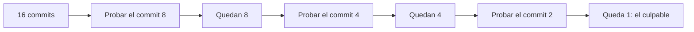

# Investigación y criterio

## En una frase

Antes de pedir ayuda con un bloqueo, investigas con método: **reproduces el bug en su forma mínima, usas Git para ubicar qué cambio lo introdujo y te pones un límite de tiempo**; si se agota, escalas con contexto, no con un "no funciona".

-----

## Antes de empezar

Conviene que ya sepas:

* Lo básico de Git: commits, ramas, tags y `git log`.
* Qué es un [trade-off](05-que-son-los-tradeoffs.md), aunque sea de forma intuitiva.

Palabras nuevas (también están en el [Glosario](Glosario.md)):

* **Escalar:** pedir ayuda a alguien con más experiencia o autoridad cuando no puedes resolver un bloqueo solo.
* **Regresión:** algo que funcionaba y dejó de funcionar por un cambio.
* **Búsqueda binaria:** estrategia que descarta la mitad de los candidatos en cada paso.
* **`git bisect`:** comando que aplica búsqueda binaria sobre el historial para encontrar el commit que introdujo un bug.
* **`git blame`:** comando que muestra quién modificó cada línea de un archivo por última vez y en qué commit.
* **MRE (*Minimal Reproducible Example*):** el caso más chico posible que sigue reproduciendo el bug.
* **Timeboxing:** fijar de antemano cuánto tiempo vas a dedicar a algo antes de cambiar de estrategia.
* **Rabbit hole:** investigación que te va llevando cada vez más lejos sin acercarte a la solución.

-----

## El problema

El lunes llega un reporte: "el total de los pedidos con descuento sale mal". El viernes funcionaba.

Un desarrollador abre `PedidoService.cs` y empieza a poner breakpoints en el flujo completo de checkout: carrito, cupones, impuestos, envío, pago. Cuatro horas después no encontró nada y le escribe a su Senior:

```text
Hola, el total de los pedidos no funciona, ¿me ayudas?
```

El Senior tiene que preguntar todo desde cero: qué pedido, qué total esperaba, qué total sale, desde cuándo, qué probó. Media hora de preguntas antes de empezar a investigar. Después corre `git bisect` y en 10 minutos encuentra el commit del jueves que cambió el orden en que se aplican descuento e impuestos.

Las consecuencias:

* se perdieron 4 horas depurando un flujo de 15 pasos cuando el error estaba en 2;
* el historial de Git tenía la respuesta y nadie lo consultó;
* el pedido de ayuda costó más tiempo al Senior que si lo hubiera investigado él desde el principio.

-----

## Cómo funciona

### 1. Investigación previa estructurada

Antes de escalar un bloqueo, llegas con:

1. El problema bien diagnosticado: qué pasa, cuándo y si es reproducible.
2. Al menos 2-3 alternativas de solución evaluadas, con sus [trade-offs](05-que-son-los-tradeoffs.md).
3. Por qué elegiste o descartaste cada una.

No es formalismo: es la diferencia entre gastar 5 minutos del tiempo de tu Senior o gastar 40. Con contexto armado, la respuesta que recibes es específica y accionable. Sin contexto, alguien termina reinvestigando el problema desde cero.

Plantilla mental para escalar:

| Parte | Pregunta que responde |
| --- | --- |
| **Contexto** | ¿Qué intentas lograr? |
| **Síntoma** | ¿Qué pasa en lugar de lo esperado? |
| **Lo que probé** | Alternativa A (resultado X), alternativa B (resultado Y). |
| **Mi hipótesis** | Creo que es esto porque... |
| **Pregunta concreta** | ¿Esto tiene sentido o me estoy perdiendo algo? |

### 2. Reproducción mínima del bug (MRE)

Antes de depurar en serio, aísla el problema al caso más chico posible que sigue fallando. Quita todo lo que no sea estrictamente necesario: datos mínimos, sin dependencias externas si se puede, sin lógica de negocio que no tenga que ver.

```text
Flujo completo (15 pasos)               MRE (2 pasos)
─────────────────────────               ─────────────
login → carrito → cupón → impuestos →   pedido de 100 con 10% de descuento
envío → pago → ... → total incorrecto   → CalcularTotal() devuelve 108 en lugar de 99
```

Depurar 2 pasos es mucho más rápido que depurar 15. Y muchas veces el MRE te revela la causa **solo en el proceso de armarlo**, antes del primer breakpoint: al quitar piezas, el bug desaparece justo cuando quitas la que lo provoca.

### 3. Git como herramienta de depuración

Git no es solo para versionar: cuando algo "andaba bien la semana pasada y ahora no", el historial sabe qué cambió.

| Comando | Pregunta que responde |
| --- | --- |
| `git bisect` | ¿**En qué commit** se rompió? |
| `git blame` | ¿**Quién y en qué commit** tocó esta línea por última vez? |
| `git log -p` | ¿**Qué cambió** en este archivo, commit por commit? |

#### `git bisect`

Encuentra el commit que introdujo un bug con búsqueda binaria.

```bash
git bisect start
git bisect bad                # el commit actual está roto
git bisect good v1.2.0        # ese commit funcionaba

# Git se detiene en commits intermedios; pruebas y marcas cada uno:
git bisect good               # si funciona
git bisect bad                # si sigue roto

# al final indica el commit exacto que introdujo el bug
git bisect reset              # termina la sesión y vuelve a tu rama
```

Con 10 commits de diferencia, `bisect` encuentra el culpable en unos 4 pasos (log₂ 10 ≈ 3,3) en lugar de revisar uno por uno. Con 1000 commits, en unos 10.

Un camino posible con 16 commits sospechosos (en cada paso el resultado puede ser bueno o malo, pero siempre se descarta la mitad):



Si lo usas mal:

```bash
git bisect start
git bisect bad
git bisect good HEAD~1        # ¿seguro que ese commit funcionaba?
```

Si marcas como `good` un commit que en realidad ya estaba roto, `bisect` busca en el rango equivocado y te señala un culpable falso. Antes de marcar el commit bueno, **pruébalo**.

#### `git blame`

Muestra quién tocó cada línea por última vez y en qué commit.

```bash
git blame PedidoService.cs -L 40,60   # solo las líneas 40 a 60
```

Sirve para entender el **contexto** de por qué una línea está como está antes de tocarla a ciegas: con el hash del commit puedes leer su mensaje, el ticket asociado o el PR donde se discutió.

#### `git log -p`

Muestra el historial de un archivo con el diff de cada commit.

```bash
git log -p --follow PedidoService.cs
```

`--follow` sigue el historial aunque el archivo haya sido renombrado. Sin él, el historial "empieza" en el último renombre.

### 4. Timeboxing: cuándo escalar

La otra cara de "investigar antes de escalar" es no quedarte horas en un rabbit hole por orgullo.

**Regla práctica:** fija un límite de tiempo (por ejemplo, 30-45 minutos) para un bloqueo puntual. Si al cumplirse no avanzaste, escalas con todo lo que armaste en el punto 1: contexto, alternativas probadas e hipótesis.

```text
Inicio ──► investigar ──► ¿avancé en el timebox?
                               │
                ┌──────────────┴──────────────┐
               Sí                            No
                │                             │
     sigo, con un nuevo timebox     escalo con contexto
```

"Avanzar" no es "resolverlo": es descartar hipótesis, acotar el área o reproducir el bug. Si en 45 minutos no lograste nada de eso, insistir solo no suele cambiar el resultado.

Escalar a tiempo con buen contexto no es debilidad, es criterio. Quemar 4 horas para poder decir "lo resolví yo", cuando el Senior lo resuelve en 5 minutos, sí es un problema: le cuesta tiempo al equipo y no demuestra nada.

-----

## Ejemplo completo

El mismo bug del problema, resuelto con método.

**09:00. Timebox.** Me doy 45 minutos.

**09:05. MRE.** Reproduzco con un solo pedido, sin cupones ni envío:

```text
Subtotal: 100
Descuento: 10 %
Impuesto: 20 %

Esperado: (100 − 10) × 1,20 = 108
Obtenido: 100 × 1,20 − 10 = 110
```

El bug ya no está "en el checkout": está en cómo se combinan descuento e impuesto.

**09:15. `git bisect`.** El viernes se publicó `v2.3.0` y funcionaba:

```bash
git bisect start
git bisect bad
git bisect good v2.3.0
# pruebo el MRE en cada commit que propone Git y marco good o bad...
```

Resultado:

```text
a1b2c3d is the first bad commit
commit a1b2c3d
Author: ...
Date:   Thu ...

    refactor: simplificar cálculo de total
```

```bash
git bisect reset
```

**09:25. `git log -p` y `git blame`.** Leo el diff del commit:

```bash
git show a1b2c3d -- PedidoService.cs
```

```diff
-    var conDescuento = subtotal - descuento;
-    return conDescuento * (1 + tasaImpuesto);
+    return subtotal * (1 + tasaImpuesto) - descuento;
```

El "refactor" cambió el orden: ahora el impuesto se aplica antes del descuento.

**09:35. Decisión.** Tengo dos alternativas:

* **A.** Revertir el commit completo con `git revert a1b2c3d`. Rápido, pero ese commit también tenía otros cambios válidos.
* **B.** Corregir solo el orden del cálculo y agregar una prueba con el MRE. Toma un poco más, pero deja el caso protegido.

Elijo B, pero la regla de negocio ("¿el descuento va antes o después del impuesto?") no la decido yo, así que escalo antes de que termine el timebox:

```text
Contexto: el total de los pedidos con descuento sale mal desde el jueves.
Síntoma: subtotal 100, descuento 10 %, impuesto 20 % → sale 110, esperábamos 108.
Lo que probé: git bisect apunta a a1b2c3d (refactor del cálculo de total).
El commit aplica el impuesto antes del descuento.
Mi hipótesis: el orden cambió sin querer en el refactor.
Pregunta concreta: ¿confirmas que el descuento va antes del impuesto?
Si es así, corrijo el orden y agrego una prueba con este caso.
```

Qué observar:

* El MRE achicó el problema de "el checkout" a "una fórmula". Eso hizo que `bisect` fuera rápido: probar cada commit tomaba segundos.
* Escalar no fue rendirse: la pregunta es de **negocio**, no técnica, y llega con evidencia.
* El Senior puede responder con un "sí" en un minuto.

-----

## Errores comunes

**1. Escalar sin contexto.**
Qué pasa: "no funciona, ¿me ayudas?" y media hora de preguntas antes de empezar.
Por qué: quien ayuda no tiene la información que tú ya juntaste (o que no juntaste).
Arreglo: usa la plantilla de contexto, síntoma, lo que probé, hipótesis y pregunta concreta.

**2. Depurar el flujo completo en lugar de armar un MRE.**
Qué pasa: horas de breakpoints en código que no tiene nada que ver con el bug.
Por qué: el bug queda escondido entre decenas de pasos que funcionan bien.
Arreglo: quita piezas hasta que el caso más chico siga fallando; recién ahí depura.

**3. Marcar mal un commit en `git bisect`.**
Qué pasa: `bisect` señala un commit que no tiene nada que ver.
Por qué: un solo `good` o `bad` equivocado manda la búsqueda a la mitad incorrecta del historial.
Arreglo: prueba de verdad cada commit con el MRE antes de marcarlo. Si un commit no se puede probar (por ejemplo, no compila), usa `git bisect skip`.

**4. Olvidar `git bisect reset`.**
Qué pasa: sigues trabajando en un commit viejo, en estado *detached HEAD*, sin darte cuenta.
Por qué: `bisect` mueve tu repositorio entre commits y no vuelve solo.
Arreglo: al terminar, siempre `git bisect reset`.

**5. No ponerte un timebox (o no respetarlo).**
Qué pasa: 4 horas en un rabbit hole que alguien resolvía en 5 minutos.
Por qué: sin un límite definido de antemano, siempre parece que la solución está "a un intento más".
Arreglo: fija el límite antes de empezar y, al cumplirse, evalúa honestamente si avanzaste.

**6. Usar `git blame` para buscar culpables.**
Qué pasa: el equipo deja de hacer cambios por miedo a "salir en el blame".
Por qué: se confunde "quién lo tocó" con "de quién es la culpa".
Arreglo: úsalo para encontrar el **contexto** del cambio (commit, ticket, PR), no a una persona a quien reclamarle.

-----

## Cuándo sí y cuándo no

**Usa `git bisect` cuando:** hay una regresión clara ("antes funcionaba"), conoces un commit bueno y el bug se puede reproducir rápido en cada paso.

**No uses `git bisect` cuando:** el bug existió siempre, depende del entorno o de los datos (no del código) o probar cada commit toma horas. Ahí conviene empezar por logs, el depurador o el MRE.

**Escala antes del timebox cuando:** el bloqueo depende de una decisión de negocio, de un permiso o de información que no tienes. Ningún tiempo de investigación resuelve eso.

-----

## Resumen en 5 líneas

1. Antes de escalar, diagnostica el problema y evalúa 2-3 alternativas con sus trade-offs.
2. Reduce el bug a un MRE: el caso más chico que sigue fallando.
3. `git bisect` encuentra el commit culpable con búsqueda binaria; `git blame` y `git log -p` explican por qué cambió.
4. Fija un timebox; si no avanzaste al cumplirse, escala.
5. Escala con contexto: síntoma, lo que probaste, tu hipótesis y una pregunta concreta.

-----

## Para profundizar

<details>
<summary>Automatizar <code>git bisect</code> con <code>git bisect run</code></summary>

Si tienes un comando que devuelve código de salida 0 cuando todo está bien y distinto de 0 cuando falla (por ejemplo, una prueba), Git puede hacer la búsqueda solo:

```bash
git bisect start
git bisect bad
git bisect good v2.3.0
git bisect run dotnet test --filter "FullyQualifiedName~CalcularTotal"
git bisect reset
```

Git prueba cada commit sin que intervengas. El código de salida 125 le indica a `bisect` que salte ese commit, como `git bisect skip`.

</details>

<details>
<summary>Buscar cuándo apareció un texto con <code>git log -S</code></summary>

`git log -p` muestra todo el historial de un archivo. Si sabes **qué texto** buscas, `-S` (el *pickaxe*) muestra solo los commits que agregaron o quitaron ese texto:

```bash
git log -S "tasaImpuesto" --oneline
```

Es ideal para preguntas como "¿cuándo desapareció esta validación?".

</details>

<details>
<summary>Ignorar cambios de formato en <code>git blame</code></summary>

Si alguien reformateó el archivo, `git blame` muestra ese commit en todas las líneas y oculta el cambio que te interesa. Dos opciones:

* `git blame -w`: ignora los cambios de espacios en blanco.
* `git blame --ignore-rev <hash>`: ignora un commit concreto (por ejemplo, el de formateo). Con `--ignore-revs-file` puedes guardar una lista de commits a ignorar en el repositorio.

</details>

-----

## En entrevista

### Respuesta corta (junior)

Cuando me bloqueo, primero intento reproducir el problema y buscar la causa por mi cuenta, en internet o en el historial de Git. Si después de un tiempo razonable no avanzo, pido ayuda explicando qué probé.

### Respuesta ampliada (semi-senior)

Primero reduzco el bug a un caso mínimo reproducible, porque eso acota dónde buscar y muchas veces revela la causa. Si es una regresión, uso `git bisect` para encontrar el commit que la introdujo y `git log -p` o `git blame` para entender el contexto del cambio. Me pongo un timebox, por ejemplo de 45 minutos; si no avancé, escalo con contexto: síntoma, lo que probé, mi hipótesis y una pregunta concreta. Si el bloqueo depende de una decisión de negocio, escalo antes, porque investigar más no lo resuelve.

### Preguntas frecuentes de seguimiento

**1. ¿Cuánto tiempo esperas antes de pedir ayuda?**
Depende del impacto y de la urgencia, pero me fijo un límite antes de empezar, de 30 a 45 minutos para un bloqueo puntual. Lo importante es decidirlo de antemano, no cuando ya estoy frustrado.

**2. ¿Cómo encontrarías qué cambio rompió algo que antes funcionaba?**
Con `git bisect` entre un commit bueno conocido y el actual. Si tengo una prueba que reproduce el bug, la automatizo con `git bisect run`.

**3. ¿Para qué sirve un MRE si ya sé dónde falla?**
Para confirmar que lo sabes. Si el MRE no falla, tu hipótesis era incorrecta. Además, se convierte en la prueba que evita que el bug vuelva.

-----

## Práctica

**Ejercicio 1.** Tienes 200 commits entre la última versión que funcionaba y la actual. ¿Cuántos pasos de `git bisect` necesitas como máximo? ¿Qué harías si uno de los commits intermedios no compila?

<details>
<summary>Solución</summary>

log₂ 200 ≈ 7,6, así que **8 pasos** como máximo. Si un commit no compila, no puedes saber si tiene el bug: lo marcas con `git bisect skip` y Git elige otro commit cercano para probar.

</details>

**Ejercicio 2.** ¿Qué tiene de malo este pedido de ayuda? Reescríbelo.

```text
Oye, el endpoint de usuarios no funciona desde ayer, ya probé de todo.
¿Lo puedes ver?
```

<details>
<summary>Solución</summary>

* "No funciona" no dice qué pasa: ¿error 500, datos incorrectos, timeout?
* "Probé de todo" no dice qué se probó ni qué resultado dio.
* No hay hipótesis ni pregunta concreta: le pide a la otra persona que investigue desde cero.

```text
Contexto: GET /api/usuarios/{id} devuelve 500 desde ayer.
Síntoma: falla solo con usuarios sin dirección; con dirección funciona.
Lo que probé: el MRE es GET /api/usuarios/42 (usuario sin dirección).
git bisect apunta a f4e5d6c, que agregó Direccion.Ciudad al DTO.
Mi hipótesis: el mapeo no contempla Direccion == null.
Pregunta concreta: ¿la dirección es opcional por regla de negocio?
Si lo es, agrego el chequeo de null y una prueba con este caso.
```

</details>

-----

## Siguiente lección

[Depuración avanzada](02-depuracion-avanzada.md)
