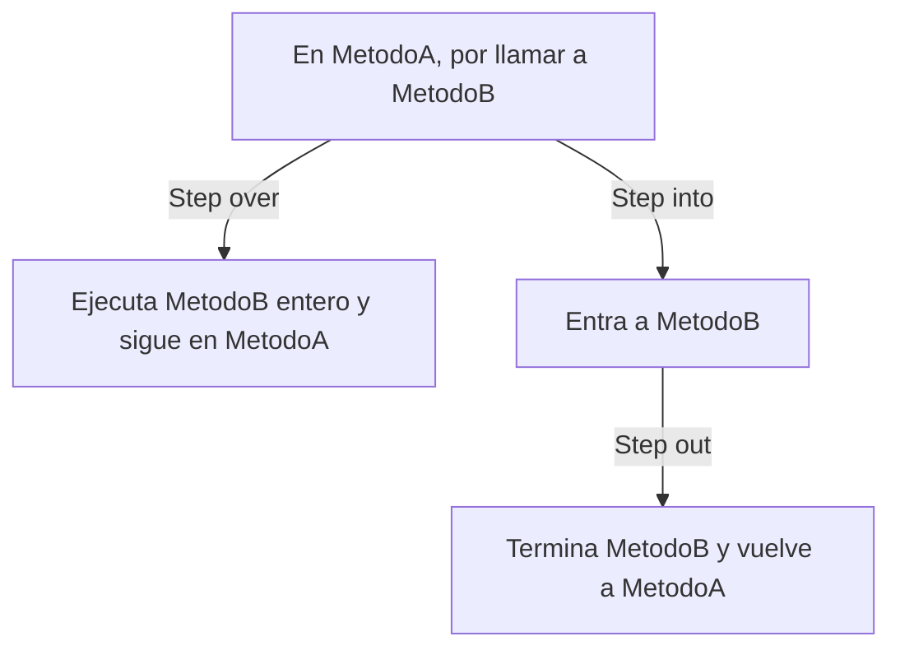

# Depuración avanzada

## En una frase

Depurar de verdad es **pausar el programa justo donde importa e inspeccionar su estado en vivo** con las herramientas del IDE (breakpoints condicionales, *step*, watch, call stack y profiler), en lugar de llenar el código de `Console.WriteLine()`.

-----

## Antes de empezar

Conviene que ya sepas:

* Cómo investigar y aislar un bug: [Investigación y criterio](01-investigacion-y-criterio.md).
* Ejecutar una aplicación desde el IDE en modo *Debug*.

Palabras nuevas (también están en el [Glosario](Glosario.md)):

* **Breakpoint:** marca en una línea donde el depurador pausa la ejecución.
* **Breakpoint condicional:** breakpoint que solo pausa cuando se cumple una expresión o al llegar a cierta cantidad de pasadas.
* **Tracepoint (*logpoint*):** breakpoint que escribe un mensaje en la consola de depuración sin pausar la ejecución.
* **Hit count:** cantidad de veces que la ejecución pasó por un breakpoint.
* **Step over / into / out:** comandos para avanzar línea por línea, entrar a un método o salir de él.
* **Call stack (pila de llamadas):** lista de métodos que se fueron llamando hasta llegar al punto actual.
* **Frame:** cada entrada del call stack: un método en ejecución con sus variables.
* **LIFO (*Last In, First Out*):** el último elemento que entra es el primero que sale.
* **Profiler:** herramienta que mide en qué se gasta el tiempo de CPU o la memoria.
* **Memory leak (fuga de memoria):** memoria que la aplicación ya no necesita pero que no se libera.

-----

## El problema

Un proceso nocturno recalcula 1000 pedidos y uno solo, el `ERR-99`, termina con total negativo. Para encontrarlo, alguien agrega esto:

```csharp
foreach (var pedido in pedidos)
{
    Console.WriteLine($"Procesando {pedido.Id}");
    var total = _calculadora.CalcularTotal(pedido);
    Console.WriteLine($"Total {pedido.Id}: {total}");
}
```

Corre el proceso, revisa 2000 líneas de salida, no entiende por qué el total es negativo, agrega más `Console.WriteLine` dentro de `CalcularTotal`, vuelve a compilar y vuelve a correr. Después pone un breakpoint normal dentro del `foreach` y presiona *Continue* 437 veces hasta llegar al pedido que importa.

Las consecuencias:

* cada hipótesis nueva requiere modificar código, compilar y volver a ejecutar;
* los `Console.WriteLine` de depuración terminan olvidados en el código que llega a producción;
* solo ves lo que imprimiste, no el estado completo del programa en ese instante.

-----

## Cómo funciona

### 1. Breakpoints condicionales

En lugar de pausar **cada vez** que la ejecución pasa por una línea (por ejemplo, dentro de un `foreach` de 1000 elementos), el depurador pausa solo cuando se cumple una condición.

| Opción | Pausa cuando... | Ejemplo |
| --- | --- | --- |
| Condición | La expresión es verdadera | `pedido.Id == "ERR-99"` |
| Hit count | Se llega a la pasada N | Pausar en la pasada 437 |
| Log message / tracepoint | Nunca: solo escribe un mensaje | `Pedido {pedido.Id}: {total}` |

#### Visual Studio 2022

1. Clic en el margen izquierdo, junto al número de línea: aparece un círculo rojo (`F9` hace lo mismo).
2. Clic derecho sobre el círculo → **Conditions...** (o el ícono de engranaje al pasar el mouse).
3. En **Conditional Expression** escribes la condición y eliges **Is true** o **When changed**. En **Hit Count** defines la pasada.
4. Para un tracepoint: clic derecho → **Actions...**, escribes el mensaje y dejas marcada la opción **Continue code execution**.

Pista visual: el breakpoint condicional se ve como un círculo rojo con un **+** blanco; el tracepoint, como un **rombo** rojo.

#### IntelliJ IDEA / Rider

1. Clic en el margen izquierdo: aparece el círculo rojo.
2. Clic derecho sobre el círculo → campo **Condition**, por ejemplo `userId == "ERR-99"`.
3. Para más opciones, **More** (`Ctrl+Shift+F8`): desmarcar **Suspend** y activar el mensaje de log lo convierte en un logpoint; **Pass count** pausa en la pasada N.

#### VS Code

VS Code no trae depuración de C# de fábrica: necesitas la extensión **C#** (la instala también **C# Dev Kit**).

1. Clic en el margen izquierdo (o `F9`): aparece el círculo rojo.
2. Clic derecho sobre el círculo → **Edit Breakpoint...**.
3. En el menú desplegable eliges **Expression** (condición), **Hit Count** o **Log Message** (logpoint).
4. Todos los breakpoints se ven y se editan en el panel **Run and Debug** (`Ctrl+Shift+D`), sección *Breakpoints*.

Si lo usas mal:

```csharp
// Condición escrita con un solo "="
pedido.Id = "ERR-99"
```

Una asignación no es una expresión booleana, así que el depurador muestra un error al evaluar la condición. Peor aún, si la condición tiene efectos secundarios (por ejemplo, llama a un método que modifica estado), la ejecutas en **cada** pasada y cambias el comportamiento del programa que estás depurando.

### 2. Step over, step into y step out

Con la ejecución pausada:

| Acción | VS / VS Code | IntelliJ / Rider | Qué hace |
| --- | --- | --- | --- |
| Step over | `F10` | `F8` | Ejecuta la línea completa y pasa a la siguiente, **sin entrar** a los métodos que llama |
| Step into | `F11` | `F7` | **Entra** al método que se llama en esa línea |
| Step out | `Shift+F11` | `Shift+F8` | Termina el método actual y vuelve a quien lo llamó |



Regla práctica: usa *step over* por defecto, porque no te interesa el detalle de cada método que llamas. Usa *step into* solo cuando sospechas que el bug está **dentro** de ese método. Si entraste por error, *step out* te saca sin recorrerlo línea por línea.

### 3. Locals, watch y call stack

| Ventana | Qué muestra | Cuándo usarla |
| --- | --- | --- |
| **Locals** | Todas las variables del scope actual con su valor | Para una mirada general |
| **Watch** | Las variables o expresiones que tú eliges | Cuando *Locals* tiene demasiado ruido, o para evaluar algo como `pedido.Lineas.Sum(l => l.Precio)` |
| **Call stack** | Los métodos que se llamaron hasta llegar aquí | Para saber **quién** llamó y **con qué datos** |

El call stack es una estructura **LIFO**: el último método llamado aparece arriba y es el primero en terminar. Puedes hacer clic en cualquier frame anterior para ver el estado de las variables **en ese punto** de la ejecución, no solo en el actual.

Esa misma lógica LIFO explica por qué un stack trace de .NET se lee de arriba hacia abajo: ver [Stack traces](04-stack-traces.md).

> **Ojo:** en una compilación *Release*, el compilador optimiza el código y algunas variables aparecen como "optimizada" o con valores incorrectos en *Locals*. Depura en *Debug*.

### 4. Profiling de CPU y memoria

El depurador responde "¿qué valor tiene esto?". El profiler responde otra pregunta: "¿qué método consume el 90 % del procesador?" o "¿por qué la memoria no deja de crecer?".

| Herramienta | Para qué |
| --- | --- |
| **Visual Studio:** Debug → Performance Profiler (`Alt+F2`) | *CPU Usage* y *Memory Usage* integrados en el IDE |
| **JetBrains:** dotTrace y dotMemory | CPU y memoria, integrados en Rider |
| **`dotnet-counters`** | Métricas en vivo: CPU, GC, memoria, requests por segundo |
| **`dotnet-trace`** | Captura de CPU para analizar después |
| **`dotnet-gcdump`** / **`dotnet-dump`** | Fotografía del heap o del proceso completo, para buscar memory leaks |

Las herramientas `dotnet-*` son de línea de comandos y multiplataforma: sirven cuando no tienes IDE gráfico, por ejemplo dentro de un contenedor en producción.

```bash
dotnet tool install --global dotnet-counters
dotnet-counters monitor --process-id 1234
```

-----

## Ejemplo completo

El mismo proceso nocturno del problema, depurado sin modificar código.

```csharp
public decimal CalcularTotal(Pedido pedido)
{
    decimal subtotal = pedido.Lineas.Sum(l => l.Precio * l.Cantidad);
    decimal descuento = CalcularDescuento(pedido, subtotal);
    return subtotal - descuento;
}

private decimal CalcularDescuento(Pedido pedido, decimal subtotal)
{
    decimal porcentaje = pedido.Cupon?.Porcentaje ?? 0m;
    return subtotal * porcentaje;
}
```

**1. Breakpoint condicional.** En la línea `var total = _calculadora.CalcularTotal(pedido);` del `foreach`, con la condición:

```text
pedido.Id == "ERR-99"
```

Ejecutas en *Debug*. El proceso recorre 436 pedidos sin pausar y se detiene en el que importa.

**2. Step into.** `F11` entra a `CalcularTotal`. `F10` hasta pasar `CalcularDescuento`.

**3. Watch.** Agregas:

```text
subtotal           → 250
descuento          → 500
pedido.Cupon       → { Codigo = "MITAD", Porcentaje = 2 }
```

El descuento es el doble del subtotal: el cupón tiene `Porcentaje = 2`, pero el código lo interpreta como fracción (`0,5` sería el 50 %). Alguien cargó "2" pensando en "2 %".

**4. Call stack.** Haces clic en el frame del proceso nocturno y confirmas que el cupón viene de la base, no de un cálculo previo. El bug no está en `CalcularDescuento`: está en el dato.

Qué observar:

* No modificaste ni compilaste el código ninguna vez.
* El breakpoint condicional ahorró 436 pausas.
* El *watch* mostró la relación entre valores (`descuento > subtotal`), algo que un `Console.WriteLine` aislado no habría mostrado.
* El call stack cambió la conclusión: de "el cálculo está mal" a "el dato está mal".

-----

## Errores comunes

**1. Depurar con `Console.WriteLine`.**
Qué pasa: ciclos de modificar, compilar y ejecutar por cada hipótesis, y prints olvidados que llegan a producción.
Por qué: solo ves lo que decidiste imprimir antes de ejecutar.
Arreglo: breakpoint condicional o tracepoint. Si necesitas trazas permanentes, usa [logs estructurados](03-interpretacion-de-logs.md).

**2. Usar step into en todo.**
Qué pasa: terminas dentro del código de LINQ, de Entity Framework o de un getter trivial.
Por qué: *step into* entra a todo lo que se llama en la línea.
Arreglo: *step over* por defecto; *step into* solo en el método sospechoso; *step out* si entraste por error.

**3. Condiciones con efectos secundarios.**
Qué pasa: el programa se comporta distinto con el depurador que sin él.
Por qué: la condición se evalúa en cada pasada; si modifica estado, cambias lo que estás observando.
Arreglo: condiciones de solo lectura, como comparaciones o propiedades simples.

**4. Depurar una compilación Release.**
Qué pasa: los breakpoints "saltan" líneas y las variables aparecen como optimizadas.
Por qué: el compilador reordena y elimina código al optimizar.
Arreglo: depura en configuración *Debug*.

**5. Optimizar sin medir.**
Qué pasa: reescribes un método "lento" y la aplicación sigue igual de lenta.
Por qué: la intuición sobre dónde se gasta el tiempo casi siempre falla.
Arreglo: mide primero con el profiler y optimiza lo que realmente consume.

-----

## Cuándo sí y cuándo no

**Usa el depurador cuando:** puedes reproducir el bug en tu máquina y necesitas ver el estado del programa en un punto concreto.

**Usa el profiler cuando:** el problema es de rendimiento (lentitud, CPU alta, memoria que crece), no de un valor incorrecto.

**No uses el depurador cuando:** el bug ocurre solo en producción, depende del tiempo (concurrencia, timeouts) o pausar la ejecución lo hace desaparecer. Ahí aportan más los [logs](03-interpretacion-de-logs.md), los tracepoints o `dotnet-dump`.

-----

## Resumen en 5 líneas

1. Un breakpoint condicional pausa solo cuando se cumple una expresión o se llega a cierta pasada; un tracepoint registra un mensaje sin pausar.
2. *Step over* por defecto, *step into* solo en el método sospechoso y *step out* para salir.
3. *Watch* muestra las expresiones que eliges; el call stack muestra quién llamó y con qué datos.
4. El call stack es LIFO: el frame más reciente está arriba.
5. Para problemas de rendimiento se usa el profiler (o `dotnet-counters` y `dotnet-trace`), no el depurador.

-----

## Para profundizar

<details>
<summary>Depurar sin pausar en producción</summary>

En producción no puedes pausar un proceso que atiende usuarios. Las alternativas:

* **Tracepoints/logpoints** en un entorno de *staging* parecido a producción.
* **`dotnet-dump collect`** para tomar una fotografía del proceso y analizarla después con `dotnet-dump analyze` o con Visual Studio, sin detenerlo más que un instante.
* **Snapshot debugging** (por ejemplo, en Azure App Service): toma una fotografía de las variables en una línea sin pausar la aplicación.

</details>

<details>
<summary>Editar el estado mientras depuras</summary>

Con la ejecución pausada puedes cambiar el valor de una variable desde *Locals* o *Watch* para probar una hipótesis ("¿y si el porcentaje fuera 0,02?") sin reiniciar. En Visual Studio también puedes arrastrar la flecha amarilla para volver a ejecutar una línea (*Set Next Statement*) o editar código en caliente (*Hot Reload*). Úsalo para probar hipótesis, no para "arreglar" el bug sin dejar el cambio en el código.

</details>

-----

## En entrevista

### Respuesta corta (junior)

Uso el depurador del IDE: pongo breakpoints, avanzo con step over y step into, y miro los valores de las variables en *Locals* y *Watch* en lugar de llenar el código de prints.

### Respuesta ampliada (semi-senior)

Uso breakpoints condicionales para pausar solo en el caso que falla y tracepoints cuando quiero registrar valores sin pausar. Avanzo con *step over* por defecto y entro solo a los métodos sospechosos. El call stack me sirve para ver con qué datos llegó la ejecución hasta ahí, que muchas veces cambia la conclusión de "el cálculo está mal" a "el dato está mal". Para rendimiento no uso el depurador: mido con el profiler o con `dotnet-counters` y `dotnet-trace`, sobre todo en contenedores donde no hay IDE.

### Preguntas frecuentes de seguimiento

**1. ¿Cómo depurarías un bug que solo ocurre en producción?**
Primero con logs estructurados y el correlation ID para reconstruir qué pasó. Si hace falta el estado de memoria, tomaría un dump con `dotnet-dump` y lo analizaría fuera de producción.

**2. ¿Qué diferencia hay entre un breakpoint y un tracepoint?**
El breakpoint pausa la ejecución; el tracepoint escribe un mensaje y sigue. El tracepoint sirve cuando pausar altera el comportamiento, por ejemplo con timeouts.

**3. ¿Cómo encontrarías un memory leak?**
Con `dotnet-counters` confirmaría que la memoria crece sin bajar después de cada GC. Después tomaría dos fotografías del heap separadas en el tiempo (`dotnet-gcdump` o dotMemory) y compararía qué tipos de objetos aumentaron.

-----

## Práctica

**Ejercicio 1.** Un método procesa una lista de 5000 usuarios y falla con el usuario número 3127, pero no sabes su ID. ¿Qué tipo de breakpoint usas y cómo lo configuras?

<details>
<summary>Solución</summary>

Un breakpoint con **hit count** igual a 3127 en la primera línea del bucle. Al pausar, lees el ID del usuario en *Locals* y, a partir de ahí, puedes cambiarlo por una condición sobre el ID (`usuario.Id == ...`), que es más estable si cambia el orden de la lista.

</details>

**Ejercicio 2.** ¿Qué tiene de malo este código de depuración? ¿Qué harías en su lugar?

```csharp
foreach (var item in items)
{
    if (item.Id == 42)
    {
        Console.WriteLine("LLEGUÉ AL 42");
        Console.WriteLine(item.Precio);
        Console.WriteLine(item.Descuento);
    }
    Procesar(item);
}
```

<details>
<summary>Solución</summary>

* Modifica el código de producción para depurar y es fácil que quede olvidado.
* Cada valor nuevo que quieras ver obliga a editar, compilar y ejecutar otra vez.
* Solo muestra tres valores, no el estado completo ni quién llamó.

En su lugar: un **breakpoint condicional** en `Procesar(item);` con la condición `item.Id == 42`. Al pausar ves todo en *Locals*, agregas lo que necesites en *Watch* y revisas el call stack. Si no quieres pausar, un **tracepoint** con el mensaje `{item.Id}: {item.Precio} - {item.Descuento}`.

</details>

-----

## Siguiente lección

[Interpretación de logs](03-interpretacion-de-logs.md)
