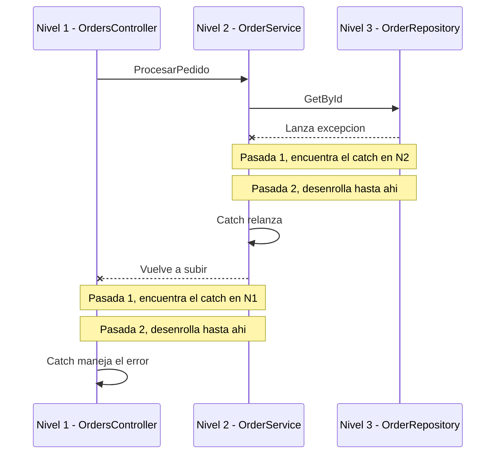

# Stack traces

## En una frase

Un stack trace es **la fotografía de la pila de llamadas en el instante en que se lanzó la excepción**: leído en el orden correcto, te dice en qué línea de tu código empezó el error y cómo llegó la ejecución hasta ahí.

-----

## Antes de empezar

Conviene que ya sepas:

* Qué es el call stack y por qué es LIFO: [Depuración avanzada](02-depuracion-avanzada.md).
* Cómo se registra una excepción en un log: [Interpretación de logs](03-interpretacion-de-logs.md).
* `try`, `catch` y `throw` en C#, al menos de forma básica.

Palabras nuevas (también están en el [Glosario](Glosario.md)):

* **Stack trace (traza de la pila):** lista de los métodos que estaban en la pila de llamadas cuando se lanzó una excepción.
* **Propagación:** la excepción sube de un método a quien lo llamó hasta encontrar un `catch` compatible.
* **Excepción no controlada:** excepción que ningún `catch` atrapa y llega al punto de entrada del programa.
* **Desenrollado de la pila (*stack unwinding*):** el proceso de sacar frames de la pila hasta llegar al `catch` que va a manejar la excepción.
* **Filtro de excepción (`when`):** condición que decide si un `catch` atrapa o no una excepción.
* **Relanzar (*rethrow*):** volver a lanzar desde un `catch` la excepción que se atrapó.
* **Excepción interna (*inner exception*):** excepción original que otra envuelve para agregar contexto.
* **CLR (*Common Language Runtime*):** el motor de .NET que ejecuta el código y maneja las excepciones.

-----

## El problema

Una API devuelve 500 y en el log aparece esto:

```text
System.NullReferenceException: Object reference not set to an instance of an object.
   at MiApp.Controllers.PedidoController.Crear(PedidoDto dto) in PedidoController.cs:line 31
```

El desarrollador abre `PedidoController.cs`, línea 31:

```csharp
catch (Exception ex)
{
    _logger.LogError("Error al crear pedido");
    throw ex; // línea 31
}
```

La línea 31 es el `catch`, no el error. El stack trace original, el que decía en qué servicio y en qué línea se encontró el `null`, se perdió por ese `throw ex;`. Hay que reproducir el bug desde cero para encontrarlo.

Las consecuencias:

* el stack trace apunta al lugar equivocado y manda a investigar código que funciona;
* sin saber leerlo, se buscan pistas en la primera línea, que a veces es código del framework;
* un detalle de una sola palabra (`throw;` frente a `throw ex;`) decide si tienes la información o no.

-----

## Cómo funciona

### 1. Del call stack al stack trace

Cuando un método llama a otro, el programa tiene que recordar adónde volver cuando termine. Por eso cada llamada agrega un *frame* a la pila, y cada método que termina lo quita: la misma lógica LIFO que ves en el call stack del [depurador](02-depuracion-avanzada.md).

```csharp
void MetodoA()
{
    MetodoB(); // A llama a B
}

void MetodoB()
{
    MetodoC(); // B llama a C
}

void MetodoC()
{
    throw new Exception("Algo falló"); // aquí falla
}
```

En el instante en que `MetodoC()` lanza la excepción, la pila se ve así, con el frame más reciente arriba:

```text
MetodoC()   ← el que se está ejecutando (el más reciente)
MetodoB()   ← quien llamó a MetodoC
MetodoA()   ← quien llamó a MetodoB
Main()      ← el punto de entrada del programa
```

Un **stack trace** es exactamente eso: la fotografía de esa pila en el momento del error. No se arma a mano: el CLR la genera y viene incluida en el objeto `Exception`.

### 2. Cómo se lee un stack trace en .NET

Cuando imprimes una excepción completa (`ex.ToString()` o el log del framework), el formato es:

```text
System.NullReferenceException: Object reference not set to an instance of an object.
   at MiApp.Servicios.PedidoService.CalcularTotal() in PedidoService.cs:line 42
   at MiApp.Controllers.PedidoController.Crear() in PedidoController.cs:line 18
   at MiApp.Program.Main() in Program.cs:line 5
```

| Parte | Qué dice |
| --- | --- |
| Primera línea | Tipo de excepción y mensaje |
| Primer `at` | El frame más profundo: **dónde se lanzó** la excepción |
| Siguientes `at` | Quién llamó a quién, alejándose hacia el punto de entrada |
| `in Archivo.cs:line N` | Archivo y línea; solo aparece si hay símbolos de depuración (`.pdb`) |

Se lee de **arriba hacia abajo**. La línea de arriba es la más profunda de la pila: literalmente donde ocurrió la excepción. A medida que bajas, te alejas hacia el punto de entrada.

Regla práctica: empezando desde arriba, busca la **primera línea que sea tu código** (no de Entity Framework, ASP.NET Core ni otra librería). Ahí está el lugar real donde arreglar el problema.

> **Ojo con Python:** ahí el orden es el **inverso**. El encabezado dice `Traceback (most recent call last)`: la línea de abajo es la más profunda. No es una sintaxis distinta, es una convención de presentación distinta, y es de las pocas cosas que no se transfieren igual entre stacks.

### 3. Propagación con varios `try`/`catch`

Un caso muy común: varias capas, cada una con su propio `try`/`catch`.

```csharp
// Nivel 3 (el más profundo: el repositorio)
public class OrderRepository
{
    public Order GetById(int id)
    {
        var pedido = _db.Orders.Find(id);
        if (pedido is null)
            throw new InvalidOperationException("Pedido no encontrado en la base");
        return pedido;
    }
}

// Nivel 2 (el servicio, llama al repositorio)
public class OrderService
{
    public void ProcesarPedido(int id)
    {
        try
        {
            var pedido = _repository.GetById(id);
            // ... lógica de negocio
        }
        catch (InvalidOperationException)
        {
            // aquí se podría manejar, pero se decide propagarla
            throw;
        }
    }
}

// Nivel 1 (el controller, llama al servicio)
public class OrdersController
{
    public IActionResult Procesar(int id)
    {
        try
        {
            _service.ProcesarPedido(id);
            return Ok();
        }
        catch (InvalidOperationException ex)
        {
            return NotFound(ex.Message); // aquí sí se maneja
        }
    }
}
```

La excepción se lanza en el nivel 3. El CLR sube al nivel 2 y encuentra un `catch` cuyo tipo coincide, así que entra. Pero ese `catch` hace `throw;`, así que la excepción **sigue subiendo** hasta el nivel 1, donde finalmente se maneja con un `NotFound`.



Reglas clave:

* Dentro de un mismo `try`, los `catch` se evalúan **en el orden en que están escritos** y gana el primero cuyo tipo sea compatible. Por eso los tipos más específicos van primero: si `catch (Exception)` estuviera antes que `catch (InvalidOperationException)`, el segundo nunca se alcanzaría, y el compilador lo marca como error **CS0160**.
* Si en un nivel ningún `catch` coincide, o el que coincidió relanza, la excepción sigue subiendo al llamador.
* Si llega al punto de entrada sin que nadie la maneje, es una **excepción no controlada**: el proceso termina, o la atrapa un manejador global (como un `IExceptionHandler` o un middleware de errores en ASP.NET Core).

### 4. El modelo de dos pasadas del CLR

Aplicado al ejemplo de los tres niveles:

1. `OrderRepository.GetById()` (nivel 3) ejecuta `throw new InvalidOperationException(...)`. El CLR empieza el manejo desde ese punto.
2. **Pasada 1, búsqueda (la pila todavía no se toca):**
   * ¿`GetById()` tiene un `try`/`catch` alrededor del `throw`? No. Sigue subiendo.
   * ¿`OrderService.ProcesarPedido()` (nivel 2) tiene un `try`/`catch` que envuelva la llamada? Sí, y `catch (InvalidOperationException)` coincide. **El handler está en el nivel 2.**
   * Si ese `catch` tuviera un filtro `when`, se evaluaría en este momento, con la pila original **todavía intacta**. Por eso los filtros pueden inspeccionar el estado exacto del error.
3. **Pasada 2, desenrollado:** el CLR saca los frames desde `GetById()` hasta el `catch` de `ProcesarPedido()`, ejecutando cualquier `finally` que haya en el camino. Recién aquí se pierde la pila original.
4. **Transferencia de control** al `catch` de `ProcesarPedido()`, que ejecuta `throw;`.
5. Ese `throw;` **inicia un proceso nuevo** desde ese punto: otra pasada 1. `ProcesarPedido()` no tiene otro `try`/`catch` que lo envuelva, así que sube a `OrdersController.Procesar()` (nivel 1), cuyo `catch` coincide.
6. **Pasada 2 otra vez:** se desenrolla hasta el `catch` del nivel 1, que finalmente devuelve `NotFound(ex.Message)`.

Si en ningún nivel hubiera un `catch` compatible, la búsqueda llegaría al punto de entrada: excepción no controlada.

### 5. `throw;` frente a `throw ex;`

```csharp
try
{
    ProcesarPedido();
}
catch (Exception ex)
{
    // MAL: reinicia el stack trace; pierdes la línea real del error
    throw ex;

    // BIEN: conserva el stack trace original completo
    throw;

    // BIEN (alternativa): envuelve el error original como inner exception
    throw new PedidoException("No se pudo procesar el pedido", ex);
}
```

¿Por qué? En .NET, el CLR registra el stack trace **en el momento del `throw`**, no cuando se crea el objeto `Exception`. Si vuelves a lanzar la misma excepción con `throw ex;`, el CLR lo trata como un `throw` nuevo y sobrescribe el trace: ahora apunta al `catch` y no al lugar real del fallo.

`throw;` (sin especificar la excepción) le indica al CLR que relance la excepción tal cual, sin tocar el trace.

| Forma | Stack trace | Cuándo usarla |
| --- | --- | --- |
| `throw;` | Se conserva | Registraste algo o liberaste recursos y quieres que siga subiendo |
| `throw new XException("...", ex);` | Se conserva en `InnerException` | Quieres agregar contexto de tu capa ("no se pudo procesar el pedido 42") |
| `throw ex;` | **Se pierde** | Nunca |

Esta particularidad es del CLR. Java y JavaScript registran el stack trace al **crear** la excepción (`new Exception()` / `new Error()`), no al lanzarla, así que no tienen este problema.

### 6. Excepciones internas en el stack trace

Cuando envuelves una excepción, `ex.ToString()` muestra las dos:

```text
MiApp.PedidoException: No se pudo procesar el pedido 42
 ---> System.NullReferenceException: Object reference not set to an instance of an object.
   at MiApp.Servicios.PedidoService.CalcularTotal() in PedidoService.cs:line 42
   --- End of inner exception stack trace ---
   at MiApp.Servicios.PedidoService.Procesar(Int32 id) in PedidoService.cs:line 20
   at MiApp.Controllers.PedidoController.Crear() in PedidoController.cs:line 18
```

La línea con `--->` marca el inicio de la excepción interna. La **causa raíz** está en la excepción más interna (la última `--->`), y su primer `at` es donde empezó todo.

### 7. Tipos comunes de excepción

| Excepción | Cuándo aparece |
| --- | --- |
| `NullReferenceException` | Accediste a un miembro de un objeto que es `null` |
| `KeyNotFoundException` | Buscaste en un `Dictionary` una clave que no existe |
| `ArgumentNullException` | Pasaste `null` a un parámetro que no lo acepta |
| `ArgumentOutOfRangeException` | Pasaste un valor fuera del rango válido, como un índice negativo |
| `InvalidOperationException` | Llamaste a un método en un estado que no lo permite, por ejemplo al modificar una colección mientras la recorres |
| `TimeoutException` | Una operación, típicamente de base de datos o red, superó el límite configurado |
| `StackOverflowException` | La pila se llenó por completo, típicamente por una recursión infinita (un método que se llama a sí mismo sin condición de corte). Es el límite físico de la estructura LIFO |

> **Ojo:** `StackOverflowException` **no se puede atrapar** en .NET: el proceso termina de inmediato, sin pasar por ningún `catch` ni `finally`. La única defensa es evitar la recursión sin límite.

### 8. ¿Se comporta igual en otros lenguajes?

| Lenguaje | Propagación | Diferencia real |
| --- | --- | --- |
| **Java, Python** | Igual: sube buscando un `catch`/`except` tipado, en orden | El modelo mental se traslada casi 1 a 1 |
| **JavaScript** | Misma dirección | No hay `catch` tipados: `catch (e)` atrapa todo y hay que distinguir a mano (`if (e instanceof TypeError)`) |
| **Go** | No hay `try`/`catch` | Usa retornos explícitos (`valor, err := funcion()`) para errores esperados y `panic`/`recover` (con `recover()` solo dentro de un `defer`) para lo excepcional. Es otro paradigma |

-----

## Ejemplo completo

El mismo 500 del problema, corregido y leído bien.

`PedidoService.cs`:

```csharp
public class PedidoService(IPedidoRepository repositorio)
{
    public decimal Procesar(int id)
    {
        try
        {
            var pedido = repositorio.ObtenerPorId(id);
            return CalcularTotal(pedido);                       // línea 20
        }
        catch (Exception ex)
        {
            throw new PedidoException($"No se pudo procesar el pedido {id}", ex); // línea 24
        }
    }

    private decimal CalcularTotal(Pedido pedido)
    {
        return pedido.Lineas.Sum(l => l.Precio * l.Cantidad);   // línea 42
    }
}
```

`PedidoController.cs`:

```csharp
[HttpPost("{id}")]
public IActionResult Crear(int id)
{
    try
    {
        return Ok(_service.Procesar(id));                       // línea 18
    }
    catch (PedidoException ex)
    {
        _logger.LogError(ex, "Error al crear el pedido {PedidoId}", id);
        throw;                                                  // conserva el trace
    }
}
```

El log ahora muestra:

```text
MiApp.PedidoException: No se pudo procesar el pedido 42
 ---> System.ArgumentNullException: Value cannot be null. (Parameter 'source')
   at System.Linq.ThrowHelper.ThrowArgumentNullException(ExceptionArgument argument)
   at System.Linq.Enumerable.Sum[TSource](IEnumerable`1 source, Func`2 selector)
   at MiApp.Servicios.PedidoService.CalcularTotal(Pedido pedido) in PedidoService.cs:line 42
   at MiApp.Servicios.PedidoService.Procesar(Int32 id) in PedidoService.cs:line 20
   --- End of inner exception stack trace ---
   at MiApp.Servicios.PedidoService.Procesar(Int32 id) in PedidoService.cs:line 24
   at MiApp.Controllers.PedidoController.Crear(Int32 id) in PedidoController.cs:line 18
```

Lectura paso a paso:

1. **Excepción externa:** `PedidoException` con el contexto de negocio: el pedido 42.
2. **`--->`:** la causa es una `ArgumentNullException`: alguien le pasó `null` a un parámetro llamado `source`.
3. **Primeros `at` de la interna:** `ThrowHelper` y `Enumerable.Sum`. Son código del framework: los omites. `Sum` solo informa que recibió `null`.
4. **Primera línea de tu código:** `CalcularTotal`, línea 42. Ahí está el problema: `pedido.Lineas` es `null` para el pedido 42.

Qué observar:

* Con `throw;` en el controller, el trace sigue apuntando a la línea 42 y no al `catch`.
* La excepción envuelta agrega el **qué** (pedido 42) sin perder el **dónde** (línea 42).
* La regla "primera línea de tu código" evitó perder tiempo en `Enumerable.Sum`.
* El trace de la excepción externa empieza en la línea 24, donde se creó la `PedidoException`. La causa real está en la interna.

-----

## Errores comunes

**1. Usar `throw ex;` para relanzar.**
Qué pasa: el stack trace apunta al `catch`, no al lugar del error.
Por qué: el CLR registra el trace en cada `throw`; `throw ex;` cuenta como un `throw` nuevo.
Arreglo: `throw;` o envolver con `throw new XException("contexto", ex);`.

**2. Quedarse con la primera línea del trace.**
Qué pasa: se investiga código de Entity Framework, LINQ o ASP.NET Core que funciona bien.
Por qué: el primer frame puede ser de una librería que recibió datos inválidos de tu código.
Arreglo: busca, desde arriba, la primera línea que sea de tu proyecto.

**3. Leer al revés al cambiar de stack.**
Qué pasa: en Python se busca la causa en la primera línea del traceback.
Por qué: Python imprime el frame más reciente **al final** (`most recent call last`).
Arreglo: lee el encabezado del trace antes de interpretar el orden.

**4. Ignorar la excepción interna.**
Qué pasa: el log dice "No se pudo procesar el pedido" y no se sabe por qué.
Por qué: se registra `ex.Message` de la excepción externa y se descarta `InnerException`.
Arreglo: registra la excepción completa (`LogError(ex, ...)`) y sigue las `--->` hasta la más interna.

**5. `catch` general antes que el específico.**
Qué pasa: error **CS0160**: "A previous catch clause already catches all exceptions of this or of a super type".
Por qué: el `catch (Exception)` atrapa todo y deja inalcanzables los siguientes.
Arreglo: ordena los `catch` del más específico al más general.

**6. Trace sin números de línea.**
Qué pasa: los `at` no muestran `in Archivo.cs:line N`.
Por qué: el despliegue no incluyó los archivos `.pdb`.
Arreglo: publica con símbolos (`<DebugType>portable</DebugType>` o `embedded` en el `.csproj`).

-----

## Cuándo sí y cuándo no

**Atrapa una excepción cuando:** puedes hacer algo útil con ella: recuperarte, reintentar, traducirla a una respuesta HTTP o agregar contexto de tu capa.

**Relanza con `throw;` cuando:** solo necesitas registrar o liberar recursos, y otra capa es la que debe decidir.

**No atrapes una excepción cuando:** no puedes hacer nada útil con ella. Un `catch` que solo relanza sin agregar nada es ruido: deja que suba al manejador global.

-----

## Resumen en 5 líneas

1. Un stack trace es la fotografía de la pila de llamadas en el momento del `throw`.
2. En .NET se lee de arriba hacia abajo: busca la primera línea que sea de tu código.
3. La excepción sube buscando el primer `catch` compatible, en dos pasadas: búsqueda y desenrollado.
4. `throw;` conserva el trace; `throw ex;` lo pierde; envolver agrega contexto sin perderlo.
5. La causa raíz está en la excepción más interna, después de la última `--->`.

-----

## Para profundizar

<details>
<summary>Stack traces con <code>async</code>/<code>await</code></summary>

En código asíncrono, el trace puede incluir líneas como:

```text
--- End of stack trace from previous location ---
```

Indican que la ejecución continuó en otro hilo después de un `await`. Desde .NET Core 2.1, los traces muestran los métodos `async` con su nombre real, en lugar de las clases generadas por el compilador (`<CalcularAsync>d__4.MoveNext()`), y desde .NET 6 son todavía más limpios. La regla de lectura no cambia: de arriba hacia abajo, primera línea de tu código.

</details>

<details>
<summary>Relanzar más tarde sin perder el trace: <code>ExceptionDispatchInfo</code></summary>

Si necesitas guardar una excepción y relanzarla después, fuera del `catch` (por ejemplo, en código de infraestructura), `throw;` no sirve. Para eso existe:

```csharp
ExceptionDispatchInfo? capturada = null;
try { Operacion(); }
catch (Exception ex) { capturada = ExceptionDispatchInfo.Capture(ex); }

// más tarde
capturada?.Throw(); // relanza conservando el trace original
```

Es lo que usa internamente `await` para relanzar excepciones de una `Task` sin perder su origen.

</details>

<details>
<summary>Filtros <code>when</code> para registrar sin desenrollar</summary>

Como el filtro se evalúa en la pasada 1, con la pila intacta, se puede usar para registrar sin atrapar:

```csharp
catch (Exception ex) when (Registrar(ex)) { }

static bool Registrar(Exception ex)
{
    logger.LogError(ex, "Error no esperado");
    return false; // no atrapa: la excepción sigue subiendo
}
```

El `catch` nunca se ejecuta porque el filtro devuelve `false`, pero el log quedó escrito con el estado original.

</details>

-----

## En entrevista

### Respuesta corta (junior)

Un stack trace muestra la lista de métodos que se estaban ejecutando cuando ocurrió una excepción. En .NET se lee de arriba hacia abajo: la primera línea es donde se lanzó. Para relanzar una excepción uso `throw;` y no `throw ex;`, porque `throw ex;` pierde el trace original.

### Respuesta ampliada (semi-senior)

El stack trace es la fotografía de la pila en el momento del `throw`. Lo leo de arriba hacia abajo y busco la primera línea de mi código, porque las primeras suelen ser del framework. Si hay excepciones internas, sigo las `--->` hasta la más interna, que es la causa raíz. Sé que el CLR maneja las excepciones en dos pasadas: primero busca un `catch` compatible, evaluando los filtros `when` con la pila intacta, y después desenrolla ejecutando los `finally`. Por eso `throw ex;` pierde el trace: es un `throw` nuevo. Cuando relanzo uso `throw;`, y si quiero agregar contexto envuelvo la excepción original como `InnerException`.

### Preguntas frecuentes de seguimiento

**1. ¿Qué diferencia hay entre `throw;` y `throw ex;`?**
`throw;` relanza la excepción conservando el stack trace original. `throw ex;` la lanza como si fuera nueva, así que el trace empieza en el `catch` y se pierde el lugar real del error.

**2. ¿Por qué un filtro `when` es mejor que atrapar y relanzar?**
Porque se evalúa antes del desenrollado: si devuelve `false`, la excepción sigue su camino sin haber sido atrapada, con la pila intacta y sin pasar por el `catch`.

**3. ¿Se puede atrapar un `StackOverflowException`?**
No en .NET moderno: el proceso termina inmediatamente. La única defensa es evitar la recursión sin condición de corte, o convertirla en un bucle.

-----

## Práctica

**Ejercicio 1.** ¿En qué archivo y línea arreglarías este error?

```text
System.InvalidOperationException: Sequence contains no elements
   at System.Linq.ThrowHelper.ThrowNoElementsException()
   at System.Linq.Enumerable.First[TSource](IEnumerable`1 source)
   at MiApp.Servicios.ClienteService.ObtenerPrincipal(Int32 id) in ClienteService.cs:line 57
   at MiApp.Controllers.ClienteController.Get(Int32 id) in ClienteController.cs:line 22
   at lambda_method12(Closure, Object, Object[])
```

<details>
<summary>Solución</summary>

En `ClienteService.cs`, **línea 57**: es la primera línea de tu código leyendo desde arriba. Las dos primeras son de LINQ, que solo informa que `.First()` recibió una secuencia vacía. El arreglo probable es usar `FirstOrDefault()` y manejar el caso de que no haya elementos, o validar antes de llamar a `First()`.

</details>

**Ejercicio 2.** ¿Qué tiene de malo este código? Reescríbelo.

```csharp
public void Guardar(Pedido pedido)
{
    try
    {
        _repositorio.Guardar(pedido);
    }
    catch (Exception ex)
    {
        _logger.LogError("Error: " + ex.Message);
        throw ex;
    }
}
```

<details>
<summary>Solución</summary>

* `throw ex;` reinicia el stack trace: el error parece ocurrir en este `catch`.
* El log guarda solo el mensaje: se pierden el tipo de excepción, el trace y las excepciones internas.
* Interpola el texto en lugar de usar una plantilla.

```csharp
public void Guardar(Pedido pedido)
{
    try
    {
        _repositorio.Guardar(pedido);
    }
    catch (Exception ex)
    {
        _logger.LogError(ex, "Error al guardar el pedido {PedidoId}", pedido.Id);
        throw;
    }
}
```

Si este `catch` no agregara el log, lo mejor sería eliminarlo y dejar que la excepción suba sola.

</details>

-----

## Siguiente lección

[¿Qué son los trade-offs?](05-que-son-los-tradeoffs.md)
