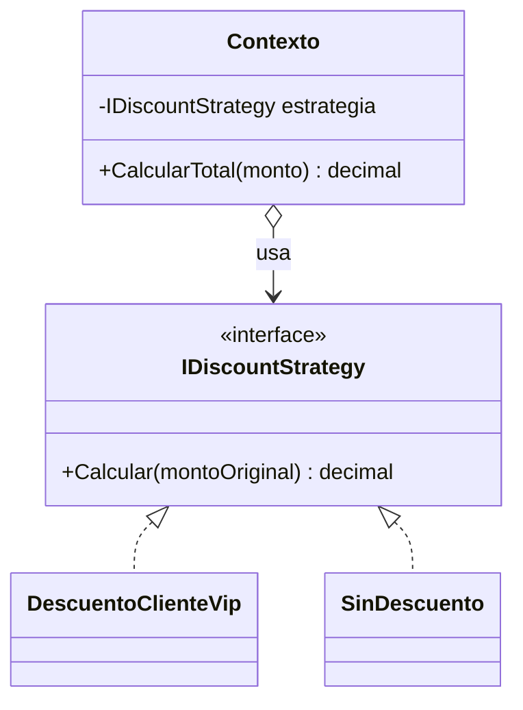
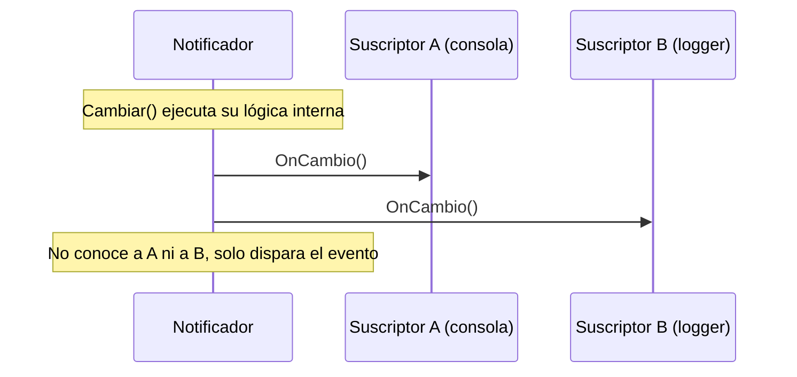

# SOLID y patrones de diseño

## En una frase

SOLID son cinco principios para que el código **se pueda cambiar sin romper lo que ya funciona**, y los patrones de diseño son soluciones conocidas a problemas concretos de diseño; los dos sirven **solo cuando el problema que resuelven está presente**, no "por si acaso".

-----

## Antes de empezar

Conviene que ya sepas:

* Clases, interfaces y herencia en C#.
* Qué es un trade-off y por qué no existe la solución perfecta: [¿Qué son los trade-offs?](../01-autonomia-resolucion-problemas/05-que-son-los-tradeoffs.md).

Palabras nuevas (también están en el [Glosario](Glosario.md)):

* **SOLID:** acrónimo de cinco principios de diseño orientado a objetos: SRP, OCP, LSP, ISP y DIP.
* **Responsabilidad:** una razón para cambiar. Una clase con tres responsabilidades tiene tres motivos distintos para ser modificada.
* **Clase Dios (*God Class*):** clase que hace de todo y por la que termina pasando cualquier cambio del sistema.
* **Interfaz gorda (*Fat Interface*):** interfaz que obliga a implementar métodos que el implementador no necesita.
* **Abstracción:** tipo (interfaz o clase abstracta) que define *qué* se hace sin decir *cómo*.
* **Indirección:** salto que hay que hacer para leer el comportamiento real, por ejemplo de una interfaz a su implementación.
* **Patrón de diseño:** solución reutilizable a un problema de diseño que aparece una y otra vez.
* **GoF (*Gang of Four*):** los cuatro autores del libro *Design Patterns* (1994), que catalogó 23 patrones clásicos.
* **Inyección de dependencias:** pasarle a una clase lo que necesita desde afuera (normalmente por el constructor) en lugar de que lo cree ella.
* **Domain Event (evento de dominio):** aviso de que algo importante pasó en el negocio, como `PedidoCreado`.

-----

## El problema

Una tienda tiene este servicio:

```csharp
public class OrderService
{
    private readonly SqlServerOrderRepository _repo = new();

    public void Procesar(Order pedido, string tipoCliente)
    {
        // 1. calcular el total
        pedido.Total = tipoCliente switch
        {
            "Regular" => pedido.Subtotal * 0.9m,
            "Premium" => pedido.Subtotal * 0.8m,
            _ => pedido.Subtotal
        };

        // 2. guardar
        _repo.Guardar(pedido);

        // 3. avisar por email
        var smtp = new SmtpClient("smtp.tienda.com");
        smtp.Send("ventas@tienda.com", pedido.EmailCliente, "Pedido confirmado", $"Total: {pedido.Total}");

        // 4. facturar
        var apiKey = ConfiguracionApp.Instancia.ApiKeyFacturacion;
        new FacturacionClient(apiKey).Emitir(pedido);
    }
}
```

Llegan tres pedidos en la misma semana:

* Marketing quiere un descuento de Black Friday: hay que modificar el `switch`.
* Se cambia el proveedor de email: hay que modificar `Procesar`.
* Alguien quiere escribir una prueba del cálculo de descuentos: no puede, porque `Procesar` se conecta a SQL Server, a un servidor SMTP y a la API de facturación.

Las consecuencias:

* cada cambio, por pequeño que sea, toca la misma clase y arriesga romper las otras tres responsabilidades;
* el cálculo de descuentos (la regla de negocio más importante) no se puede probar de forma aislada;
* nadie se anima a refactorizar, así que cada nuevo requerimiento agrega otro `if` al mismo método.

-----

## Cómo funciona

### 1. S: principio de responsabilidad única (SRP)

Una clase debe tener **una sola razón para cambiar**. El `OrderService` del problema calcula precios, persiste, envía emails y factura: cuatro razones distintas para cambiar. Es una **clase Dios**.

```csharp
// Viola SRP: genera el reporte Y lo guarda en disco
public class Reporte
{
    public string Generar() => "Contenido del reporte";

    public void GuardarEnArchivo(string contenido) =>
        File.WriteAllText("reporte.txt", contenido);
}

// Respeta SRP: cada clase tiene una única razón para cambiar
public class GeneradorDeReportes
{
    public string Generar() => "Contenido del reporte";
}

public class GuardadorDeArchivos
{
    public void Guardar(string contenido) =>
        File.WriteAllText("reporte.txt", contenido);
}
```

Pregunta para detectarlo: **"¿quién me pediría cambiar esta clase?"**. Si la respuesta incluye a marketing, a infraestructura y a contabilidad, tiene demasiadas responsabilidades.

### 2. O: principio abierto/cerrado (OCP)

Un componente debe estar **abierto a extensión y cerrado a modificación**: agregar comportamiento nuevo no debería requerir tocar código que ya funciona y ya está probado. Lo definió Bertrand Meyer en 1988, y Robert C. Martin lo popularizó dentro de SOLID.

```csharp
// Viola OCP: cada tipo de cliente nuevo obliga a modificar este método
public class CalculadoraDescuentos
{
    public decimal Calcular(string tipoCliente, decimal total) => tipoCliente switch
    {
        "Regular" => total * 0.9m,
        "Premium" => total * 0.8m,
        _ => total
    };
}

// Respeta OCP: un tipo de cliente nuevo es una clase nueva, sin tocar las existentes
public interface IDescuento
{
    decimal Aplicar(decimal total);
}

public class DescuentoRegular : IDescuento
{
    public decimal Aplicar(decimal total) => total * 0.9m;
}

public class DescuentoPremium : IDescuento
{
    public decimal Aplicar(decimal total) => total * 0.8m;
}
```

En la práctica, es el mismo patrón **Strategy** que se ve más abajo: OCP es la razón de fondo por la que Strategy existe.

> **Ojo:** un `switch` no viola OCP por existir. Si los casos casi nunca cambian (los días de la semana, por ejemplo), un `switch` es más simple y más legible. OCP importa donde **ya se ve** que se agregan casos seguido.

### 3. L: principio de sustitución de Liskov (LSP)

Si `B` hereda de `A`, cualquier lugar que use un `A` debe poder recibir un `B` **sin que nada se rompa ni cambie el comportamiento esperado**.

```csharp
// Viola LSP: Pinguino hereda de Ave pero no puede cumplir el contrato de "volar"
public class Ave
{
    public virtual void Volar() => Console.WriteLine("Volando");
}

public class Pinguino : Ave
{
    public override void Volar() =>
        throw new NotSupportedException("Los pingüinos no vuelan");
}

void HacerVolar(Ave ave) => ave.Volar(); // falla si recibe un Pinguino
```

```csharp
// Respeta LSP: no se fuerza una jerarquía que no tiene sentido
public interface IVolador
{
    void Volar();
}

public class Aguila : IVolador
{
    public void Volar() => Console.WriteLine("Volando");
}

public class Pinguino
{
    public void Nadar() => Console.WriteLine("Nadando");
}
```

Señal de alerta clásica: un método sobrescrito que lanza `NotImplementedException` o `NotSupportedException` en lugar de cumplir lo que promete la clase base. Otra más sutil: una subclase que exige **más** condiciones de entrada que la base (por ejemplo, la base acepta cualquier monto y la subclase rechaza los mayores a 1000).

### 4. I: principio de segregación de interfaces (ISP)

Mejor varias interfaces chicas y específicas que una **interfaz gorda** que obliga a implementar métodos que no se necesitan. Es SRP aplicado a interfaces.

```csharp
// Viola ISP: Programador se ve obligado a implementar Disenar()
public interface ITrabajador
{
    void Trabajar();
    void Codificar();
    void Disenar();
}

public class Programador : ITrabajador
{
    public void Trabajar() { }
    public void Codificar() { }
    public void Disenar() => throw new NotImplementedException();
}
```

```csharp
// Respeta ISP: interfaces separadas por responsabilidad
public interface ITrabajador { void Trabajar(); }
public interface IDesarrollador { void Codificar(); }
public interface IDisenador { void Disenar(); }

public class Programador : ITrabajador, IDesarrollador
{
    public void Trabajar() { }
    public void Codificar() { }
}
```

Fíjate que la violación de ISP terminó produciendo una violación de LSP (`NotImplementedException`). Los principios están conectados: romper uno suele arrastrar a otro.

### 5. D: principio de inversión de dependencias (DIP)

Las clases de alto nivel (reglas de negocio) no deben depender de clases concretas de bajo nivel (base de datos, email, APIs externas): **ambas dependen de una abstracción**.

```csharp
// Viola DIP: Servicio depende directamente de una implementación concreta
public class Servicio
{
    private readonly MySqlRepositorio _repo = new(); // acoplado a MySQL

    public void Ejecutar() => _repo.Guardar("dato");
}
```

```csharp
// Respeta DIP: Servicio depende de una abstracción; la implementación se inyecta
public interface IRepositorio
{
    void Guardar(string dato);
}

public class MySqlRepositorio : IRepositorio
{
    public void Guardar(string dato) { /* ... */ }
}

public class Servicio(IRepositorio repo)
{
    public void Ejecutar() => repo.Guardar("dato");
}
```

Hay tres formas de inyectar una dependencia:

| Forma | Ejemplo | Cuándo |
| --- | --- | --- |
| Por constructor | `public Servicio(IRepositorio repo)` | **Por defecto**: la dependencia es obligatoria y queda visible |
| Por propiedad | `public ILogger? Logger { get; set; }` | Dependencias opcionales |
| Por parámetro de método | `Ejecutar(IReloj reloj)` | Solo ese método la necesita |

> **En la práctica:** en mi proyecto `OrderManagementBackend`, `OrderService` recibe `IOrderRepository` por constructor y nunca crea un `OrderRepository` concreto adentro.

DIP es lo que hace posible probar de forma aislada: como el servicio depende de `IRepositorio`, en una prueba se reemplaza por un doble sin base de datos (ver [Estrategia de testing](03-estrategia-de-testing.md)). Cómo se registran y se resuelven esas dependencias en .NET está en [Inyección de dependencias](06-inyeccion-de-dependencias.md).

### 6. "Justificado", no "porque se puede"

Un patrón resuelve un problema concreto. Aplicarlo sin ese problema es sobreingeniería: código "por si algún día se necesita", más difícil de entender y sin beneficio hoy (ver [Simplicidad frente a flexibilidad](../01-autonomia-resolucion-problemas/05-que-son-los-tradeoffs.md)).

La pregunta antes de aplicar cualquier patrón: **¿qué problema concreto tengo hoy que este patrón resuelve?** Si la respuesta es "ninguno, pero por si acaso", todavía no corresponde.

Ejemplo: hoy la API solo envía notificaciones por email.

* **No justificado:** una interfaz `INotificationSender` con implementaciones para email, SMS, push y Slack, "por si en el futuro se necesitan". Nadie pidió los otros tres canales. Es complejidad que se paga hoy por un beneficio que quizás nunca llegue: viola YAGNI (ver [DRY, KISS y YAGNI](07-principios-de-simplicidad.md)).
* **Justificado:** el ticket dice "esta semana se agrega SMS, y ya está confirmado que el próximo sprint llegan las notificaciones push". Hay un cambio real y confirmado.

La pregunta no es "¿esto podría cambiar?" (casi todo **podría**). La pregunta es: **¿hay ya una señal concreta (un ticket, un requerimiento confirmado, un cambio que ya se repitió) de que va a cambiar?**

**La paradoja de la flexibilidad:** cada abstracción agrega **indirección**. Para entender qué hace el código hay que saltar de la interfaz a la implementación, en lugar de leerlo de corrido. Ese salto mental se paga cada vez que alguien lee el código, aunque la abstracción represente fielmente un concepto real del dominio: "representar bien la realidad" y "no tener costo" son cosas distintas.

**Regla de oro.** Introduce una abstracción solo cuando se cumple al menos una de estas condiciones:

1. Ya se siente el dolor del acoplamiento: cambiar una cosa obliga a tocar muchas partes que no deberían verse afectadas.
2. Se sabe que esa pieza va a cambiar seguido (no "capaz cambia": ya se anticipa el cambio).
3. Hace falta aislarla para probar otra cosa, aunque casi no cambie nunca, como una pasarela de pagos externa.

Si ninguna aplica, la abstracción es costo sin beneficio.

### 7. ¿Qué patrón para qué síntoma?

La forma más rápida de elegir es reconocer el síntoma en tu código, no memorizar el catálogo:

| Si el síntoma es... | El patrón es... |
| --- | --- |
| Crear un objeto es complejo o depende de una condición en tiempo de ejecución (`switch` para decidir qué construir) | **Factory** |
| Hay varias formas de hacer lo mismo y se intercambian según el contexto | **Strategy** |
| Un cambio de estado tiene que avisar a varios interesados sin que el objeto los conozca | **Observer** |
| La lógica de negocio tiene que dejar de depender directamente de EF Core o de SQL | **Repository** |
| Hace falta desacoplar quién **pide** una acción de quién la **ejecuta**, para auditarla, encolarla o deshacerla | **Command** |

Si tu código no muestra ninguno de estos síntomas, ningún patrón corresponde todavía.

### 8. Factory

**Problema que resuelve:** la creación de un objeto es compleja o depende de una condición en tiempo de ejecución.

```csharp
public interface INotificationFactory
{
    INotifier Create(NotificationChannel channel);
}

public class NotificationFactory : INotificationFactory
{
    public INotifier Create(NotificationChannel channel) => channel switch
    {
        NotificationChannel.Email => new EmailNotifier(),
        NotificationChannel.Sms => new SmsNotifier(),
        _ => throw new ArgumentOutOfRangeException(nameof(channel), channel, "Canal no soportado")
    };
}
```

El `switch` no desaparece: se concentra en **un solo lugar**, en lugar de repetirse en cada sitio que necesita un notificador.

**Cuándo no usarlo:** si el código es simplemente `new Producto()` sin lógica condicional detrás, un Factory es indirección que no aporta nada.

### 9. Strategy

**Problema que resuelve:** hay varias formas de ejecutar el mismo tipo de operación y se eligen según el contexto o se intercambian en tiempo de ejecución.

```csharp
public interface IDiscountStrategy
{
    decimal Calcular(decimal montoOriginal);
}

public class DescuentoClienteVip : IDiscountStrategy
{
    public decimal Calcular(decimal montoOriginal) => montoOriginal * 0.85m;
}

public class SinDescuento : IDiscountStrategy
{
    public decimal Calcular(decimal montoOriginal) => montoOriginal;
}
```



El `Contexto` (por ejemplo, un `OrderService`) no sabe qué implementación concreta usa: solo conoce la interfaz. Qué estrategia se inyecta se decide afuera.

**Cuándo no usarlo:** si solo existe una forma de calcular algo y no hay señales de que vaya a cambiar, una interfaz con una sola implementación es complejidad sin beneficio.

> **Factory y Strategy juntos:** es muy común que una Factory decida **qué** Strategy usar (`factory.Para(tipoCliente)`). La Factory resuelve la creación; la Strategy, el comportamiento.

### 10. Observer

**Problema que resuelve:** un cambio de estado tiene que notificar a varios interesados sin que el objeto que cambia sepa quiénes son.

```csharp
public class Notificador
{
    public event Action? OnCambio;

    public void Cambiar()
    {
        // ... lógica del cambio
        OnCambio?.Invoke(); // notifica a todos los suscritos, sin saber quiénes son
    }
}

var notificador = new Notificador();
notificador.OnCambio += () => Console.WriteLine("Algo cambió");
notificador.OnCambio += () => logger.LogInformation("Cambio detectado");

notificador.Cambiar(); // dispara ambas suscripciones
```



En .NET aparece en los `event` y delegados del lenguaje, y a mayor escala en los **Domain Events**: al crear un pedido se publica `PedidoCreado`, y un servicio de email y uno de facturación lo escuchan por separado, sin que `OrderService` sepa que existen.

**Cuándo no usarlo:** si hay un solo consumidor fijo y no se prevén más, llamarlo directamente es más simple y más fácil de seguir.

> **Ojo:** un suscriptor que nunca se desuscribe (`-=`) mantiene viva la referencia al objeto que lo publica. Con objetos de vida larga, es una causa clásica de memory leaks.

### 11. Repository

**Problema que resuelve:** ocultar el acceso a datos detrás de una interfaz, para que la lógica de negocio no dependa directamente de EF Core o de SQL.

```csharp
public interface IOrderRepository
{
    Task<Order?> GetByIdAsync(int id);
    Task AddAsync(Order order);
}
```

**Matiz importante:** con EF Core, el `DbContext` **ya implementa** internamente los patrones Repository y Unit of Work: `DbSet<T>` funciona como repositorio y `SaveChanges()` como unidad de trabajo. Envolverlo en otro repositorio genérico que solo delega cada método uno a uno puede ser una capa redundante: "un repositorio sobre otro repositorio". Es una discusión real en la comunidad .NET, no un error si se hace, pero conviene saber que aplicado sin criterio puede no aportar nada.

Cuándo **sí** vale la pena, incluso sobre EF Core: cuando el repositorio agrega algo propio (consultas complejas reutilizables, mapeo a otro modelo, aislar el dominio del ORM), no cuando es un `return _context.Orders.Find(id);` envuelto en una interfaz. La crítica completa al repositorio genérico está en [Arquitectura en capas](08-arquitectura-en-capas-ntier.md).

### 12. Command

**Problema que resuelve:** desacoplar quién **pide** una acción de quién la **ejecuta**, encapsulando la petición completa en un objeto en lugar de llamar a un método con parámetros sueltos.

```csharp
// El Command: una "caja" inmutable con los datos de la petición
public record RegistrarEmpleadoCommand(string NombreCompleto, string Departamento, decimal SalarioBase);

// El Handler: la única clase que sabe qué hacer con ese comando
public class RegistrarEmpleadoCommandHandler
{
    public void Handle(RegistrarEmpleadoCommand comando)
    {
        // lógica de negocio
    }
}

// Quien pide solo arma el comando y lo despacha
var comando = new RegistrarEmpleadoCommand("Jorge Díaz", "Sistemas", 3500m);
handler.Handle(comando);
```

**Por qué es distinto de llamar a un método:** al ser un objeto, el comando se puede guardar, registrar para auditoría, encolar para procesarlo después o revertir. Una llamada a un método se ejecuta y se pierde.

Extensión clásica: si cada comando implementa `Ejecutar()` y `Deshacer()`, y un invocador guarda el historial en un `Stack<ICommand>`, tienes un Ctrl+Z real. Es el mecanismo detrás del "deshacer" de editores como Word o Photoshop.

**Cuándo no usarlo:** si la acción es simple y no necesitas historial, cola ni deshacer, es indirección de más.

Command es la base de **CQRS** (separar las operaciones que escriben de las que leen), que en .NET se implementa a menudo con MediatR: ver [CQRS](10-cqrs.md).

### 13. Singleton clásico: el que conviene evitar

**Problema que dice resolver:** garantizar que una clase tenga una única instancia en toda la aplicación, con un punto de acceso global.

```csharp
public class ConfiguracionApp
{
    private static ConfiguracionApp? _instancia;
    private ConfiguracionApp() { } // nadie puede hacer "new" desde afuera

    public static ConfiguracionApp Instancia => _instancia ??= new ConfiguracionApp();

    public string ApiKey { get; set; } = string.Empty;
}

// Uso en cualquier parte del código:
ConfiguracionApp.Instancia.ApiKey = "abc123";
```

**No confundir con el lifetime Singleton de DI** (ver [Inyección de dependencias](06-inyeccion-de-dependencias.md)). Logran algo parecido (una sola instancia) por caminos distintos:

| | Patrón Singleton clásico | Lifetime Singleton de DI |
| --- | --- | --- |
| Quién decide que hay una sola instancia | La propia clase (constructor privado + propiedad estática) | El contenedor de DI |
| Cómo se obtiene | `ConfiguracionApp.Instancia` desde cualquier parte | Se inyecta por constructor |
| Se puede reemplazar en una prueba | No | Sí |

Por qué conviene evitarlo: hay **dos problemas de fondo**.

**Problema 1: acoplamiento a una clase concreta.** `ConfiguracionApp.Instancia` dentro de la lógica es una llamada directa a **esa** clase, no a algo reemplazable. Es lo mismo que DIP prohíbe con `new SqlServerRepository()`, solo que escondido detrás de una llamada estática que parece inofensiva. Se nota apenas intentas probarlo:

```csharp
public class OrderService
{
    public void ProcesarPedido(Order pedido)
    {
        var apiKey = ConfiguracionApp.Instancia.ApiKey; // acoplado a la clase concreta
        // ... usa apiKey para llamar a un servicio externo
    }
}

[Fact]
public void ProcesarPedido_DeberiaFuncionar()
{
    var service = new OrderService();
    service.ProcesarPedido(pedidoDePrueba);
    // No hay forma de controlar qué ApiKey usa la prueba.
    // Si está vacía en el entorno de pruebas, falla por una razón
    // que no tiene nada que ver con la lógica que se prueba.
}
```

**Problema 2: estado compartido entre todo lo que corre en la aplicación.** Pasa aunque nunca escribas una prueba. Hay una sola instancia para **toda** la aplicación, así que cualquier código que la modifique toca lo mismo que está usando otra petición, de otro usuario, en ese mismo momento:

```csharp
public class ConfiguracionApp
{
    // ...
    public int IntentosDeReintento; // mutable y compartido: aquí está el problema
}

// Petición del usuario A, en un hilo:
ConfiguracionApp.Instancia.IntentosDeReintento = 3;

// Al mismo tiempo, petición del usuario B, en otro hilo:
ConfiguracionApp.Instancia.IntentosDeReintento = 1;

// Cuando el código de A vuelve a leer el valor, puede encontrar el 1 de B,
// sin que ninguno de los dos haya hecho nada "mal" en su propio código.
```

En una API que atiende peticiones en paralelo (que es como funciona ASP.NET Core bajo carga), no es un caso raro: es el comportamiento normal.

> **Ojo:** incluso la creación tiene una condición de carrera. `_instancia ??= new ConfiguracionApp()` no es *thread-safe*: dos hilos pueden ver `null` al mismo tiempo y crear dos instancias. La versión correcta usa `Lazy<T>`: `private static readonly Lazy<ConfiguracionApp> _instancia = new(() => new ConfiguracionApp());`.

**Conclusión:** el patrón mezcla dos decisiones que conviene separar: **quién decide cuántas instancias hay** (debería ser el contenedor de DI, no la clase) y **si esa instancia tiene estado mutable compartido** (hay que evitarlo siempre, sea Singleton clásico o lifetime Singleton). El patrón clásico junta los dos problemas y los vuelve invisibles hasta que algo falla en producción bajo carga.

**Por qué igual conviene conocerlo:** es uno de los patrones originales del libro GoF y aparece seguido en entrevistas. Entender por qué se evita hoy es tan valioso como saber implementarlo. En .NET moderno, casi cualquier caso de Singleton clásico se resuelve registrando el servicio con lifetime Singleton en el contenedor: misma garantía de una sola instancia, sin ninguno de los dos problemas.

### 14. SOLID y patrones en otros lenguajes

**SOLID:**

* **S, O y D se generalizan bien.** En TypeScript, Python o Java, "una clase o función hace una sola cosa", "se extiende sin modificar lo existente" y "se depende de abstracciones" aplican igual, sean lenguajes puramente orientados a objetos o no.
* **L e I están atadas al modelo de herencia e interfaces.** Java y TypeScript las aplican casi igual que C#. Python es más flexible por el *duck typing*: muchas veces ni se declara una interfaz formal (aunque existen `Protocol` y `ABC`). La idea (no romper el contrato esperado) sigue vigente, pero el compilador no la impone.

**Patrones:** TypeScript, Python y Java tienen **funciones de primera clase** (se pasan como valores, como `Func<T>` en C#). Eso cambia cuándo hace falta el patrón completo:

| Patrón | Cambio en otros lenguajes |
| --- | --- |
| Strategy | En TypeScript y Python muchas veces alcanza con pasar una función, sin interfaz ni clases |
| Command | Puede ser una función o *closure* que captura su contexto |
| Observer | Java no tiene `event`: se implementa con interfaces o librerías (RxJava). En TypeScript es central a la plataforma: eventos del DOM, `EventEmitter` de Node, Observables de RxJS |
| Singleton | En Python, un módulo ya funciona como singleton porque los imports se cachean |

No cambia el nombre del patrón: a veces el patrón completo deja de hacer falta porque el lenguaje ya resuelve ese problema con una característica nativa. Verificarlo por lenguaje, no asumirlo, es el mismo hábito de [sintaxis frente a comportamiento](../01-autonomia-resolucion-problemas/README.md) de la fase 1.

-----

## Ejemplo completo

El `OrderService` del problema, refactorizado solo donde hay un síntoma real.

`Descuentos.cs` (OCP + Strategy: hay un tipo de cliente nuevo cada temporada):

```csharp
public interface IDescuento
{
    decimal Aplicar(decimal subtotal);
}

public class DescuentoRegular : IDescuento { public decimal Aplicar(decimal s) => s * 0.9m; }
public class DescuentoPremium : IDescuento { public decimal Aplicar(decimal s) => s * 0.8m; }
public class DescuentoBlackFriday : IDescuento { public decimal Aplicar(decimal s) => s * 0.7m; }
public class SinDescuento : IDescuento { public decimal Aplicar(decimal s) => s; }

// Factory: el único lugar que sabe qué descuento corresponde a cada tipo
public class DescuentoFactory
{
    public IDescuento Para(string tipoCliente) => tipoCliente switch
    {
        "Regular" => new DescuentoRegular(),
        "Premium" => new DescuentoPremium(),
        "BlackFriday" => new DescuentoBlackFriday(),
        _ => new SinDescuento()
    };
}
```

`Puertos.cs` (DIP: lo externo detrás de abstracciones, para poder probar y cambiar de proveedor):

```csharp
public interface IOrderRepository { Task GuardarAsync(Order pedido); }
public interface INotificador { Task PedidoConfirmadoAsync(Order pedido); }
public interface IFacturacion { Task EmitirAsync(Order pedido); }
```

`OrderService.cs` (SRP: solo orquesta; cada detalle vive en su propia clase):

```csharp
public class OrderService(
    DescuentoFactory descuentos,
    IOrderRepository repositorio,
    INotificador notificador,
    IFacturacion facturacion)
{
    public async Task ProcesarAsync(Order pedido, string tipoCliente)
    {
        pedido.Total = descuentos.Para(tipoCliente).Aplicar(pedido.Subtotal);

        await repositorio.GuardarAsync(pedido);
        await notificador.PedidoConfirmadoAsync(pedido);
        await facturacion.EmitirAsync(pedido);
    }
}
```

`DescuentoTests.cs` (ahora la regla de negocio se prueba sin base de datos, SMTP ni API):

```csharp
public class DescuentoTests
{
    [Theory]
    [InlineData("Regular", 100, 90)]
    [InlineData("Premium", 100, 80)]
    [InlineData("BlackFriday", 100, 70)]
    [InlineData("Desconocido", 100, 100)]
    public void Para_TipoDeCliente_AplicaElDescuentoCorrecto(string tipo, decimal subtotal, decimal esperado)
    {
        decimal total = new DescuentoFactory().Para(tipo).Aplicar(subtotal);

        Assert.Equal(esperado, total);
    }
}
```

Qué observar:

* **Black Friday** se agregó con una clase nueva y una línea en la Factory: `OrderService` no se tocó.
* **Cambiar de proveedor de email** es una nueva implementación de `INotificador`: `OrderService` no se tocó.
* `DescuentoFactory` no tiene interfaz: no hay ningún motivo hoy para reemplazarla, y se puede probar tal cual. Es la regla de oro aplicada: abstraer solo lo que lo necesita.
* No se agregó Observer para las notificaciones: hay un solo consumidor. Si mañana aparecen tres más (analítica, CRM, stock), ahí sí se justifica un `PedidoCreado`.

-----

## Errores comunes

**1. Aplicar patrones "por si acaso".**
Qué pasa: interfaces con una sola implementación, factories que solo hacen `new` y capas que solo delegan.
Por qué: se diseña para escenarios imaginados en lugar de para síntomas reales.
Arreglo: aplica la regla de oro: dolor de acoplamiento, cambio frecuente confirmado o necesidad de aislar para probar.

**2. Confundir SRP con "una clase, un método".**
Qué pasa: decenas de clases diminutas que hay que recorrer para entender un flujo simple.
Por qué: se interpreta "una responsabilidad" como "una cosa técnica" y no como "una razón para cambiar".
Arreglo: agrupa lo que cambia por el mismo motivo y separa lo que cambia por motivos distintos.

**3. Heredar para reutilizar código.**
Qué pasa: subclases que lanzan `NotImplementedException` en métodos heredados.
Por qué: se usa la herencia porque "comparten código", aunque la subclase no cumple el contrato de la base (viola LSP).
Arreglo: hereda solo si la relación es realmente "es un" y se cumple el contrato completo; si no, usa composición o una interfaz.

**4. Llamar "DIP" a crear una interfaz por cada clase.**
Qué pasa: `IUserService`, `IUserValidator`, `IUserMapper`, todas con una sola implementación y sin pruebas que las reemplacen.
Por qué: se confunde "depender de abstracciones" con "tener una interfaz para todo".
Arreglo: abstrae los límites con el exterior (base de datos, red, reloj, servicios externos) y lo que de verdad varía.

**5. Singleton clásico con estado mutable.**
Qué pasa: valores que "cambian solos" bajo carga y pruebas que fallan según el orden en que se ejecutan.
Por qué: una única instancia compartida por todos los hilos y peticiones.
Arreglo: registra el servicio como Singleton en el contenedor de DI y que no tenga estado mutable; si necesitas estado por petición, usa el lifetime Scoped.

-----

## Cuándo sí y cuándo no

**Aplica SOLID con fuerza cuando:** el código es de larga vida, lo mantiene un equipo y concentra reglas de negocio que cambian seguido.

**Usa un patrón cuando:** reconoces en el código el síntoma que resuelve (la tabla de la sección 7).

**No fuerces SOLID ni patrones cuando:** es un script descartable, un prototipo para validar una idea o código que nunca cambió en años. Ahí la simplicidad vale más que la flexibilidad.

-----

## Resumen en 5 líneas

1. SRP: una razón para cambiar. OCP: extender sin modificar. LSP: la subclase cumple el contrato de la base. ISP: interfaces chicas. DIP: depender de abstracciones.
2. Un patrón resuelve un síntoma concreto; sin el síntoma, es sobreingeniería.
3. Factory para creación condicional, Strategy para comportamientos intercambiables, Observer para avisar a varios, Repository para aislar el acceso a datos, Command para encapsular peticiones.
4. Cada abstracción tiene un costo de indirección: introdúcela por dolor de acoplamiento, cambio confirmado o necesidad de probar.
5. Evita el Singleton clásico: usa el lifetime Singleton del contenedor de DI, sin estado mutable.

-----

## Para profundizar

<details>
<summary>¿SOLID es solo para programación orientada a objetos?</summary>

Las ideas de fondo van más allá de las clases. En programación funcional, SRP es "una función hace una cosa", OCP aparece al componer funciones en lugar de modificarlas, y DIP es pasar funciones como parámetros en lugar de llamar a implementaciones concretas. A nivel de arquitectura, los mismos principios reaparecen como la Regla de Dependencia de [Clean Architecture](09-clean-architecture.md) y los puertos de la [Arquitectura hexagonal](11-arquitectura-hexagonal.md).

</details>

<details>
<summary>Composición sobre herencia</summary>

El libro GoF ya lo decía en 1994: "favorece la composición de objetos sobre la herencia de clases". La herencia acopla la subclase a los detalles de la base: un cambio en la base puede romper a todas sus hijas (el problema de la "clase base frágil"). La composición (tener un objeto en lugar de heredar de él) permite cambiar el comportamiento en tiempo de ejecución, que es exactamente lo que hace Strategy. Ver también [Clase abstracta frente a interfaz](05-abstract-vs-interface.md).

</details>

-----

## En entrevista

### Respuesta corta (junior)

SOLID son cinco principios de diseño: responsabilidad única, abierto/cerrado, sustitución de Liskov, segregación de interfaces e inversión de dependencias. Sirven para que el código sea más fácil de mantener y de probar. Los patrones de diseño, como Factory, Strategy o Repository, son soluciones conocidas a problemas que se repiten.

### Respuesta ampliada (semi-senior)

Uso SOLID como criterio, no como regla absoluta. SRP me ayuda a separar lo que cambia por motivos distintos, y DIP me permite aislar la base de datos y los servicios externos para probar la lógica de negocio. Aplico un patrón cuando veo su síntoma: Strategy cuando hay varias formas de calcular algo que se agregan seguido, Factory cuando la creación depende de una condición. Cada abstracción tiene un costo de indirección, así que solo la introduzco si hay dolor de acoplamiento, un cambio confirmado o necesidad de probar. Por ejemplo, con EF Core no siempre agrego un repositorio genérico, porque el `DbContext` ya implementa Repository y Unit of Work.

### Preguntas frecuentes de seguimiento

**1. Dame un ejemplo de violación de LSP.**
Un `Pinguino` que hereda de `Ave` y lanza `NotSupportedException` en `Volar()`. Cualquier código que reciba un `Ave` y llame a `Volar()` falla si recibe un pingüino.

**2. ¿Qué diferencia hay entre DIP e inyección de dependencias?**
DIP es el principio: depender de abstracciones y no de implementaciones concretas. La inyección de dependencias es la técnica para cumplirlo: recibir esas abstracciones desde afuera, normalmente por el constructor.

**3. ¿Por qué se considera el Singleton un antipatrón?**
Porque acopla el código a una clase concreta a través de un acceso estático, lo que impide reemplazarla en pruebas, y porque su estado se comparte entre todos los hilos. En .NET se prefiere el lifetime Singleton del contenedor de DI.

**4. ¿Cuándo no usarías un patrón?**
Cuando no existe el problema que resuelve. Una interfaz con una sola implementación, sin pruebas que la reemplacen y sin cambios previstos, es solo indirección.

-----

## Práctica

**Ejercicio 1.** ¿Qué principio o principios viola esta clase? ¿Cómo la separarías?

```csharp
public class UsuarioService
{
    public void Registrar(string email, string password)
    {
        if (!email.Contains('@')) throw new ArgumentException("Email inválido");

        var hash = BCrypt.Net.BCrypt.HashPassword(password);
        using var conn = new SqlConnection("Server=prod;...");
        conn.Execute("INSERT INTO Usuarios (Email, Hash) VALUES (@email, @hash)", new { email, hash });

        new SmtpClient("smtp.empresa.com").Send("no-reply@empresa.com", email, "Bienvenido", "...");
    }
}
```

<details>
<summary>Solución</summary>

* **SRP:** valida, cifra, persiste y envía emails: cuatro razones para cambiar.
* **DIP:** crea directamente `SqlConnection` y `SmtpClient`, y tiene la cadena de conexión escrita en el código. No se puede probar sin una base de datos y un servidor SMTP reales.

Separación posible:

```csharp
public class UsuarioService(IUsuarioRepository repositorio, IHasher hasher, INotificador notificador)
{
    public async Task RegistrarAsync(string email, string password)
    {
        if (!email.Contains('@')) throw new ArgumentException("Email inválido", nameof(email));

        await repositorio.AgregarAsync(new Usuario(email, hasher.Hash(password)));
        await notificador.BienvenidaAsync(email);
    }
}
```

La validación simple puede quedarse en el servicio. Persistencia, cifrado y email van detrás de abstracciones porque son detalles externos que se quieren reemplazar en pruebas.

</details>

**Ejercicio 2.** ¿Qué tiene de malo este diseño? ¿Qué harías en su lugar?

```csharp
public interface ICalculadoraImpuestos { decimal Calcular(decimal monto); }

public class CalculadoraImpuestos : ICalculadoraImpuestos
{
    public decimal Calcular(decimal monto) => monto * 0.18m;
}

public class CalculadoraImpuestosFactory
{
    public ICalculadoraImpuestos Crear() => new CalculadoraImpuestos();
}
```

La empresa opera en un solo país y la tasa no cambió en 10 años.

<details>
<summary>Solución</summary>

* La interfaz tiene una sola implementación y no hay señal de que vaya a tener otra.
* La Factory no tiene ninguna lógica condicional: solo hace `new`.
* El cálculo es puro (sin base de datos ni red), así que se puede probar sin reemplazarlo.

Ninguna de las tres condiciones de la regla de oro se cumple. En su lugar:

```csharp
public static class Impuestos
{
    public const decimal Tasa = 0.18m;
    public static decimal Calcular(decimal monto) => monto * Tasa;
}
```

Si mañana la empresa abre en otro país, **ahí** aparece el síntoma (varias formas de calcular según el contexto) y se extrae la interfaz como Strategy.

</details>

-----

## Siguiente lección

[Arquitectura y límites entre capas](02-arquitectura-y-limites.md)
