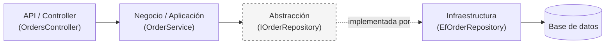

# Arquitectura y límites entre capas

## En una frase

Separar en capas solo sirve si se respetan los límites: **el controller no decide reglas de negocio, el negocio no conoce la base de datos**, y dentro de cada capa el código se lee de corrido gracias a guard clauses, nombres que siguen la convención del lenguaje y comentarios solo donde aportan.

-----

## Antes de empezar

Conviene que ya sepas:

* El principio de inversión de dependencias (DIP): [SOLID y patrones](01-solid-y-patrones.md).

Palabras nuevas (también están en el [Glosario](Glosario.md)):

* **Capa:** grupo de código con una responsabilidad común (presentación, negocio, datos) que solo se comunica con otras capas por puntos definidos.
* **Dominio:** las reglas y conceptos del negocio (pedido, cliente, descuento), independientes de la tecnología.
* **Infraestructura:** el código que habla con el mundo exterior: base de datos, archivos, APIs, email.
* **Regla de dependencia:** las dependencias entre capas siguen una sola dirección, hacia el código más estable (el dominio).
* **Guard clause (cláusula de guarda):** validación al inicio de un método que corta la ejecución si los datos no sirven.
* **PascalCase / camelCase / snake_case:** formas de escribir nombres compuestos: `TotalPedido`, `totalPedido`, `total_pedido`.
* **Linter:** herramienta que analiza el código y marca lo que no sigue las convenciones o reglas configuradas.

-----

## El problema

```csharp
[ApiController]
[Route("api/pedidos")]
public class PedidosController(AppDbContext db) : ControllerBase
{
    [HttpPut("{id}")]
    public IActionResult Actualizar(int id, int cant)
    {
        var p = db.Orders.Find(id);
        if (p != null)
        {
            if (p.Estado != EstadoPedido.Completado)
            {
                if (cant > 0)
                {
                    // descuento por volumen (lo pidió Ana el 12/03)
                    if (cant > 100) p.Total = p.PrecioUnitario * cant * 0.9m;
                    else p.Total = p.PrecioUnitario * cant;
                    p.Cantidad = cant;
                    db.SaveChanges();
                    return Ok();
                }
            }
        }
        // return BadRequest("Error");
        return BadRequest();
    }
}
```

Y la entidad del dominio:

```csharp
[Table("tbl_orders")]
public class Order
{
    [Key, DatabaseGenerated(DatabaseGeneratedOption.Identity)]
    public int Id { get; set; }
    // ...
}
```

Las consecuencias:

* el descuento por volumen vive en el controller: si mañana se crea un pedido desde una cola de mensajes, la regla no se aplica (o se duplica);
* la entidad `Order` depende de Entity Framework: el dominio no se puede usar ni probar sin el ORM;
* tres niveles de `if` anidados, nombres como `p` y `cant`, un comentario con fecha y código comentado: hay que leerlo tres veces para entender qué valida;
* el cliente recibe un `400` sin saber si el pedido no existe, ya estaba completado o la cantidad era inválida.

-----

## Cómo funciona

### 1. La regla de dependencia

Lo que separa una arquitectura con límites reales de un proyecto con carpetas es **hacia dónde apuntan las dependencias**.

* El controller (API) **no contiene lógica de negocio**: recibe la petición, la delega y traduce el resultado a una respuesta HTTP.
* El dominio **no sabe nada de la base de datos ni de frameworks**: no importa `Microsoft.EntityFrameworkCore` ni ninguna librería de infraestructura.



La flecha punteada es la clave: `OrderService` conoce la interfaz `IOrderRepository`, nunca a `EfOrderRepository`. La interfaz pertenece a la capa de negocio, y es infraestructura la que la implementa. Así, la dependencia de código apunta **desde la infraestructura hacia el negocio**, y no al revés.

| Estilo | Hacia dónde apuntan las dependencias |
| --- | --- |
| N-Tier clásico | Hacia abajo: presentación → negocio → datos. El negocio depende **directamente** de la capa de datos |
| N-Tier con DIP | El negocio define las interfaces y datos las implementa: la dependencia hacia datos se invierte |
| Clean, Onion, Hexagonal | Formalizan esa inversión como regla: **todo apunta hacia el dominio** |

> **En la práctica:** en mi proyecto `OrderManagementBackend`, `OrdersController` llama a `OrderService`, que llama a `IOrderRepository`. El servicio nunca sabe si detrás hay MySQL, SQL Server o una lista en memoria.

**Señales de violación:**

* un controller con `if` de reglas de negocio;
* un controller que usa el `DbContext` directamente para algo más que una consulta trivial;
* una entidad de dominio con atributos de Entity Framework (`[Table]`, `[Key]`, `[Column]`).

Cuando aparecen, la capa que debería ser independiente dejó de serlo. Los atributos de EF se reemplazan por configuración en infraestructura con `IEntityTypeConfiguration<T>`.

### 2. Guard clauses

En lugar de anidar condicionales, se valida temprano y se corta la ejecución apenas algo no es válido.

```csharp
// Sin guard clauses: anidación innecesaria, difícil de leer
public void ActualizarPedido(Order pedido, int nuevaCantidad)
{
    if (pedido != null)
    {
        if (pedido.Estado != EstadoPedido.Completado)
        {
            if (nuevaCantidad > 0)
            {
                pedido.Cantidad = nuevaCantidad;
            }
        }
    }
}
```

```csharp
// Con guard clauses: se valida y se corta, sin anidar
public void ActualizarPedido(Order pedido, int nuevaCantidad)
{
    ArgumentNullException.ThrowIfNull(pedido);
    ArgumentOutOfRangeException.ThrowIfNegativeOrZero(nuevaCantidad);

    if (pedido.Estado == EstadoPedido.Completado)
        throw new BusinessRuleException("No se puede modificar un pedido completado");

    pedido.Cantidad = nuevaCantidad;
}
```

La segunda versión se lee de arriba hacia abajo: cada condición de error queda en su propia línea y el "camino feliz" queda al final, sin indentación.

`ThrowIfNull` (.NET 6) y `ThrowIfNegativeOrZero` (.NET 8) son atajos para las guardas más comunes: además de acortar el código, completan solos el nombre del parámetro en el mensaje de error.

Si lo usas mal:

```csharp
if (pedido.Estado == EstadoPedido.Completado)
    return; // falla en silencio
```

Una guard clause que hace `return` sin avisar oculta el error: quien llama cree que la actualización funcionó. Corta con una excepción o con un resultado explícito, nunca en silencio.

### 3. Convenciones de nombres en C#

| Elemento | Convención | Ejemplo |
| --- | --- | --- |
| Clases, métodos, propiedades, constantes | `PascalCase` | `OrderService`, `GetById()`, `TotalAmount`, `MaxIntentos` |
| Variables locales, parámetros | `camelCase` | `pedidoActual`, `nuevaCantidad` |
| Campos privados | `_camelCase` | `_repository`, `_logger` |
| Interfaces | `I` + `PascalCase` | `IOrderRepository` |
| Métodos asíncronos | Sufijo `Async` | `GetByIdAsync()` |

No es una regla estética arbitraria: es la convención de Microsoft para C#, y seguirla hace que cualquier persona que llega al proyecto reconozca de un vistazo qué es cada cosa. Además, el nombre tiene que decir **qué es**, no cómo se escribe más corto: `cantidad` y no `cant`, `pedido` y no `p`.

### 4. Cómo cambian los nombres en otros lenguajes

`PascalCase` para clases es casi universal. Lo que sí cambia, y no es solo estética:

| | C# | Java | Python | JavaScript / TypeScript |
| --- | --- | --- | --- | --- |
| Métodos / funciones | `PascalCase` | `camelCase` | `snake_case` | `camelCase` |
| Variables / parámetros | `camelCase` | `camelCase` | `snake_case` | `camelCase` |
| Constantes | `PascalCase` | `UPPER_SNAKE_CASE` | `UPPER_SNAKE_CASE` | `UPPER_SNAKE_CASE` (constantes reales) |
| Campos privados | `_camelCase` | `camelCase`, sin prefijo | `_snake_case` (convención) | `#campo` (privado real) o `camelCase` |

Escribir `calcularTotal` en Python en lugar de `calcular_total` no es un detalle: un linter de PEP 8 lo marca, y cualquier desarrollador de Python lo nota como código "no nativo".

> **Ojo con la privacidad, porque aquí cambia el comportamiento:**
> * En Python, `_nombre` es solo convención ("uso interno") y nadie lo impide. `__nombre` sí activa un mecanismo del lenguaje (*name mangling*: Python lo renombra para evitar colisiones en subclases). No es igual al `private` de C#, pero tampoco es solo decoración.
> * En JavaScript y TypeScript, `#campo` es privacidad real que impone el motor. En C#, el `_` de `_camelCase` es solo estilo; la privacidad la da la palabra clave `private`.

### 5. Comentarios: cuándo sí y cuándo no

| No comentes | Sí comenta |
| --- | --- |
| Lo que ya dice el nombre (`// incrementa el contador`) | Una decisión no obvia (por qué se eligió esto y no lo evidente) |
| Cambios y fechas (`// se cambió el 20/03`): para eso está Git | Una restricción externa (un límite de la API del proveedor) |
| Código "por las dudas": si no se usa, se borra; Git lo recuerda | Un workaround puntual, con el enlace al issue que lo explica |

Si un comentario explica **qué** hace un bloque, normalmente ese bloque pide ser un método con un buen nombre. El comentario útil explica **por qué**.

-----

## Ejemplo completo

El controller del problema, con cada responsabilidad en su capa.

`Dominio/Order.cs` (sin atributos de EF; la regla de negocio vive en la entidad):

```csharp
public class Order
{
    private const int UmbralDescuentoVolumen = 100;
    private const decimal DescuentoVolumen = 0.9m;

    public int Id { get; private set; }
    public int Cantidad { get; private set; }
    public decimal PrecioUnitario { get; private set; }
    public decimal Total { get; private set; }
    public EstadoPedido Estado { get; private set; }

    public void CambiarCantidad(int nuevaCantidad)
    {
        ArgumentOutOfRangeException.ThrowIfNegativeOrZero(nuevaCantidad);

        if (Estado == EstadoPedido.Completado)
            throw new BusinessRuleException("No se puede modificar un pedido completado");

        Cantidad = nuevaCantidad;
        Total = PrecioUnitario * nuevaCantidad;

        // Descuento por volumen acordado con Comercial (ver ADR-012).
        if (nuevaCantidad > UmbralDescuentoVolumen)
            Total *= DescuentoVolumen;
    }
}
```

`Aplicacion/OrderService.cs` (orquesta; no sabe qué base de datos hay):

```csharp
public class OrderService(IOrderRepository repositorio)
{
    public async Task CambiarCantidadAsync(int pedidoId, int nuevaCantidad)
    {
        var pedido = await repositorio.GetByIdAsync(pedidoId)
            ?? throw new NotFoundException($"No existe el pedido {pedidoId}");

        pedido.CambiarCantidad(nuevaCantidad);

        await repositorio.SaveAsync(pedido);
    }
}
```

`Infraestructura/OrderConfiguration.cs` (el mapeo a la tabla, fuera del dominio):

```csharp
public class OrderConfiguration : IEntityTypeConfiguration<Order>
{
    public void Configure(EntityTypeBuilder<Order> builder)
    {
        builder.ToTable("tbl_orders");
        builder.HasKey(o => o.Id);
    }
}
```

`Api/PedidosController.cs` (solo HTTP):

```csharp
[ApiController]
[Route("api/pedidos")]
public class PedidosController(OrderService orderService) : ControllerBase
{
    [HttpPut("{id}/cantidad")]
    public async Task<IActionResult> CambiarCantidad(int id, CambiarCantidadRequest request)
    {
        await orderService.CambiarCantidadAsync(id, request.Cantidad);
        return NoContent();
    }
}
```

Las excepciones se traducen a respuestas HTTP en un solo lugar (un manejador global): `NotFoundException` → `404`, `BusinessRuleException` → `409` o `422`, `ArgumentOutOfRangeException` → `400`.

Qué observar:

* El descuento por volumen se aplica igual venga la orden de la API, de una cola o de un proceso por lotes: está en el dominio.
* `Order` no referencia Entity Framework: se prueba con un `new Order(...)`, sin base de datos.
* El único comentario explica **por qué** existe el descuento y dónde está la decisión; las fechas y nombres viven en Git.
* El cliente recibe un error distinto para cada caso, en lugar de un `400` genérico.

-----

## Errores comunes

**1. Lógica de negocio en el controller.**
Qué pasa: la misma regla se duplica (o se olvida) en cada punto de entrada: API, colas, jobs.
Por qué: el controller es lo primero que se escribe y "ahí ya están los datos".
Arreglo: el controller solo traduce HTTP; la regla va al dominio o al servicio de aplicación.

**2. Atributos de ORM en las entidades de dominio.**
Qué pasa: el dominio depende de Entity Framework y no se puede reutilizar ni probar sin él.
Por qué: `[Table]` y `[Key]` son lo más rápido de escribir.
Arreglo: configura el mapeo con `IEntityTypeConfiguration<T>` en infraestructura.

**3. Interfaz del repositorio definida en infraestructura.**
Qué pasa: el negocio tiene que referenciar el proyecto de infraestructura para usar la interfaz, y la dependencia vuelve a apuntar hacia afuera.
Por qué: se crea la interfaz "junto a" su implementación.
Arreglo: la interfaz la define quien la **usa** (negocio); infraestructura la implementa.

**4. Guard clauses que fallan en silencio.**
Qué pasa: un `return;` ante datos inválidos y quien llama cree que todo funcionó.
Por qué: se usa la guarda para "salir rápido" sin comunicar el motivo.
Arreglo: lanza una excepción o devuelve un resultado de error explícito.

**5. Comentarios que mienten.**
Qué pasa: el comentario dice una cosa y el código hace otra.
Por qué: el código se modificó y el comentario no.
Arreglo: comenta el porqué, no el qué; si un comentario describe qué hace un bloque, extrae un método con ese nombre.

-----

## Cuándo sí y cuándo no

**Separa en capas con límites estrictos cuando:** hay reglas de negocio reales, más de un punto de entrada (API, colas, jobs) o el proyecto va a vivir y cambiar durante años.

**Usa guard clauses siempre que:** un método tenga precondiciones. No tiene costo y mejora la lectura.

**No separes en capas cuando:** es un CRUD sin reglas (leer y guardar tal cual), un script o un prototipo. Ahí un controller que usa el `DbContext` directamente es honesto y suficiente; las capas vacías que solo delegan son costo sin beneficio (ver [DRY, KISS y YAGNI](07-principios-de-simplicidad.md)).

-----

## Resumen en 5 líneas

1. El controller traduce HTTP; el negocio decide; la infraestructura habla con el exterior.
2. El dominio no referencia frameworks ni el ORM; el mapeo vive en infraestructura.
3. La interfaz la define quien la usa: así la dependencia apunta hacia el negocio.
4. Guard clauses: valida al inicio, corta con un error explícito y deja el camino feliz al final.
5. Nombres según la convención del lenguaje y comentarios que expliquen el porqué, no el qué.

-----

## Para profundizar

<details>
<summary>Hacer cumplir los límites con el compilador</summary>

Si todo vive en un solo proyecto, nada impide que alguien use el `DbContext` desde el dominio: depende de la disciplina. Separar en proyectos distintos (`Dominio.csproj`, `Aplicacion.csproj`, `Infraestructura.csproj`, `Api.csproj`) hace que el compilador lo impida: si `Dominio` no tiene referencia a `Infraestructura`, el código no compila. Un paso más: pruebas de arquitectura con librerías como NetArchTest o ArchUnitNET, que fallan si alguna clase del dominio depende de `Microsoft.EntityFrameworkCore`. Ver [Arquitectura hexagonal](11-arquitectura-hexagonal.md).

</details>

<details>
<summary>Guard clauses frente al patrón Result</summary>

Las excepciones son adecuadas para lo **inesperado**. Si un caso es **esperado** y frecuente (por ejemplo, "el usuario ingresó una cantidad inválida en un formulario"), algunos equipos prefieren devolver un `Result<T>` con el error en lugar de lanzar una excepción, porque lanzar es más costoso y obliga a quien llama a recordar atraparla. Las dos opciones son válidas; lo importante es que el equipo elija una y sea consistente.

</details>

-----

## En entrevista

### Respuesta corta (junior)

Separo el código en capas: el controller recibe la petición, el servicio tiene la lógica de negocio y el repositorio accede a la base de datos. Uso guard clauses para validar al inicio de los métodos y evitar `if` anidados.

### Respuesta ampliada (semi-senior)

Lo importante no son las carpetas, sino hacia dónde apuntan las dependencias. El controller solo traduce HTTP, las reglas viven en el dominio o en los servicios de aplicación, y el dominio no conoce el ORM: el mapeo va en infraestructura con `IEntityTypeConfiguration`. Las interfaces de los repositorios las define la capa de negocio, así la dependencia apunta hacia adentro, que es lo que formalizan Clean Architecture y Hexagonal. Si el proyecto lo justifica, separo en proyectos para que el compilador haga cumplir los límites. Dentro de cada método uso guard clauses con errores explícitos, y comento solo el porqué de las decisiones no obvias.

### Preguntas frecuentes de seguimiento

**1. ¿Por qué no poner lógica en el controller si es más rápido?**
Porque el controller es solo un punto de entrada. Si mañana la misma operación llega por una cola o un job, la regla se duplica o se pierde.

**2. ¿Dónde debe estar la interfaz `IOrderRepository`?**
En la capa que la usa: negocio o aplicación. Si estuviera en infraestructura, el negocio dependería de infraestructura y se perdería la inversión de dependencias.

**3. ¿Qué es una guard clause?**
Una validación al principio de un método que corta la ejecución si una precondición no se cumple, para evitar `if` anidados y dejar el camino principal sin indentación.

-----

## Práctica

**Ejercicio 1.** Reescribe este método con guard clauses.

```csharp
public decimal CalcularEnvio(Pedido pedido)
{
    if (pedido != null)
    {
        if (pedido.Direccion != null)
        {
            if (pedido.Peso > 0)
            {
                return pedido.Direccion.EsInternacional ? pedido.Peso * 20 : pedido.Peso * 5;
            }
            else throw new ArgumentException("Peso inválido");
        }
        else throw new InvalidOperationException("El pedido no tiene dirección");
    }
    else throw new ArgumentNullException(nameof(pedido));
}
```

<details>
<summary>Solución</summary>

```csharp
public decimal CalcularEnvio(Pedido pedido)
{
    ArgumentNullException.ThrowIfNull(pedido);

    if (pedido.Direccion is null)
        throw new InvalidOperationException("El pedido no tiene dirección");

    if (pedido.Peso <= 0)
        throw new ArgumentException("El peso debe ser mayor a 0", nameof(pedido));

    return pedido.Direccion.EsInternacional ? pedido.Peso * 20 : pedido.Peso * 5;
}
```

Cada error queda junto a la condición que lo provoca, en lugar de quedar en el `else` de un `if` que empezó diez líneas antes.

</details>

**Ejercicio 2.** ¿Qué límites rompe este código? ¿Dónde movería cada parte?

```csharp
[Table("Clientes")]
public class Cliente
{
    [Key] public int Id { get; set; }
    public decimal LimiteCredito { get; set; }
}

[HttpPost("{id}/compras")]
public IActionResult Comprar(int id, decimal monto)
{
    var cliente = _db.Clientes.Find(id);
    if (monto > cliente.LimiteCredito) return BadRequest("Supera el límite");
    _db.Compras.Add(new Compra { ClienteId = id, Monto = monto });
    _db.SaveChanges();
    return Ok();
}
```

<details>
<summary>Solución</summary>

* `Cliente` tiene atributos de EF: el mapeo va a una `IEntityTypeConfiguration<Cliente>` en infraestructura.
* La regla "no superar el límite de crédito" está en el controller: va al dominio, por ejemplo en `cliente.RegistrarCompra(monto)`.
* El controller usa el `DbContext` directamente: el acceso a datos va a un repositorio o servicio de aplicación.
* Además, si `Find` devuelve `null`, falla con `NullReferenceException`: falta la guarda de "cliente no encontrado".

</details>

-----

## Siguiente lección

[Estrategia de testing](03-estrategia-de-testing.md)
