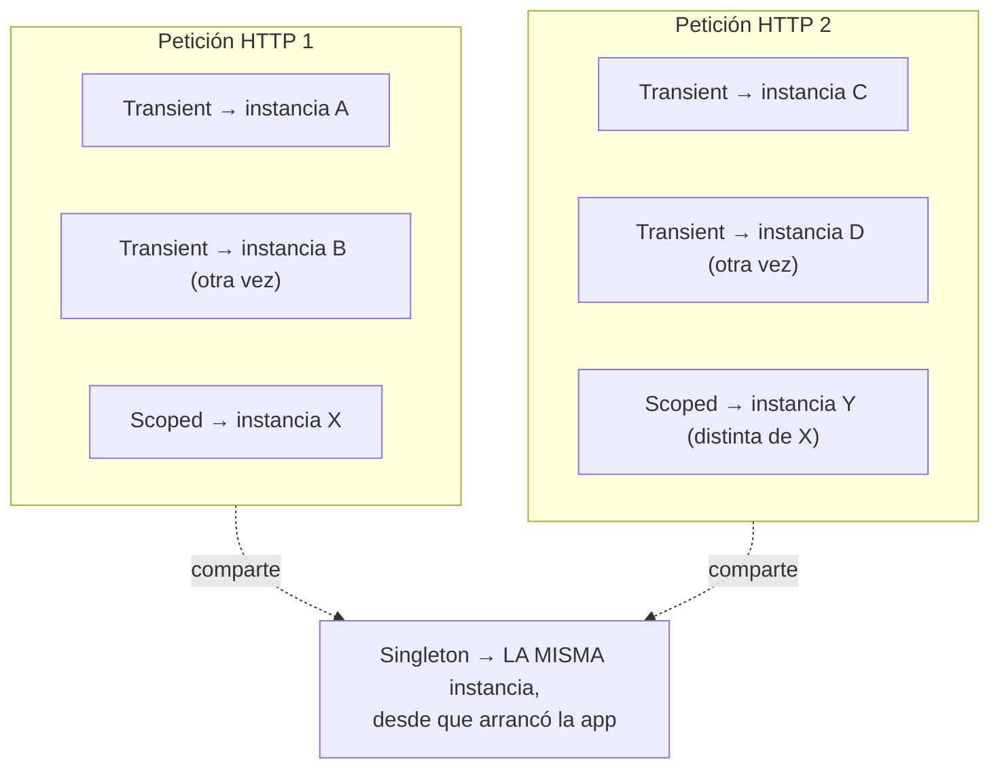
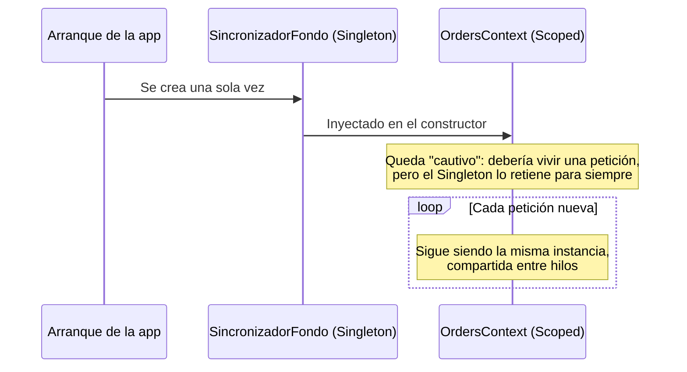

# Inyección de dependencias: lifetimes y patrón Options

## En una frase

El contenedor de DI de .NET crea las dependencias por ti, y al registrarlas decides **cuánto vive cada instancia** (Transient, Scoped o Singleton); elegir mal el lifetime produce bugs que solo aparecen bajo carga, y el patrón Options aplica la misma idea a la configuración: tipada, validada al arrancar e inyectada.

-----

## Antes de empezar

Conviene que ya sepas:

* El principio de inversión de dependencias y la inyección por constructor: [SOLID y patrones](01-solid-y-patrones.md).
* Cómo se configura `appsettings.json`: [Interpretación de logs](../01-autonomia-resolucion-problemas/03-interpretacion-de-logs.md).

Palabras nuevas (también están en el [Glosario](Glosario.md)):

* **Contenedor de DI:** componente que registra qué implementación corresponde a cada abstracción y crea las instancias cuando alguien las pide.
* **Lifetime:** cuánto vive una instancia creada por el contenedor.
* **Transient:** una instancia nueva cada vez que se pide.
* **Scoped:** una instancia por scope; en ASP.NET Core, una por petición HTTP.
* **Singleton (lifetime):** una sola instancia para toda la vida de la aplicación.
* **Scope:** período de vida acotado dentro del cual se comparten las instancias Scoped.
* **Dependencia cautiva (*captive dependency*):** dependencia de vida corta atrapada dentro de un servicio de vida más larga.
* **Patrón Options:** leer una sección de configuración como una clase tipada, inyectada con `IOptions<T>`.
* **Binding:** asignar automáticamente los valores de la configuración a las propiedades de una clase.

-----

## El problema

Una API tiene un servicio que sincroniza pedidos con un ERP:

```csharp
builder.Services.AddDbContext<OrdersContext>(o => o.UseSqlServer(connectionString));
builder.Services.AddSingleton<SincronizadorErp>();

public class SincronizadorErp(OrdersContext db, IConfiguration config)
{
    private readonly string _url = config["Erp:Url"]!;
    private readonly int _timeout = int.Parse(config["Erp:TimeOut"]!);

    public async Task SincronizarAsync()
    {
        var pendientes = await db.Orders.Where(o => !o.Sincronizado).ToListAsync();
        // ... llamar al ERP con _url y _timeout
    }
}
```

En local funciona. En producción, bajo carga:

```text
System.InvalidOperationException: A second operation was started on this context
instance before a previous operation completed.
```

Y en otro ambiente, la aplicación arranca bien pero falla una hora después, la primera vez que alguien sincroniza:

```text
System.ArgumentNullException: Value cannot be null. (Parameter 's')
   at System.Int32.Parse(String s)
```

Las consecuencias:

* un `DbContext` pensado para una petición quedó atrapado en un Singleton y compartido entre hilos;
* la configuración se lee con strings sueltos: `"Erp:TimeOut"` tiene un error de tipeo (la clave es `"Erp:Timeout"`) y nadie lo detectó;
* el error de configuración aparece en producción, una hora después del despliegue, en lugar de al arrancar.

-----

## Cómo funciona

### 1. Los 3 lifetimes

Al registrar un servicio (`builder.Services.Add...`) decides cuánto vive cada instancia, eligiendo entre `AddTransient`, `AddScoped` o `AddSingleton`. Un servicio que no se registra no "cae" en un lifetime por defecto: falla al resolverse.

| Lifetime | Instancias | Ejemplo típico |
| --- | --- | --- |
| **Transient** | Una nueva **cada vez** que algo la pide, incluso dentro de la misma petición | Servicios livianos y sin estado, como un validador |
| **Scoped** | Una por **petición HTTP**, compartida por todo lo que se resuelve en esa petición | `DbContext`, repositorios, unidad de trabajo |
| **Singleton** | Una para **toda la vida de la aplicación**, compartida por todas las peticiones | Caché en memoria, `HttpClient` configurado, configuración |

```csharp
builder.Services.AddTransient<IEmailSender, EmailSender>();
builder.Services.AddScoped<IOrderRepository, OrderRepository>();
builder.Services.AddSingleton<ICacheService, CacheService>();
```



El ejemplo más importante de Scoped es **el `DbContext`**. `AddDbContext<OrdersContext>(...)` lo registra como Scoped por defecto: hace falta la **misma** instancia durante toda la petición (para que el seguimiento de cambios de EF Core funcione), pero no se debe compartir entre peticiones de usuarios distintos.

> **Ojo con el Singleton:** nunca debería tener estado mutable compartido sin control. Si un Singleton tiene un campo que cambia (`public int Contador;`) y un usuario lo modifica, **todos** los demás ven ese cambio, porque es literalmente el mismo objeto. Es una fuente clásica de bugs bajo carga concurrente (ver el Singleton clásico en [SOLID y patrones](01-solid-y-patrones.md)).

> **Ojo en consola:** en una aplicación sin ASP.NET Core, un servicio Scoped que se resuelve directamente desde el proveedor raíz (sin `CreateScope()`) vive tanto como el proveedor: se comporta como un Singleton. No es que DI "no funcione": la diferencia aparece cuando creas scopes explícitos, o en ASP.NET Core, que crea uno por petición.

### 2. La dependencia cautiva

La regla: **un servicio no puede depender de otro con un lifetime más corto que el suyo.**

| Consumidor ↓ / Dependencia → | Transient | Scoped | Singleton |
| --- | --- | --- | --- |
| **Transient** | ✅ | ✅ | ✅ |
| **Scoped** | ✅ | ✅ | ✅ |
| **Singleton** | ⚠️ (vive tanto como el Singleton) | ❌ dependencia cautiva | ✅ |

```csharp
// Peligroso: un Singleton que vive para siempre atrapa un DbContext Scoped
public class SincronizadorFondo(OrdersContext db)
{
    // ...
}
```



Qué pasa en la práctica:

* El `DbContext` **no es thread-safe**. Si dos peticiones lo usan al mismo tiempo, falla con `A second operation was started on this context instance before a previous operation completed`.
* Su seguimiento de cambios acumula entidades de todas las peticiones: devuelve datos viejos y la memoria crece sin parar.

**La solución: inyectar `IServiceScopeFactory` y crear un scope cada vez que se necesita algo Scoped.**

```csharp
public class SincronizadorFondo(IServiceScopeFactory scopeFactory)
{
    public async Task EjecutarTareaNocturnaAsync()
    {
        // Se crea un scope temporal, se usa y se libera, cada vez
        await using var scope = scopeFactory.CreateAsyncScope();
        var db = scope.ServiceProvider.GetRequiredService<OrdersContext>();

        db.Orders.Add(/* ... */);
        await db.SaveChangesAsync();
        // al salir del using, el scope y su DbContext se liberan
    }
}
```

> **Ojo, ASP.NET Core te avisa, pero solo en Development:** en el entorno `Development` está activo `ValidateScopes`, y la aplicación falla con `Cannot consume scoped service 'OrdersContext' from singleton 'SincronizadorFondo'`. En `Production` esa validación está apagada por defecto, así que el error llega como un bug intermitente bajo carga. Puedes activarla siempre:
>
> ```csharp
> builder.Host.UseDefaultServiceProvider(o =>
> {
>     o.ValidateScopes = true;
>     o.ValidateOnBuild = true; // también verifica al arrancar que todo se pueda resolver
> });
> ```

### 3. Varias implementaciones con `IEnumerable<T>`

Cuando varias clases implementan la misma interfaz, puedes inyectarlas **todas** con `IEnumerable<T>`: el contenedor entrega todo lo registrado contra esa interfaz.

```csharp
public interface INotificadorFactura
{
    void Notificar(string cliente, decimal monto);
}

public class NotificadorEmail : INotificadorFactura
{
    public void Notificar(string cliente, decimal monto) => Console.WriteLine($"Email a {cliente}");
}

public class NotificadorWhatsApp : INotificadorFactura
{
    public void Notificar(string cliente, decimal monto) => Console.WriteLine($"WhatsApp a {cliente}");
}

public class EmisorFacturas(IEnumerable<INotificadorFactura> notificadores)
{
    public void ProcesarVenta(string cliente, decimal monto)
    {
        foreach (var notificador in notificadores)
            notificador.Notificar(cliente, monto);
    }
}
```

```csharp
builder.Services.AddTransient<INotificadorFactura, NotificadorEmail>();
builder.Services.AddTransient<INotificadorFactura, NotificadorWhatsApp>();
```

`EmisorFacturas` no sabe cuántos canales existen. Si mañana se agrega `NotificadorTelegram`, se crea la clase, se registra con una línea y `EmisorFacturas` no se toca: es OCP aplicado a la inyección de dependencias.

> **Ojo:** si en lugar de `IEnumerable<INotificadorFactura>` pides solo `INotificadorFactura`, el contenedor no falla: te entrega **la última** implementación registrada (`NotificadorWhatsApp`). Es fácil de pasar por alto.

### 4. Patrón Options: configuración tipada

Leer la configuración como strings sueltos (`builder.Configuration["Erp:Url"]`) es propenso a errores de tipeo, no tiene autocompletado y es difícil de mantener. El patrón Options convierte una sección del JSON en una clase:

```json
"ApiSettings": {
  "Url": "https://api.com",
  "Timeout": 30
}
```

```csharp
public class ApiSettings
{
    public string Url { get; set; } = string.Empty;
    public int Timeout { get; set; }
}

builder.Services.Configure<ApiSettings>(builder.Configuration.GetSection("ApiSettings"));

public class ClienteApi(IOptions<ApiSettings> opciones)
{
    private readonly ApiSettings _config = opciones.Value;
}
```

.NET hace el binding del JSON a la clase: tienes autocompletado y el compilador detecta los errores en los nombres de las propiedades.

### 5. Las 3 interfaces de Options

| Interfaz | Lifetime | ¿Cuándo se lee el valor? |
| --- | --- | --- |
| `IOptions<T>` | Singleton | Una sola vez. No refleja cambios posteriores en el archivo |
| `IOptionsSnapshot<T>` | Scoped | Una vez por petición: refleja cambios entre peticiones |
| `IOptionsMonitor<T>` | Singleton | En cualquier momento, con el valor actual; tiene `OnChange` para reaccionar a cambios sin reiniciar |

Para la mayoría de los casos (configuración que no cambia en caliente, como la URL de un servicio externo), `IOptions<T>` alcanza.

Esto se conecta directamente con la dependencia cautiva: `IOptionsSnapshot<T>` es Scoped, así que **no** se inyecta en un Singleton. Para un servicio de larga vida que necesita enterarse de los cambios, la herramienta es `IOptionsMonitor<T>`:

```csharp
public class SincronizadorApi(IOptionsMonitor<IntegracionConfig> monitor)
{
    public Task SincronizarAsync()
    {
        var config = monitor.CurrentValue; // siempre el valor actual
        // ... usar config.ServicioWebhookUrl
        return Task.CompletedTask;
    }
}
```

Leer `CurrentValue` en cada uso es más simple y más seguro que guardar una copia y actualizarla en `OnChange`. Si usas `OnChange`, guarda el `IDisposable` que devuelve y libéralo cuando el servicio se descarte.

### 6. Validar la configuración al arrancar

El patrón Options evita errores de tipeo en los nombres, pero no que alguien deje una URL vacía o un timeout negativo: esos valores se asignan igual y el problema explota más tarde, en producción. Se resuelve con Data Annotations, con el mismo espíritu de las [guard clauses](02-arquitectura-y-limites.md): fallar rápido y de forma explícita.

```csharp
public class IntegracionConfig
{
    [Required(ErrorMessage = "La URL del webhook es obligatoria.")]
    [Url(ErrorMessage = "El formato de la URL es inválido.")]
    public string ServicioWebhookUrl { get; set; } = string.Empty;

    [Required]
    public string ApiKey { get; set; } = string.Empty;

    [Range(1, 60, ErrorMessage = "El timeout debe estar entre 1 y 60 segundos.")]
    public int TimeoutSegundos { get; set; }
}
```

```csharp
builder.Services.AddOptions<IntegracionConfig>()
    .Bind(builder.Configuration.GetSection("IntegracionExterna"))
    .ValidateDataAnnotations()
    .ValidateOnStart(); // valida al arrancar, no la primera vez que se usa
```

Con `.ValidateOnStart()`, si el JSON tiene un timeout de `-2` o le falta la URL, la aplicación **se niega a arrancar**:

```text
Microsoft.Extensions.Options.OptionsValidationException:
DataAnnotation validation failed for 'IntegracionConfig' members:
'TimeoutSegundos' with the error: 'El timeout debe estar entre 1 y 60 segundos.'
```

Es mucho mejor que arrancar con datos corruptos y fallar cuando un usuario real llega a esa parte del código.

### 7. DI en otros lenguajes: cambia el mecanismo, no solo la sintaxis

El concepto (recibir dependencias desde afuera en lugar de crearlas adentro) es universal. Lo que cambia es si hay un contenedor formal y cuál es el comportamiento por defecto:

| Plataforma | Contenedor | Lifetime por defecto |
| --- | --- | --- |
| **.NET** | Integrado (`IServiceCollection`) | Ninguno: lo eliges en cada registro |
| **Java (Spring)** | `ApplicationContext` | **Singleton** si no se especifica |
| **TypeScript (NestJS)** | Integrado, con `@Injectable()` y scopes `DEFAULT`, `REQUEST`, `TRANSIENT` | `DEFAULT`, que es **Singleton** |
| **Python (FastAPI)** | `Depends()`, resuelto por parámetro en cada endpoint | Por petición: cada dependencia se resuelve una vez por petición y se cachea dentro de ella |
| **Python (Django)** | Sin DI formal en el núcleo | Se importan o pasan a mano, o se usa una librería aparte |

Antes de aplicar en Spring o NestJS la regla de .NET ("eliges el lifetime en cada registro"), verifica el comportamiento real: ahí el valor por defecto **sí** existe, y es Singleton. Un servicio con estado que en .NET registrarías como Scoped, en Spring es compartido por todas las peticiones si no lo declaras.

-----

## Ejemplo completo

El sincronizador del problema, corregido.

`appsettings.json`:

```json
"Erp": {
  "Url": "https://erp.empresa.com/api",
  "TimeoutSegundos": 30,
  "ApiKey": "se-carga-desde-secretos"
}
```

`ErpOptions.cs`:

```csharp
public class ErpOptions
{
    public const string Seccion = "Erp";

    [Required, Url]
    public string Url { get; set; } = string.Empty;

    [Range(1, 120)]
    public int TimeoutSegundos { get; set; }

    [Required]
    public string ApiKey { get; set; } = string.Empty;
}
```

`SincronizadorErp.cs` (Singleton que crea un scope por ejecución):

```csharp
public class SincronizadorErp(
    IServiceScopeFactory scopeFactory,
    IOptionsMonitor<ErpOptions> opciones,
    ILogger<SincronizadorErp> logger)
{
    public async Task SincronizarAsync(CancellationToken ct)
    {
        var config = opciones.CurrentValue;

        await using var scope = scopeFactory.CreateAsyncScope();
        var db = scope.ServiceProvider.GetRequiredService<OrdersContext>();

        var pendientes = await db.Orders.Where(o => !o.Sincronizado).ToListAsync(ct);
        logger.LogInformation("Sincronizando {Cantidad} pedidos con {Url}", pendientes.Count, config.Url);

        // ... llamar al ERP con config.Url y config.TimeoutSegundos
        await db.SaveChangesAsync(ct);
    }
}
```

`Program.cs`:

```csharp
builder.Services.AddDbContext<OrdersContext>(o => o.UseSqlServer(connectionString));

builder.Services.AddOptions<ErpOptions>()
    .Bind(builder.Configuration.GetSection(ErpOptions.Seccion))
    .ValidateDataAnnotations()
    .ValidateOnStart();

builder.Services.AddSingleton<SincronizadorErp>();

builder.Host.UseDefaultServiceProvider(o =>
{
    o.ValidateScopes = true;
    o.ValidateOnBuild = true;
});
```

Qué observar:

* El `DbContext` ya no está cautivo: cada sincronización crea su scope y lo libera al terminar.
* El error de tipeo `"TimeOut"` ya no puede ocurrir: la propiedad es `TimeoutSegundos` y el compilador la conoce.
* Si falta la URL o el timeout está fuera de rango, la aplicación no arranca: el error aparece en el despliegue, no una hora después.
* `ValidateScopes` y `ValidateOnBuild` activos en todos los ambientes: si alguien vuelve a inyectar el `DbContext` directamente, falla al arrancar.
* `IOptionsMonitor` (y no `IOptionsSnapshot`) porque el consumidor es Singleton.

-----

## Errores comunes

**1. Inyectar un servicio Scoped en un Singleton.**
Qué pasa: `A second operation was started on this context instance`, datos viejos o memoria que crece.
Por qué: la instancia Scoped queda atrapada en el Singleton y se comparte entre peticiones e hilos.
Arreglo: `IServiceScopeFactory` y un scope por operación; activa `ValidateScopes` en todos los ambientes.

**2. Estado mutable en un Singleton.**
Qué pasa: valores que "cambian solos" según qué otro usuario usó el servicio.
Por qué: todas las peticiones comparten el mismo objeto.
Arreglo: Singletons sin estado mutable, o con estructuras thread-safe (`ConcurrentDictionary`) si el estado es necesario.

**3. Resolver un servicio Scoped desde el proveedor raíz.**
Qué pasa: `Cannot resolve scoped service 'X' from root provider` en Development, o un Scoped que se comporta como Singleton en Production.
Por qué: se llama a `app.Services.GetRequiredService<T>()` fuera de cualquier petición, por ejemplo en `Program.cs`.
Arreglo: `using var scope = app.Services.CreateScope();` y resolver desde `scope.ServiceProvider`.

**4. `IOptionsSnapshot<T>` en un Singleton.**
Qué pasa: `Cannot consume scoped service 'IOptionsSnapshot<T>' from singleton`.
Por qué: `IOptionsSnapshot` es Scoped.
Arreglo: en un Singleton, usa `IOptionsMonitor<T>`.

**5. Configuración sin validar.**
Qué pasa: la aplicación arranca bien y falla horas después con un `null` o un valor absurdo.
Por qué: el binding asigna lo que haya en el JSON, aunque sea inválido.
Arreglo: `ValidateDataAnnotations()` + `ValidateOnStart()`.

**6. Esperar una implementación y recibir la última registrada.**
Qué pasa: se registraron dos implementaciones y el servicio siempre usa la segunda.
Por qué: al resolver `T` (no `IEnumerable<T>`), el contenedor devuelve la última registrada.
Arreglo: inyecta `IEnumerable<T>` si quieres todas, o usa servicios con clave (.NET 8) si necesitas una concreta.

-----

## Evolución y versiones

* **ASP.NET Core 1.0 (2016):** contenedor de DI integrado con Transient, Scoped y Singleton, y el patrón Options.
* **.NET Core 2.0 (2017):** `IOptionsSnapshot<T>` y `IOptionsMonitor<T>`; `ValidateScopes` activo en Development.
* **.NET 6 (2021):** `ValidateOnStart()` para validar la configuración al arrancar; `CreateAsyncScope()` para liberar de forma asíncrona.
* **.NET 8 (2023):** servicios con clave (*keyed services*) con `AddKeyedScoped` y `[FromKeyedServices]`; validación de Options con generador de código fuente (`[OptionsValidator]`).

-----

## Cuándo sí y cuándo no

**Usa Transient cuando:** el servicio es liviano y sin estado.

**Usa Scoped cuando:** el servicio debe compartir estado durante una petición, como el `DbContext` o una unidad de trabajo.

**Usa Singleton cuando:** el servicio es costoso de crear y es thread-safe (cachés, clientes configurados), y no depende de nada Scoped.

**No uses el contenedor de DI cuando:** el objeto es un valor del dominio (`Order`, `Money`) o un DTO. Esos se crean con `new`: no son dependencias, son datos.

-----

## Resumen en 5 líneas

1. Transient: una instancia por pedido; Scoped: una por petición; Singleton: una para toda la aplicación.
2. Nunca inyectes algo de vida corta en algo de vida larga: usa `IServiceScopeFactory` en los Singletons.
3. Activa `ValidateScopes` y `ValidateOnBuild` para detectar dependencias cautivas al arrancar, también en producción.
4. Patrón Options: configuración tipada; `IOptions` (fija), `IOptionsSnapshot` (por petición), `IOptionsMonitor` (en vivo, para Singletons).
5. Valida la configuración con `ValidateDataAnnotations()` y `ValidateOnStart()` para fallar al arrancar.

-----

## Para profundizar

<details>
<summary>Servicios con clave (.NET 8)</summary>

Si tienes varias implementaciones de la misma interfaz y necesitas **una en particular**, desde .NET 8 puedes registrarlas con una clave:

```csharp
builder.Services.AddKeyedScoped<IPasarelaPagos, StripePasarela>("stripe");
builder.Services.AddKeyedScoped<IPasarelaPagos, PayPalPasarela>("paypal");

public class CheckoutService([FromKeyedServices("stripe")] IPasarelaPagos pasarela) { }
```

Antes de .NET 8 había que usar una Factory o un diccionario armado a mano.

</details>

<details>
<summary><code>IDisposable</code> y quién libera qué</summary>

El contenedor libera (`Dispose`) los servicios **que él creó** al terminar su lifetime: los Scoped al terminar el scope, los Singleton al apagar la aplicación. Los Transient que implementan `IDisposable` se liberan cuando termina el scope en el que se resolvieron. Si resuelves muchos Transient desechables desde el proveedor raíz, quedan retenidos hasta que se apaga la aplicación: otra forma de memory leak.

Si registras una instancia que tú creaste (`AddSingleton(new MiServicio())`), el contenedor **no** la libera: es tu responsabilidad.

</details>

<details>
<summary>Service Locator: por qué se considera un antipatrón</summary>

Pedirle al contenedor las dependencias desde adentro de una clase (`serviceProvider.GetService<IRepo>()` en lugar de recibirlas por constructor) se llama *Service Locator*. Oculta las dependencias reales de la clase, que ya no se ven en el constructor, y hace las pruebas más difíciles. La excepción razonable es justamente la del Singleton que necesita algo Scoped: ahí se usa `IServiceScopeFactory`, de forma acotada y explícita.

</details>

-----

## En entrevista

### Respuesta corta (junior)

En .NET hay tres lifetimes: Transient crea una instancia nueva cada vez, Scoped una por petición HTTP y Singleton una para toda la aplicación. El `DbContext` se registra como Scoped. Para leer configuración se usa el patrón Options con `IOptions<T>`.

### Respuesta ampliada (semi-senior)

Elijo el lifetime según el estado del servicio: Transient para servicios livianos sin estado, Scoped para lo que comparte estado durante una petición, como el `DbContext`, y Singleton para lo costoso y thread-safe. La regla que no rompo es no inyectar algo de vida más corta en algo de vida más larga: si un Singleton o un `BackgroundService` necesita el `DbContext`, uso `IServiceScopeFactory` y creo un scope por operación. Activo `ValidateScopes` y `ValidateOnBuild` para detectarlo al arrancar. Para la configuración uso el patrón Options con validación al inicio, y elijo entre `IOptions`, `IOptionsSnapshot` e `IOptionsMonitor` según si necesito ver los cambios en caliente y según el lifetime del consumidor.

### Preguntas frecuentes de seguimiento

**1. ¿Qué es una dependencia cautiva?**
Un servicio de vida corta (por ejemplo, Scoped) inyectado en uno de vida más larga (Singleton). Queda atrapado y se comparte entre peticiones. Con el `DbContext` produce errores de concurrencia y datos viejos.

**2. ¿Cómo usas el `DbContext` en un `BackgroundService`?**
Un `BackgroundService` es Singleton, así que inyecto `IServiceScopeFactory` y en cada iteración creo un scope, resuelvo el `DbContext` y lo libero al terminar.

**3. ¿Qué diferencia hay entre `IOptions`, `IOptionsSnapshot` e `IOptionsMonitor`?**
`IOptions` lee una vez y es Singleton. `IOptionsSnapshot` relee por petición y es Scoped. `IOptionsMonitor` es Singleton, siempre da el valor actual y permite reaccionar a cambios.

**4. ¿En Spring también hay que elegir el lifetime siempre?**
No: en Spring el scope por defecto es Singleton. Es una diferencia de comportamiento, no solo de sintaxis.

-----

## Práctica

**Ejercicio 1.** ¿Qué combinaciones son un problema? ¿Por qué?

```csharp
builder.Services.AddSingleton<CacheProductos>();        // depende de IProductoRepository
builder.Services.AddScoped<IProductoRepository, EfProductoRepository>(); // depende del DbContext
builder.Services.AddTransient<CalculadoraPrecios>();    // depende de CacheProductos
builder.Services.AddScoped<CarritoService>();           // depende de IOptionsSnapshot<CarritoOptions>
```

<details>
<summary>Solución</summary>

* **`CacheProductos` (Singleton) → `IProductoRepository` (Scoped): problema.** Es una dependencia cautiva: el repositorio y su `DbContext` quedan atrapados en el Singleton. Solución: `CacheProductos` usa `IServiceScopeFactory` para crear un scope cuando necesita recargar.
* **`CalculadoraPrecios` (Transient) → `CacheProductos` (Singleton): bien.** Algo de vida corta puede depender de algo de vida larga.
* **`CarritoService` (Scoped) → `IOptionsSnapshot` (Scoped): bien.** Mismo lifetime.

</details>

**Ejercicio 2.** ¿Qué tiene de malo este código? Reescríbelo.

```csharp
public class EnviadorEmails(IConfiguration config)
{
    public void Enviar(string destino, string mensaje)
    {
        var host = config["Smtp:Host"];
        var puerto = int.Parse(config["Smtp:Port"]);
        var usarSsl = bool.Parse(config["Smtp:UseSSL"]);
        // ...
    }
}
```

<details>
<summary>Solución</summary>

* Strings sueltos: un error de tipeo en una clave produce un `null` en tiempo de ejecución.
* `int.Parse` y `bool.Parse` en cada envío, sin validación: si falta un valor, falla con el primer email, no al arrancar.
* La clase depende de toda la configuración (`IConfiguration`), no solo de lo que necesita.

```csharp
public class SmtpOptions
{
    [Required] public string Host { get; set; } = string.Empty;
    [Range(1, 65535)] public int Port { get; set; }
    public bool UseSsl { get; set; }
}

public class EnviadorEmails(IOptions<SmtpOptions> opciones)
{
    private readonly SmtpOptions _smtp = opciones.Value;

    public void Enviar(string destino, string mensaje)
    {
        // usa _smtp.Host, _smtp.Port, _smtp.UseSsl
    }
}

builder.Services.AddOptions<SmtpOptions>()
    .Bind(builder.Configuration.GetSection("Smtp"))
    .ValidateDataAnnotations()
    .ValidateOnStart();
```

</details>

-----

## Siguiente lección

[DRY, KISS y YAGNI](07-principios-de-simplicidad.md)
