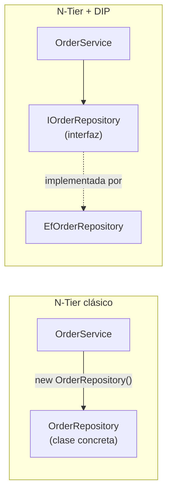

# Arquitectura en capas (N-Tier) en la práctica

## En una frase

N-Tier separa el código en presentación, negocio y datos con dependencias **de arriba hacia abajo**; por sí sola te da organización, pero la testabilidad, los DTOs, el manejo de errores y el async de punta a punta los tienes que agregar tú con técnicas concretas.

-----

## Antes de empezar

Conviene que ya sepas:

* La regla de dependencia y los límites entre capas: [Arquitectura y límites entre capas](02-arquitectura-y-limites.md).
* El principio de inversión de dependencias y los lifetimes: [SOLID y patrones](01-solid-y-patrones.md) e [Inyección de dependencias](06-inyeccion-de-dependencias.md).

Palabras nuevas (también están en el [Glosario](Glosario.md)):

* **N-Tier (arquitectura en capas):** organización del código en capas horizontales donde cada una solo usa a la de abajo.
* **BLL (*Business Logic Layer*):** la capa de lógica de negocio.
* **DAL (*Data Access Layer*):** la capa de acceso a datos.
* **DTO (*Data Transfer Object*):** objeto pensado solo para transportar datos entre capas o hacia afuera, sin lógica.
* **Excepción de negocio:** excepción propia que representa la violación de una regla de negocio.
* **Patrón Result:** devolver un objeto con el éxito o los errores de una operación, en lugar de lanzar una excepción.
* **Repositorio genérico:** un único repositorio `IRepository<T>` reutilizado para todas las entidades.
* **Unidad de trabajo (*Unit of Work*):** agrupar varios cambios para confirmarlos juntos, todos o ninguno.
* **Thread pool:** conjunto de hilos que .NET reutiliza para atender trabajo, como las peticiones HTTP.

-----

## El problema

```csharp
public class OrderService
{
    private readonly OrderRepository _repo = new();           // la BLL crea la DAL
    private readonly IRepository<OrderLine> _lineas = new EfRepository<OrderLine>(new AppDbContext());

    public string Crear(Order pedido)
    {
        if (pedido.Total <= 0) return "Error: el total debe ser mayor a cero";

        _repo.AddAsync(pedido).Wait();                         // bloquea el hilo
        foreach (var linea in pedido.Lineas)
            _lineas.AddAsync(linea).Wait();                    // cada Add hace SaveChanges

        return "OK";
    }

    public List<Order> ObtenerTodos() => _repo.GetAll();       // devuelve la entidad completa
}
```

Las consecuencias:

* no hay forma de probar `OrderService` sin una base de datos real, porque crea sus repositorios con `new`;
* el controller tiene que comparar strings (`if (resultado != "OK")`) y nada le impide ignorar el error;
* si falla la tercera línea del pedido, el pedido y las dos primeras líneas **ya quedaron guardados**: datos inconsistentes;
* la API devuelve `CostoInterno` y las columnas de auditoría a cualquier cliente;
* bajo carga, los `.Wait()` agotan el thread pool y **todas** las peticiones se vuelven lentas, no solo esta.

-----

## Cómo funciona

### 1. El matiz: "conocer una capa" no es todo o nada

Es común leer: "la capa de negocio no sabe si los datos se guardan en SQL Server, Oracle o un archivo de texto: no conoce el acceso a datos". Y unas líneas después: "la lógica de negocio conoce y llama al acceso a datos". Tal como se presentan, se contradicen. El matiz está en **qué** se conoce:

| | Qué conoce la BLL | Qué no conoce |
| --- | --- | --- |
| **N-Tier clásico** | El **tipo concreto** de la DAL (`new OrderRepository()`) | Los detalles internos: cadena de conexión, motor, SQL |
| **N-Tier + DIP** | Solo una **interfaz** (`IOrderRepository`) | Ni siquiera qué clase la implementa |



En el primer caso, probar `OrderService` sin base de datos es imposible: el objeto concreto se crea adentro. En el segundo, una prueba inyecta una implementación falsa de `IOrderRepository`.

**N-Tier por sí sola te da organización y una dirección de dependencia clara, de arriba hacia abajo.** No te da testabilidad ni intercambiabilidad: eso lo agrega el principio de inversión de dependencias, no la arquitectura en capas. A nivel de sistema completo, el estilo se ve en [Cliente-servidor y arquitectura en capas](../11-arquitectura-de-sistemas-y-estilos-arquitectonicos/02-cliente-servidor-y-arquitectura-en-capas.md).

### 2. DTO: la entidad interna no es lo que se expone

Un error común es que la presentación reciba la entidad completa, con campos que no debería ver (datos internos, columnas de auditoría, relaciones de EF Core). Un **DTO** es un objeto más chico, pensado para lo que el consumidor necesita.

```csharp
// Entidad interna: tiene campos que no le importan a la UI
public class Order
{
    public int Id { get; set; }
    public string CustomerName { get; set; } = string.Empty;
    public decimal Total { get; set; }
    public decimal CostoInterno { get; set; } // nunca debería salir de la BLL
}

// DTO: solo lo que la presentación necesita
public record OrderSummaryDto(int Id, string CustomerName, decimal Total);

public class OrderService(IOrderRepository repository)
{
    public async Task<List<OrderSummaryDto>> ObtenerResumenAsync()
    {
        var pedidos = await repository.GetAllAsync();

        // el mapeo ocurre en la BLL, no en la presentación
        return pedidos
            .Select(p => new OrderSummaryDto(p.Id, p.CustomerName, p.Total))
            .ToList();
    }
}
```

> **Ojo con dónde se formatea:** es tentador mapear `Total` a un string `"S/ 120.00"` en la BLL. Pero el formato (moneda, decimales, idioma) es responsabilidad de la presentación: si mañana hay una app móvil en otro país, la BLL no debería cambiar. Devuelve el `decimal` y formatéalo arriba.

No es una idea exclusiva de N-Tier: es lo mismo que hace un controller REST al devolver un DTO en lugar de la entidad de EF Core (ver [Diseño de APIs](../03-diseno-de-apis-y-contratos/)). La idea de fondo es no exponer nunca la forma interna de los datos tal cual, sobre todo si incluye datos sensibles.

### 3. Excepciones de negocio, con una advertencia

En lugar de devolver un `string` con el error, se define una excepción propia y se lanza:

```csharp
public class ReglaNegocioException(string mensaje) : Exception(mensaje);

public class OrderService
{
    public void ValidarPedido(Order pedido)
    {
        if (pedido.Total <= 0)
            throw new ReglaNegocioException("El total del pedido debe ser mayor a cero.");
    }
}
```

Ventajas frente a devolver un string:

* quien llama **no puede ignorar el error en silencio**: un string se puede no revisar; una excepción no manejada interrumpe la ejecución;
* se puede atrapar por tipo (`catch (ReglaNegocioException ex)`) sin atrapar cualquier otro error inesperado.

Se conecta con el mecanismo de excepciones de la [fase 1](../01-autonomia-resolucion-problemas/04-stack-traces.md), y con **Problem Details** de la fase 3 (RFC 9457, que reemplazó a RFC 7807 en 2023): un manejador global que traduce `ReglaNegocioException` a una respuesta `422` o `400` con formato estándar es la versión "de API" de este patrón.

**La advertencia:** usar excepciones para **cada** validación (incluidas las que pasan todo el tiempo, como un formulario con un campo vacío) es un trade-off, no una verdad absoluta:

| | Excepciones | Patrón Result |
| --- | --- | --- |
| Forma | `throw new ReglaNegocioException(...)` | `return Result.Fail("...")` |
| Ventaja | No se puede ignorar; el código del camino feliz queda limpio | Explícito en la firma; sin costo de construir un stack trace |
| Desventaja | Costo de rendimiento; mezcla lo esperado con lo excepcional | Quien llama tiene que revisar el resultado en cada paso |
| Ideal para | Lo **inesperado**: la base de datos no responde, un estado imposible | Lo **esperado y frecuente**: validaciones de entrada del usuario |

Ninguna es "la correcta" de forma universal (ver [trade-offs](../01-autonomia-resolucion-problemas/05-que-son-los-tradeoffs.md)). Lo importante es que el equipo elija un criterio y sea consistente.

### 4. Repositorio genérico: cuidado con la sobreabstracción

Para no repetir `Insertar` y `ObtenerTodos` en un repositorio por cada entidad, se puede definir un contrato genérico:

```csharp
public interface IRepository<T> where T : class
{
    Task<T?> GetByIdAsync(int id);
    void Add(T entidad);
}

public class EfRepository<T>(AppDbContext context) : IRepository<T> where T : class
{
    public Task<T?> GetByIdAsync(int id) => context.Set<T>().FindAsync(id).AsTask();

    public void Add(T entidad) => context.Set<T>().Add(entidad);
}
```

Es DRY (ver [DRY, KISS y YAGNI](07-principios-de-simplicidad.md)) aplicado al acceso a datos, y funciona para CRUD simple. Pero hay una **crítica real y conocida** en la comunidad .NET:

* Un repositorio genérico sobre EF Core termina siendo una versión **más pobre** del `DbContext`. EF Core ya sabe hacer `Include()`, proyecciones LINQ complejas y transacciones que tocan varias entidades. Un `IRepository<T>` no puede exponer todo eso sin volverse tan complejo como EF Core, o sin filtrar `IQueryable<T>` hacia afuera, que rompe el propósito de esconder EF Core.
* Es la misma discusión de [SOLID y patrones](01-solid-y-patrones.md) sobre envolver un `DbContext` en otro repositorio, multiplicada por todo el sistema.

Si lo usas mal:

```csharp
public async Task AddAsync(T entidad)
{
    context.Set<T>().Add(entidad);
    await context.SaveChangesAsync(); // guarda en cada Add
}
```

Si cada `Add` llama a `SaveChangesAsync`, **se rompe la unidad de trabajo**: guardar un pedido con cinco líneas son seis viajes a la base y seis transacciones separadas. Si falla la cuarta línea, las anteriores ya quedaron guardadas. `SaveChanges` debe llamarse **una vez**, al final de la operación de negocio, por quien la orquesta (el servicio o una unidad de trabajo), no por el repositorio.

**Cuándo sí conviene:** entidades realmente simples, sin consultas propias, o cuando la fuente de datos no es EF Core (una API externa, archivos) y sí hay código que compartir entre entidades.

### 5. Async de punta a punta

Si el controller es `async` pero en algún punto intermedio alguien llama a `.Result` o `.Wait()` en lugar de `await`, el hilo queda **bloqueado** esperando. Se pierde la ventaja de la asincronía, y bajo carga el **thread pool se agota**: afecta a **todas** las peticiones, no solo a esa.

```text
Controller (async)  →  Service (.Wait())  →  Repository (async)
                            ▲
                    el hilo queda bloqueado aquí
```

La regla: si la DAL expone `async Task`, la BLL que la llama también es `async Task` y usa `await`, y así hasta el controller. Cortar la cadena con `.Result`, `.Wait()` o un método síncrono que envuelve uno asíncrono es un antipatrón, no un detalle de estilo:

| Contexto | Qué pasa con `.Result` / `.Wait()` |
| --- | --- |
| ASP.NET Core | No hay `SynchronizationContext`, así que no hay deadlock, pero sí **agotamiento del thread pool** bajo carga |
| WinForms, WPF, ASP.NET clásico | Hay `SynchronizationContext`: puede producir un **deadlock** |

-----

## Ejemplo completo

El `OrderService` del problema, corregido.

`Dal/IOrderRepository.cs`:

```csharp
public interface IOrderRepository
{
    void Add(Order pedido);
    Task<List<Order>> GetAllAsync(CancellationToken ct);
}

public interface IUnitOfWork
{
    Task SaveChangesAsync(CancellationToken ct);
}
```

`Dal/EfOrderRepository.cs` (EF Core ya es la unidad de trabajo):

```csharp
public class EfOrderRepository(AppDbContext db) : IOrderRepository, IUnitOfWork
{
    public void Add(Order pedido) => db.Orders.Add(pedido); // las líneas se agregan con el pedido

    public Task<List<Order>> GetAllAsync(CancellationToken ct) =>
        db.Orders.AsNoTracking().ToListAsync(ct);

    public Task SaveChangesAsync(CancellationToken ct) => db.SaveChangesAsync(ct);
}
```

`Bll/OrderService.cs`:

```csharp
public record CrearPedidoDto(string CustomerName, List<LineaDto> Lineas);
public record LineaDto(int ProductoId, int Cantidad, decimal Precio);
public record OrderSummaryDto(int Id, string CustomerName, decimal Total);

public class OrderService(IOrderRepository repositorio, IUnitOfWork unidadDeTrabajo)
{
    public async Task<int> CrearAsync(CrearPedidoDto dto, CancellationToken ct)
    {
        var pedido = new Order(dto.CustomerName,
            dto.Lineas.Select(l => new OrderLine(l.ProductoId, l.Cantidad, l.Precio)));

        if (pedido.Total <= 0)
            throw new ReglaNegocioException("El total del pedido debe ser mayor a cero.");

        repositorio.Add(pedido);
        await unidadDeTrabajo.SaveChangesAsync(ct); // una sola vez: pedido y líneas juntos

        return pedido.Id;
    }

    public async Task<List<OrderSummaryDto>> ObtenerResumenAsync(CancellationToken ct)
    {
        var pedidos = await repositorio.GetAllAsync(ct);
        return pedidos.Select(p => new OrderSummaryDto(p.Id, p.CustomerName, p.Total)).ToList();
    }
}
```

`Presentacion/PedidosController.cs`:

```csharp
[ApiController]
[Route("api/pedidos")]
public class PedidosController(OrderService service) : ControllerBase
{
    [HttpPost]
    public async Task<IActionResult> Crear(CrearPedidoDto dto, CancellationToken ct)
    {
        var id = await service.CrearAsync(dto, ct);
        return CreatedAtAction(nameof(Listar), new { id }, null);
    }

    [HttpGet]
    public Task<List<OrderSummaryDto>> Listar(CancellationToken ct) => service.ObtenerResumenAsync(ct);
}
```

`Program.cs`:

```csharp
builder.Services.AddScoped<EfOrderRepository>();
builder.Services.AddScoped<IOrderRepository>(sp => sp.GetRequiredService<EfOrderRepository>());
builder.Services.AddScoped<IUnitOfWork>(sp => sp.GetRequiredService<EfOrderRepository>());
builder.Services.AddScoped<OrderService>();
```

Qué observar:

* `OrderService` se prueba con dobles de `IOrderRepository` e `IUnitOfWork`, sin base de datos.
* Un solo `SaveChangesAsync`: si algo falla, no se guarda ni el pedido ni ninguna línea.
* La API devuelve `OrderSummaryDto`: `CostoInterno` nunca sale de la BLL.
* `async`/`await` desde el controller hasta EF Core, con `CancellationToken`: si el cliente cancela la petición, la consulta también se cancela.
* `IOrderRepository` e `IUnitOfWork` se resuelven a la **misma** instancia Scoped, así comparten el mismo `DbContext`.

-----

## Errores comunes

**1. La BLL crea la DAL con `new`.**
Qué pasa: la lógica de negocio no se puede probar sin una base de datos real.
Por qué: N-Tier clásico, sin inversión de dependencias.
Arreglo: la BLL depende de interfaces y las recibe por constructor.

**2. Devolver la entidad de EF Core desde la API.**
Qué pasa: se exponen datos internos, y aparecen errores de serialización por referencias circulares (`Order.Lineas[0].Order...`).
Por qué: se devuelve lo que ya se tiene a mano.
Arreglo: un DTO por cada respuesta, mapeado en la BLL.

**3. `SaveChanges` dentro del repositorio.**
Qué pasa: operaciones de negocio guardadas a medias cuando algo falla en el medio.
Por qué: cada repositorio confirma sus propios cambios.
Arreglo: un único `SaveChanges` al final de la operación, desde el servicio o una unidad de trabajo.

**4. Errores como strings.**
Qué pasa: `if (resultado == "OK")` en el controller, y errores ignorados.
Por qué: es lo más rápido de escribir.
Arreglo: excepciones de negocio o patrón Result, según el criterio del equipo.

**5. `.Result` o `.Wait()` en el medio de la cadena.**
Qué pasa: bajo carga, toda la API se vuelve lenta; en aplicaciones de escritorio, deadlocks.
Por qué: un método síncrono llama a uno asíncrono.
Arreglo: `async`/`await` de punta a punta.

-----

## Cuándo sí y cuándo no

**Usa N-Tier cuando:** el proyecto es chico o mediano, lo mantiene un solo equipo y la lógica de negocio es moderada. Es simple de entender y de enseñar.

**Agrégale DIP cuando:** quieres probar la lógica de negocio sin base de datos, que es casi siempre.

**Pasa a Clean o Hexagonal cuando:** la lógica de negocio es compleja, tiene que sobrevivir a cambios de framework o de base de datos, o hay muchos puntos de entrada (API, colas, jobs). Ver [Clean Architecture](09-clean-architecture.md).

**No uses un repositorio genérico cuando:** trabajas con EF Core y las entidades tienen consultas propias. Usa el `DbContext` o repositorios específicos por agregado.

-----

## Resumen en 5 líneas

1. N-Tier da organización y dependencias de arriba hacia abajo; la testabilidad la agrega DIP.
2. Los DTOs evitan exponer la entidad interna; el formato de presentación se hace arriba.
3. Excepciones de negocio para lo inesperado, patrón Result para lo esperado: elige un criterio y sé consistente.
4. El repositorio genérico sobre EF Core suele ser un `DbContext` más pobre, y nunca debe llamar a `SaveChanges` en cada operación.
5. `async`/`await` de punta a punta: un `.Result` en el medio agota el thread pool.

-----

## Para profundizar

<details>
<summary>Mapeo manual frente a librerías de mapeo</summary>

Para pasar de entidad a DTO hay dos caminos:

* **Mapeo manual** (`new OrderSummaryDto(p.Id, p.CustomerName, p.Total)`): explícito, rápido, el compilador detecta los errores. Es más código.
* **Librerías** como AutoMapper o Mapster: menos código, pero el mapeo se vuelve "magia" difícil de seguir y los errores aparecen en tiempo de ejecución. Desde 2025, AutoMapper pasó a una licencia comercial para muchos usos, lo que llevó a varios equipos a volver al mapeo manual o a generadores de código fuente como Mapperly.

Para la mayoría de los proyectos, el mapeo manual con métodos de extensión (`pedido.ToSummaryDto()`) es suficiente y más fácil de mantener.

</details>

<details>
<summary>Proyectar directamente a DTO con EF Core</summary>

En lugar de traer la entidad completa y mapearla en memoria, EF Core puede proyectar a DTO en la consulta SQL:

```csharp
db.Orders
    .Select(o => new OrderSummaryDto(o.Id, o.CustomerName, o.Total))
    .ToListAsync(ct);
```

El SQL generado solo pide esas tres columnas. Es más eficiente, pero acopla la consulta al DTO: es un trade-off típico en el lado de lectura, y es una de las ideas de fondo de [CQRS](10-cqrs.md).

</details>

-----

## En entrevista

### Respuesta corta (junior)

N-Tier separa la aplicación en capas: presentación, negocio y acceso a datos. Cada capa solo llama a la de abajo. Uso DTOs para no exponer las entidades y `async`/`await` en todas las capas.

### Respuesta ampliada (semi-senior)

N-Tier por sí sola solo me da organización y una dirección de dependencia hacia abajo. Para poder probar la lógica sin base de datos, la capa de negocio depende de interfaces y las implementaciones se inyectan. Expongo DTOs y no entidades, y el formato de presentación lo resuelve la capa de arriba. Para los errores, uso excepciones de negocio para lo inesperado y el patrón Result cuando el error es esperado y frecuente, según lo que haya acordado el equipo. Con EF Core evito el repositorio genérico porque termina siendo un `DbContext` más pobre, y cuido que `SaveChanges` se llame una sola vez por operación para no romper la unidad de trabajo. Y `async` de punta a punta, porque un `.Result` en el medio agota el thread pool bajo carga.

### Preguntas frecuentes de seguimiento

**1. ¿Qué problema tiene el repositorio genérico con EF Core?**
Que esconde capacidades de EF Core (`Include`, proyecciones, transacciones) o las filtra con `IQueryable`, y muchas implementaciones llaman a `SaveChanges` en cada operación, lo que rompe la unidad de trabajo.

**2. ¿Por qué es malo llamar a `.Result` sobre una `Task`?**
Porque bloquea el hilo mientras espera. En ASP.NET Core agota el thread pool bajo carga; en aplicaciones con `SynchronizationContext` puede producir un deadlock.

**3. ¿Excepciones o patrón Result para validaciones?**
Depende de cuán esperado sea el error. Para validaciones frecuentes de entrada, Result es más explícito y barato; para fallos inesperados, excepciones. Lo importante es la consistencia.

-----

## Práctica

**Ejercicio 1.** Este servicio transfiere saldo entre dos cuentas. ¿Qué problema tiene? ¿Cómo lo corriges?

```csharp
public async Task TransferirAsync(int origenId, int destinoId, decimal monto)
{
    var origen = await _cuentas.GetByIdAsync(origenId);
    var destino = await _cuentas.GetByIdAsync(destinoId);

    origen.Saldo -= monto;
    await _cuentas.UpdateAsync(origen);   // hace SaveChanges

    destino.Saldo += monto;
    await _cuentas.UpdateAsync(destino);  // hace SaveChanges
}
```

<details>
<summary>Solución</summary>

Cada `UpdateAsync` guarda por separado. Si el segundo falla, el dinero **sale** de la cuenta origen y **nunca llega** a la de destino. Además, no valida saldo suficiente ni cuentas inexistentes.

```csharp
public async Task TransferirAsync(int origenId, int destinoId, decimal monto, CancellationToken ct)
{
    var origen = await _cuentas.GetByIdAsync(origenId, ct)
        ?? throw new NotFoundException($"No existe la cuenta {origenId}");
    var destino = await _cuentas.GetByIdAsync(destinoId, ct)
        ?? throw new NotFoundException($"No existe la cuenta {destinoId}");

    origen.Debitar(monto);    // valida saldo suficiente
    destino.Acreditar(monto);

    await _unidadDeTrabajo.SaveChangesAsync(ct); // las dos modificaciones juntas
}
```

</details>

**Ejercicio 2.** ¿Qué tiene de malo este endpoint? Enumera al menos tres problemas.

```csharp
[HttpGet("{id}")]
public Usuario Get(int id)
{
    var usuario = _service.ObtenerAsync(id).Result;
    return usuario;
}
```

`Usuario` tiene `Email`, `PasswordHash`, `FechaUltimoLogin` y `Pedidos` (relación de EF Core).

<details>
<summary>Solución</summary>

* **`.Result`**: bloquea el hilo; bajo carga agota el thread pool.
* **Devuelve la entidad**: expone `PasswordHash` y datos internos, y `Pedidos` puede causar referencias circulares al serializar.
* **No maneja el "no encontrado"**: si `usuario` es `null`, devuelve `200` con cuerpo vacío en lugar de `404`.

```csharp
[HttpGet("{id}")]
public async Task<ActionResult<UsuarioDto>> Get(int id, CancellationToken ct)
{
    var usuario = await _service.ObtenerAsync(id, ct);
    return usuario is null ? NotFound() : usuario.ToDto();
}
```

</details>

-----

## Siguiente lección

[Clean Architecture](09-clean-architecture.md)
