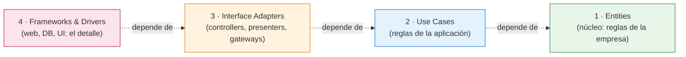
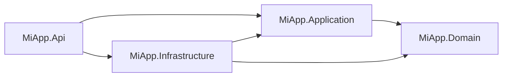

# Clean Architecture

## En una frase

Clean Architecture organiza el sistema en círculos con **una sola regla que importa: el código solo depende hacia adentro**, hacia las reglas de negocio, de modo que la base de datos, el framework web y la UI son detalles reemplazables y el núcleo se prueba sin ninguno de ellos.

-----

## Antes de empezar

Conviene que ya sepas:

* El principio de inversión de dependencias: [SOLID y patrones](01-solid-y-patrones.md).
* Qué aporta y qué no aporta N-Tier: [Arquitectura en capas](08-arquitectura-en-capas-ntier.md).
* Cómo se registran las dependencias: [Inyección de dependencias](06-inyeccion-de-dependencias.md).

Palabras nuevas (también están en el [Glosario](Glosario.md)):

* **Regla de dependencia:** el código fuente solo puede depender hacia adentro; una capa interna no sabe nada de las externas.
* **Entities (entidades):** objetos con las reglas de negocio más generales de la empresa.
* **Use Case (caso de uso):** una operación concreta de la aplicación, como "crear un pedido", que orquesta entidades.
* **Interface Adapters (adaptadores de interfaz):** código que traduce entre el formato del núcleo y el del mundo exterior: controllers, presenters, gateways.
* **Frameworks & Drivers:** la capa más externa: framework web, base de datos, UI.
* **Modelo de dominio anémico:** entidades que solo tienen propiedades públicas, con toda la lógica afuera.
* **Modelo de dominio rico:** entidades que protegen sus propias reglas y solo cambian a través de métodos con significado.
* **Invariante:** condición que siempre debe cumplirse en un objeto, como "el total nunca es negativo".
* **Composition root:** el único lugar donde se conectan las interfaces con sus implementaciones; en ASP.NET Core, `Program.cs`.
* **Fake:** doble de prueba con una implementación simple que funciona de verdad, por ejemplo un repositorio en memoria.

-----

## El problema

Un equipo tiene esta estructura:

```text
MiApp.Domain     → referencia a Microsoft.EntityFrameworkCore
MiApp.Services   → referencia a MiApp.Data
MiApp.Data       → DbContext, repositorios, migraciones
MiApp.Api        → referencia a todo
```

```csharp
// MiApp.Domain
[Table("Orders")]
public class Order
{
    public Guid Id { get; set; }
    public decimal Total { get; set; }
    public virtual ICollection<OrderLine> Lineas { get; set; } = []; // lazy loading de EF
}

// MiApp.Services
public class OrderService(AppDbContext db, SmtpClient smtp)
{
    public async Task CrearAsync(Order order)
    {
        if (order.Total <= 0) throw new ArgumentException("Total inválido");
        db.Orders.Add(order);
        await db.SaveChangesAsync();
        smtp.Send(/* ... */);
    }
}
```

La empresa decide migrar de SQL Server a PostgreSQL y de SMTP a un proveedor de email por API.

Las consecuencias:

* el dominio referencia Entity Framework: la migración toca hasta las entidades;
* no hay forma de probar `CrearAsync` sin una base de datos y un servidor SMTP;
* la validación del total vive en el servicio: otro servicio que cree pedidos (por ejemplo, desde una importación) puede olvidarla;
* tienen cuatro proyectos y aun así todo depende de la infraestructura: la estructura de carpetas no garantizó nada.

-----

## Cómo funciona

### 1. Origen

Robert C. Martin la formalizó en un post de 2012 y en su libro *Clean Architecture* (2017). No es una idea completamente nueva: es una síntesis de propuestas con el mismo objetivo:

| Propuesta | Autor | Año |
| --- | --- | --- |
| Hexagonal (Ports & Adapters) | Alistair Cockburn | 2005 |
| Onion Architecture | Jeffrey Palermo | 2008 |
| Clean Architecture | Robert C. Martin | 2012 |

Las tres resuelven el mismo problema con distinto vocabulario. Conviene saberlo para no memorizar tres nombres como si fueran tres ideas distintas. Las diferencias reales con Hexagonal están en [Arquitectura hexagonal](11-arquitectura-hexagonal.md).

### 2. La regla de dependencia

Clean Architecture se dibuja con círculos concéntricos, pero el dibujo es secundario. Lo que importa es una regla:

> El código fuente solo puede depender **hacia adentro**. Una capa interna no puede saber nada (ni un `using`) de una capa externa.

Es el principio de inversión de dependencias aplicado a toda la arquitectura, no solo entre dos clases.

### 3. Las 4 capas



| # | Capa | Qué contiene | Qué conoce |
| --- | --- | --- | --- |
| 1 | **Entities** | Las reglas de negocio más generales: objetos de dominio puros | Nada externo |
| 2 | **Use Cases** | Las reglas de la aplicación: orquestan entidades para un caso de uso ("crear un pedido", "cancelar una reserva") y definen las interfaces que necesitan | Entities |
| 3 | **Interface Adapters** | Traducen entre el formato del núcleo y el del exterior: controllers, presenters, implementaciones de repositorios | Use Cases y Entities |
| 4 | **Frameworks & Drivers** | El framework web, la base de datos concreta, la UI | Todo lo de adentro |

La capa 1 nunca sabe que existen las capas 2, 3 o 4: son las externas las que dependen de las internas. El negocio no debería temblar si mañana cambias de SQL Server a PostgreSQL o de ASP.NET Core a otro framework.

### 4. Modelo de dominio rico frente a anémico

Un error frecuente en la capa de Entities: clases que son solo "bolsas de propiedades" con `get; set;` públicos, y toda la validación y la lógica movidas afuera. Es el **modelo de dominio anémico**, un término que Martin Fowler acuñó en 2003 para señalarlo como antipatrón, no como una alternativa neutral.

```csharp
// Modelo anémico: la entidad no protege nada
public class Order
{
    public Guid Id { get; set; }
    public decimal Total { get; set; } // nada impide asignar un total negativo
}

// La validación queda suelta en el caso de uso, y otro caso de uso la puede olvidar
public class CreateOrderUseCase
{
    public void Execute(Order order)
    {
        if (order.Total <= 0) throw new ArgumentException("Total inválido");
        // ...
    }
}
```

Un **modelo de dominio rico** hace lo contrario: la entidad protege sus propias **invariantes**. Las propiedades son de solo lectura desde afuera (`private set`), y el constructor y los métodos con significado son la única forma de cambiar su estado.

```csharp
// Modelo rico: la entidad se protege a sí misma, la use quien la use
public class Order
{
    public Guid Id { get; private set; }
    public decimal Total { get; private set; }

    public Order(decimal total)
    {
        ArgumentOutOfRangeException.ThrowIfNegativeOrZero(total);

        Id = Guid.NewGuid();
        Total = total;
    }

    public void AplicarDescuento(decimal porcentaje)
    {
        if (porcentaje is <= 0 or >= 1)
            throw new ArgumentOutOfRangeException(nameof(porcentaje), "El descuento debe estar entre 0 y 1.");

        Total -= Total * porcentaje;
    }

    private Order() { } // para EF Core
}
```

Con este diseño, ningún caso de uso puede construir un `Order` con total inválido ni dejarlo en ese estado, sin importar desde dónde se cree. La validación no se repite: vive en un solo lugar.

> **Ojo:** "imposible que exista un `Order` inválido" vale para el código que usa la API pública de la clase. EF Core, los serializadores y la reflexión pueden crear instancias sin pasar por tu constructor (por eso existe el `private Order()`). Las invariantes protegen la lógica de negocio; los datos que ya están en la base se protegen con restricciones de la base de datos.

### 5. Cómo se ve en un proyecto .NET

La forma más común es un proyecto por capa:

```text
MiApp.Domain          → Entities (sin referencias a nada externo)
MiApp.Application     → Use Cases + interfaces (IOrderRepository, IEmailSender)
MiApp.Infrastructure  → Implementaciones concretas (EF Core, email, APIs externas)
MiApp.Api             → Controllers, Program.cs (composition root)
```



La clave está en la dirección de las referencias entre proyectos: `Infrastructure` referencia a `Application` (para implementar sus interfaces), pero `Application` **nunca** referencia a `Infrastructure`. Si ves un `using MiApp.Infrastructure` dentro de `MiApp.Application`, la regla de dependencia ya se rompió. Con proyectos separados, el compilador lo impide.

> En la práctica, .NET junta las capas 3 y 4 de Uncle Bob en `Infrastructure` (implementaciones) y `Api` (controllers). No es una violación: la regla de dependencia se sigue cumpliendo.

La interfaz vive en la capa interna:

```csharp
// MiApp.Application
public interface IOrderRepository
{
    Task<Order?> GetByIdAsync(Guid id, CancellationToken ct);
    Task SaveAsync(Order order, CancellationToken ct);
}

public class CreateOrderUseCase(IOrderRepository repository)
{
    public async Task<Guid> ExecuteAsync(decimal total, CancellationToken ct)
    {
        var order = new Order(total); // el dominio valida al construir
        await repository.SaveAsync(order, ct);
        return order.Id;
    }
}
```

El detalle vive afuera:

```csharp
// MiApp.Infrastructure
public class EfOrderRepository(AppDbContext context) : IOrderRepository
{
    public Task<Order?> GetByIdAsync(Guid id, CancellationToken ct) =>
        context.Orders.FindAsync([id], ct).AsTask();

    public async Task SaveAsync(Order order, CancellationToken ct)
    {
        context.Orders.Add(order);
        await context.SaveChangesAsync(ct);
    }
}
```

Y la conexión se arma en el **composition root**:

```csharp
// MiApp.Api/Program.cs
builder.Services.AddScoped<IOrderRepository, EfOrderRepository>();
builder.Services.AddScoped<CreateOrderUseCase>();
```

### 6. La prueba real del desacople: un fake en lugar de una base de datos

La forma más concreta de comprobar que la regla de dependencia se cumple: ¿puedes probar `CreateOrderUseCase` sin levantar SQL Server? Si la respuesta es sí, la arquitectura está haciendo su trabajo.

```csharp
// Un fake: cumple la interfaz con una implementación en memoria
public class FakeOrderRepository : IOrderRepository
{
    public List<Order> Guardados { get; } = [];

    public Task<Order?> GetByIdAsync(Guid id, CancellationToken ct) =>
        Task.FromResult(Guardados.FirstOrDefault(o => o.Id == id));

    public Task SaveAsync(Order order, CancellationToken ct)
    {
        Guardados.Add(order);
        return Task.CompletedTask;
    }
}

public class CreateOrderUseCaseTests
{
    [Fact]
    public async Task ExecuteAsync_TotalValido_GuardaElPedido()
    {
        var repo = new FakeOrderRepository();
        var useCase = new CreateOrderUseCase(repo);

        var id = await useCase.ExecuteAsync(150m, CancellationToken.None);

        Assert.Single(repo.Guardados);
        Assert.Equal(id, repo.Guardados[0].Id);
    }

    [Fact]
    public async Task ExecuteAsync_TotalInvalido_NoGuardaNada()
    {
        var repo = new FakeOrderRepository();
        var useCase = new CreateOrderUseCase(repo);

        await Assert.ThrowsAsync<ArgumentOutOfRangeException>(
            () => useCase.ExecuteAsync(-100m, CancellationToken.None));

        Assert.Empty(repo.Guardados);
    }
}
```

Esto corre en milisegundos, sin red, sin disco y sin una base de datos configurada en la máquina que ejecuta la prueba: el mismo argumento de reemplazar los límites externos de [Estrategia de testing](03-estrategia-de-testing.md).

Si lo usas mal:

```csharp
await Assert.ThrowsAsync<ArgumentOutOfRangeException>(
    () => useCase.ExecuteAsync(new Order(-100m)));
```

Si el caso de uso recibe un `Order` ya construido, la excepción la lanza `new Order(-100m)` **antes** de llamar al caso de uso. La prueba pasa, pero lo que prueba es el constructor de `Order`, no el caso de uso: con un nombre que dice otra cosa, es una prueba engañosa.

### 7. El punto real de todo esto

No es "tener cuatro proyectos": puedes violar la regla de dependencia con cuatro proyectos igual de fácil que con uno, como en el problema. El punto es que:

* las reglas de negocio (`Order`, `CreateOrderUseCase`) se prueben con pruebas unitarias, sin base de datos;
* un cambio de infraestructura (de EF Core a Dapper, de SQL Server a PostgreSQL) no obligue a tocar una sola línea de `Application` ni de `Domain`.

-----

## Ejemplo completo

La migración del problema, con la regla de dependencia cumplida.

`MiApp.Domain/Order.cs`:

```csharp
public class Order
{
    private readonly List<OrderLine> _lineas = [];

    public Guid Id { get; private set; }
    public string EmailCliente { get; private set; } = string.Empty;
    public IReadOnlyList<OrderLine> Lineas => _lineas;
    public decimal Total => _lineas.Sum(l => l.Subtotal);

    public Order(string emailCliente, IEnumerable<OrderLine> lineas)
    {
        ArgumentException.ThrowIfNullOrWhiteSpace(emailCliente);
        _lineas.AddRange(lineas);
        if (_lineas.Count == 0)
            throw new ArgumentException("Un pedido necesita al menos una línea.", nameof(lineas));

        Id = Guid.NewGuid();
        EmailCliente = emailCliente;
    }

    private Order() { } // EF Core
}
```

`MiApp.Application/CreateOrderUseCase.cs`:

```csharp
public interface IEmailSender
{
    Task EnviarConfirmacionAsync(string email, Guid pedidoId, CancellationToken ct);
}

public record CreateOrderCommand(string EmailCliente, List<(int ProductoId, int Cantidad, decimal Precio)> Lineas);

public class CreateOrderUseCase(IOrderRepository repositorio, IEmailSender email)
{
    public async Task<Guid> ExecuteAsync(CreateOrderCommand cmd, CancellationToken ct)
    {
        var order = new Order(cmd.EmailCliente,
            cmd.Lineas.Select(l => new OrderLine(l.ProductoId, l.Cantidad, l.Precio)));

        await repositorio.SaveAsync(order, ct);
        await email.EnviarConfirmacionAsync(order.EmailCliente, order.Id, ct);

        return order.Id;
    }
}
```

`MiApp.Infrastructure` (lo único que cambia con la migración):

```csharp
// antes: options.UseSqlServer(...)
services.AddDbContext<AppDbContext>(o => o.UseNpgsql(configuration.GetConnectionString("Pedidos")));

// antes: SmtpEmailSender
services.AddScoped<IEmailSender, ProveedorApiEmailSender>();

public class OrderConfiguration : IEntityTypeConfiguration<Order>
{
    public void Configure(EntityTypeBuilder<Order> b)
    {
        b.ToTable("orders");
        b.HasKey(o => o.Id);
        b.Ignore(o => o.Total); // calculado en el dominio
        b.HasMany(o => o.Lineas).WithOne().HasForeignKey("OrderId");
        b.Navigation(o => o.Lineas).UsePropertyAccessMode(PropertyAccessMode.Field);
    }
}
```

Qué observar:

* La migración a PostgreSQL y al nuevo proveedor de email solo tocó `MiApp.Infrastructure`. `Domain` y `Application` no cambiaron.
* El dominio no tiene atributos de EF: el mapeo, incluido el acceso al campo privado `_lineas`, está en `OrderConfiguration`.
* La regla "al menos una línea" está en el constructor: la importación de pedidos tampoco puede evitarla.
* `CreateOrderUseCase` se prueba con un `FakeOrderRepository` y un `FakeEmailSender`.

-----

## Errores comunes

**1. Creer que los proyectos garantizan la arquitectura.**
Qué pasa: cuatro proyectos y el dominio referencia a EF Core.
Por qué: se copia la estructura de carpetas sin respetar la dirección de las referencias.
Arreglo: revisa las referencias entre proyectos y agrega pruebas de arquitectura (NetArchTest).

**2. Modelo anémico.**
Qué pasa: la misma validación repetida en varios casos de uso, y alguno la olvida.
Por qué: las entidades se diseñan como tablas, con `get; set;` públicos.
Arreglo: `private set`, constructores que validan y métodos con significado de negocio.

**3. Interfaces definidas en `Infrastructure`.**
Qué pasa: `Application` tiene que referenciar a `Infrastructure` para usar sus propias dependencias.
Por qué: la interfaz se crea "al lado" de su implementación.
Arreglo: las interfaces las define quien las usa (`Application`).

**4. Entidades de dominio en la respuesta de la API.**
Qué pasa: cualquier cambio en el dominio rompe el contrato con los clientes.
Por qué: se devuelve la entidad para "no duplicar".
Arreglo: DTOs en la capa de la API; el dominio cambia sin romper a nadie.

**5. Olvidar `partial` en una de las declaraciones de una clase.**
Qué pasa: `error CS0260: Missing partial modifier on declaration of type 'OrquestadorNodos'; another partial declaration of this type exists`.
Por qué: al dividir una clase en varios archivos, **todas** las declaraciones necesitan `partial`, incluida la original. Pasa seguido al copiar fragmentos de material de estudio que muestran clases "actualizadas" en archivos separados.
Arreglo: agrega `partial` en todas las declaraciones del tipo.

-----

## Cuándo sí y cuándo no

**Usa Clean Architecture cuando:** la lógica de negocio es compleja, tiene que sobrevivir a cambios de framework o de base de datos, hay varios puntos de entrada o la testabilidad del núcleo es prioridad.

**No la uses cuando:** es un CRUD sin reglas de negocio, un prototipo o un servicio chico. Cuatro proyectos y una capa de casos de uso que solo delega al repositorio son costo sin beneficio. Una [arquitectura en capas](08-arquitectura-en-capas-ntier.md) con DIP suele alcanzar.

-----

## Resumen en 5 líneas

1. Una sola regla importa: las dependencias apuntan hacia adentro, hacia el negocio.
2. Entities → Use Cases → Interface Adapters → Frameworks & Drivers; las de afuera conocen a las de adentro, nunca al revés.
3. Modelo rico: las entidades protegen sus invariantes; el anémico es un antipatrón.
4. Las interfaces viven en `Application` y se implementan en `Infrastructure`; se conectan en `Program.cs`.
5. La prueba de que funciona: el núcleo se prueba sin base de datos y un cambio de infraestructura no lo toca.

-----

## Para profundizar

<details>
<summary>Pruebas de arquitectura: que el build haga cumplir la regla</summary>

Con NetArchTest puedes escribir una prueba que falla si alguien rompe la regla de dependencia:

```csharp
[Fact]
public void Domain_NoDependeDeInfraestructura()
{
    var resultado = Types.InAssembly(typeof(Order).Assembly)
        .ShouldNot()
        .HaveDependencyOnAny("Microsoft.EntityFrameworkCore", "MiApp.Infrastructure")
        .GetResult();

    Assert.True(resultado.IsSuccessful);
}
```

Así la regla no depende de la disciplina de cada desarrollador: el pipeline la verifica en cada PR.

</details>

<details>
<summary>Value Objects: invariantes más chicas que una entidad</summary>

No todo concepto del dominio es una entidad con identidad. Un `Email`, un `Dinero` o un `RangoDeFechas` se definen por su valor, no por un `Id`. Modelarlos como *value objects* (en C#, un `record` que valida en su constructor) lleva la idea del modelo rico un paso más allá:

```csharp
public record Email
{
    public string Valor { get; }

    public Email(string valor)
    {
        if (!valor.Contains('@')) throw new ArgumentException("Email inválido", nameof(valor));
        Valor = valor.ToLowerInvariant();
    }
}
```

Ahora `Order` recibe un `Email` en lugar de un `string`, y ningún email inválido puede llegar hasta ahí.

</details>

-----

## En entrevista

### Respuesta corta (junior)

Clean Architecture separa el sistema en capas: entidades, casos de uso, adaptadores e infraestructura. Las capas de adentro, que tienen las reglas de negocio, no dependen de las de afuera, como la base de datos o el framework web.

### Respuesta ampliada (semi-senior)

Lo central es la regla de dependencia: el código solo depende hacia adentro. En .NET lo implemento con proyectos `Domain`, `Application`, `Infrastructure` y `Api`, donde `Application` define las interfaces que necesita y `Infrastructure` las implementa, y conecto todo en `Program.cs`. Uso un modelo de dominio rico para que las entidades protejan sus invariantes en lugar de repetir validaciones en cada caso de uso. Sé que tener cuatro proyectos no garantiza nada: lo que importa es la dirección de las referencias, y la verifico con pruebas de arquitectura. Y no la uso para todo: en un CRUD sin reglas de negocio es costo sin beneficio.

### Preguntas frecuentes de seguimiento

**1. ¿Dónde va la interfaz del repositorio?**
En `Application` (o en `Domain`), es decir, en la capa que la usa. `Infrastructure` la implementa.

**2. ¿Qué es un modelo de dominio anémico?**
Entidades que solo tienen propiedades públicas, con toda la lógica en servicios. Fowler lo describe como antipatrón porque las reglas quedan dispersas y cualquiera puede dejar una entidad en un estado inválido.

**3. ¿Qué diferencia hay entre Clean, Onion y Hexagonal?**
Resuelven el mismo problema (proteger el núcleo de los detalles) con distinto vocabulario. Clean habla de círculos y casos de uso; Hexagonal, de puertos y adaptadores; Onion, de capas concéntricas alrededor del dominio.

**4. ¿Cuándo no usarías Clean Architecture?**
En un CRUD simple, un prototipo o un servicio chico, donde las capas solo delegarían y agregarían indirección.

-----

## Práctica

**Ejercicio 1.** ¿En qué proyecto va cada elemento?

* `IPasarelaPagos`
* `StripePasarelaPagos`
* `Reserva` (con la regla "no se puede cancelar con menos de 24 horas")
* `CancelarReservaUseCase`
* `ReservasController`
* `AppDbContext`

<details>
<summary>Solución</summary>

| Elemento | Proyecto |
| --- | --- |
| `Reserva` | `Domain`: entidad con su regla de negocio |
| `IPasarelaPagos` | `Application`: interfaz que el caso de uso necesita |
| `CancelarReservaUseCase` | `Application` |
| `StripePasarelaPagos` | `Infrastructure`: implementación concreta |
| `AppDbContext` | `Infrastructure` |
| `ReservasController` | `Api` |

</details>

**Ejercicio 2.** Convierte esta entidad anémica en una rica.

```csharp
public class CuentaBancaria
{
    public string Numero { get; set; } = string.Empty;
    public decimal Saldo { get; set; }
}

// en un servicio:
if (monto <= 0) throw new ArgumentException();
if (cuenta.Saldo < monto) throw new InvalidOperationException("Saldo insuficiente");
cuenta.Saldo -= monto;
```

<details>
<summary>Solución</summary>

```csharp
public class CuentaBancaria
{
    public string Numero { get; private set; }
    public decimal Saldo { get; private set; }

    public CuentaBancaria(string numero, decimal saldoInicial = 0)
    {
        ArgumentException.ThrowIfNullOrWhiteSpace(numero);
        ArgumentOutOfRangeException.ThrowIfNegative(saldoInicial);
        Numero = numero;
        Saldo = saldoInicial;
    }

    public void Retirar(decimal monto)
    {
        ArgumentOutOfRangeException.ThrowIfNegativeOrZero(monto);
        if (Saldo < monto)
            throw new InvalidOperationException("Saldo insuficiente");

        Saldo -= monto;
    }

    public void Depositar(decimal monto)
    {
        ArgumentOutOfRangeException.ThrowIfNegativeOrZero(monto);
        Saldo += monto;
    }
}
```

El servicio ahora llama a `cuenta.Retirar(monto)`, y ningún otro servicio puede dejar la cuenta con saldo negativo asignando `Saldo` directamente.

</details>

-----

## Siguiente lección

[CQRS](10-cqrs.md)
