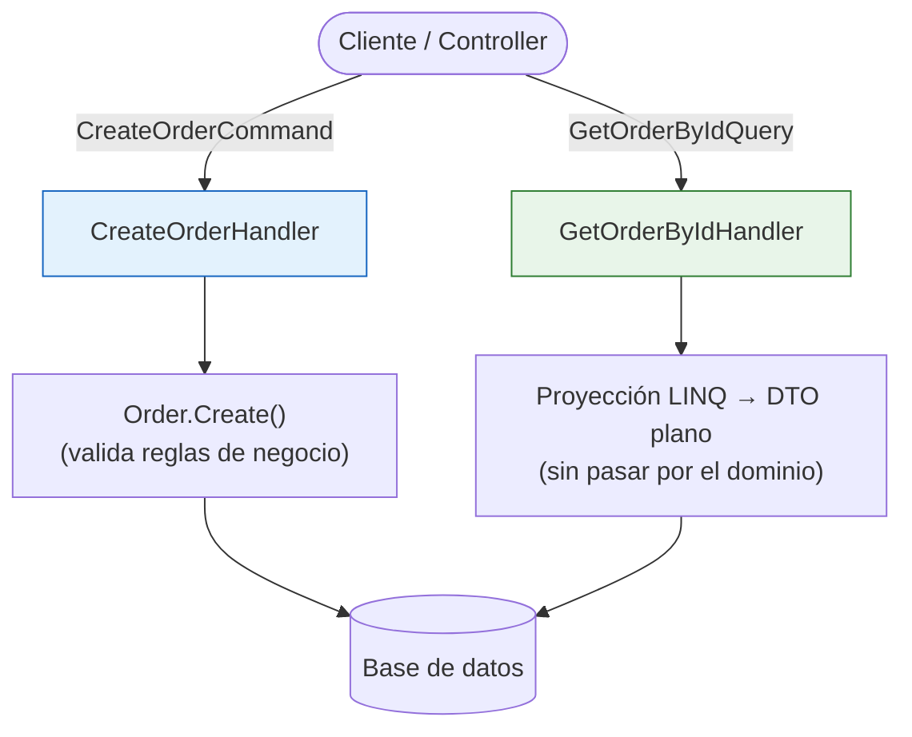

# CQRS (Command Query Responsibility Segregation)

## En una frase

CQRS separa **el modelo que escribe (commands) del modelo que lee (queries)**: las escrituras pasan por el dominio y sus reglas, y las lecturas van directo a un DTO optimizado; en su forma más común usa **una sola base de datos**, no dos.

-----

## Antes de empezar

Conviene que ya sepas:

* El patrón Command: [SOLID y patrones](01-solid-y-patrones.md).
* Modelo de dominio rico y casos de uso: [Clean Architecture](09-clean-architecture.md).
* Cuándo una abstracción es sobreingeniería: [DRY, KISS y YAGNI](07-principios-de-simplicidad.md).

Palabras nuevas (también están en el [Glosario](Glosario.md)):

* **CQS (*Command-Query Separation*):** un método cambia estado o devuelve datos, nunca las dos cosas.
* **CQRS:** CQS llevado a la arquitectura: modelos separados para escribir y para leer.
* **Command:** petición que cambia el estado del sistema, como "crear pedido".
* **Query:** petición que solo lee datos y no modifica nada.
* **Handler:** la clase que procesa un command o una query concreta.
* **Mediator (mediador):** objeto que recibe una petición y la entrega al handler que corresponde, sin que quien la envía lo conozca.
* **Proyección:** consulta que devuelve solo los campos necesarios, directamente como DTO.
* **Consistencia eventual:** los datos de lectura se actualizan un poco después que los de escritura, no en el mismo instante.
* **Event Sourcing:** guardar la secuencia de eventos que ocurrieron en lugar del estado actual.

-----

## El problema

Un `OrderService` creció durante dos años:

```csharp
public class OrderService(AppDbContext db)
{
    public async Task<Guid> CreateAsync(CreateOrderRequest r) { /* reglas de negocio */ }
    public async Task CancelAsync(Guid id) { /* reglas de negocio */ }
    public async Task<Order> GetAsync(Guid id) { /* ... */ }

    public async Task<List<Order>> GetForDashboardAsync()
    {
        return await db.Orders
            .Include(o => o.Lineas).ThenInclude(l => l.Producto)
            .Include(o => o.Cliente)
            .Include(o => o.Pagos)
            .ToListAsync(); // para mostrar 4 columnas en una tabla
    }

    // ... 22 métodos más, mitad escrituras y mitad reportes
}
```

Las consecuencias:

* la pantalla del dashboard carga entidades completas con todas sus relaciones para mostrar cuatro columnas, y tarda segundos;
* para optimizar un reporte hay que tocar la misma clase que tiene las reglas de negocio de crear y cancelar pedidos;
* nadie se anima a cambiar `GetAsync`, porque lo usan tanto las escrituras (para validar) como cinco pantallas distintas.

-----

## Cómo funciona

### 1. Origen: de CQS a CQRS

| | CQS | CQRS |
| --- | --- | --- |
| Autor | Bertrand Meyer (1988) | Greg Young (alrededor de 2010) |
| Nivel | **Método** | **Arquitectura** |
| Regla | Un método cambia estado **o** devuelve datos, nunca ambos | El modelo de escritura y el de lectura son distintos |

En lugar de un único servicio que hace todo (`GetOrder`, `CreateOrder`, `UpdateOrder` y `DeleteOrder` juntos), hay commands que escriben y queries que leen, cada uno con su handler.

### 2. El malentendido: "CQRS necesita dos bases de datos"

Es habitual escuchar que "CQRS es tener una base para escribir y otra para leer". **Es falso como requisito.** Es una variante avanzada y opcional, a veces combinada con Event Sourcing, no la definición de CQRS.

| Nivel | Qué se separa | Complejidad |
| --- | --- | --- |
| **1. Handlers separados** | Clases de commands y queries, **misma base de datos** | Baja: es lo más común |
| **2. Modelos de lectura** | Vistas, tablas desnormalizadas o una réplica de lectura | Media |
| **3. Bases separadas + eventos** | Una base para escribir y otra para leer, sincronizadas por eventos; consistencia eventual | Alta |

Confundir el nivel 3 con la definición hace pensar que CQRS es mucho más complejo y caro de lo que es en su versión básica.

### 3. Cómo se ve en .NET con MediatR

**MediatR** (Jimmy Bogard) es la librería más usada para implementar CQRS en .NET. No es CQRS en sí misma: es una herramienta de mensajería dentro del proceso (un *mediator*) que encaja bien con el patrón.

**Command:** cambia estado y, como mucho, devuelve un Id o un resultado de éxito o fallo.

```csharp
public record CreateOrderCommand(Guid CustomerId, List<OrderItem> Items) : IRequest<Guid>;

public class CreateOrderHandler(IOrderRepository repository) : IRequestHandler<CreateOrderCommand, Guid>
{
    public async Task<Guid> Handle(CreateOrderCommand request, CancellationToken ct)
    {
        var order = Order.Create(request.CustomerId, request.Items); // reglas de negocio
        await repository.SaveAsync(order, ct);
        return order.Id;
    }
}
```

**Query:** solo lee, nunca modifica estado.

```csharp
public record GetOrderByIdQuery(Guid OrderId) : IRequest<OrderDto?>;

public class GetOrderByIdHandler(AppDbContext context) : IRequestHandler<GetOrderByIdQuery, OrderDto?>
{
    public Task<OrderDto?> Handle(GetOrderByIdQuery request, CancellationToken ct) =>
        context.Orders
            .Where(o => o.Id == request.OrderId)
            .Select(o => new OrderDto(o.Id, o.CustomerName, o.Total))
            .FirstOrDefaultAsync(ct);
}
```

**Controller:** solo arma la petición y la despacha.

```csharp
[HttpGet("{id}")]
public async Task<ActionResult<OrderDto>> Get(Guid id, CancellationToken ct) =>
    await mediator.Send(new GetOrderByIdQuery(id), ct) is { } dto ? dto : NotFound();
```

Si lo usas mal:

```csharp
.Select(o => new OrderDto(o.Id, o.CustomerName, o.Total))
.FirstAsync(ct);
```

`FirstAsync` lanza `InvalidOperationException: Sequence contains no elements` si el pedido no existe. En una consulta por Id, "no existe" es un caso esperado: usa `FirstOrDefaultAsync` y devuelve `404`.

> **Ojo con la licencia:** desde 2025, MediatR pasó a una licencia comercial para muchas organizaciones. Antes de agregarlo a un proyecto nuevo, revisa si aplica. CQRS **no necesita MediatR**: puedes inyectar los handlers directamente o usar alternativas como un mediator propio de pocas líneas.

### 4. Por qué es útil: dos caminos con necesidades distintas



| | Escritura (command) | Lectura (query) |
| --- | --- | --- |
| Pasa por el dominio | **Sí**: `Order.Create()` valida las reglas | **No**: no hay reglas que aplicar para mostrar datos |
| Carga | La entidad completa, con lo que la regla necesita | Solo las columnas necesarias, proyectadas a un DTO |
| Se optimiza con | Un buen modelo de dominio | Proyecciones, índices, vistas, incluso SQL directo con Dapper |
| Riesgo de optimizar | Alto: puedes romper una regla | Bajo: las escrituras siguen pasando por el dominio |

No tiene sentido cargar toda la entidad `Order` con su lógica solo para mostrar tres campos. Y las lecturas se pueden optimizar libremente sin arriesgar las reglas de negocio, porque las escrituras siguen pasando por el modelo de dominio.

### 5. Cuándo se justifica

CQRS agrega indirección real: más clases, más archivos y más que navegar para seguir un flujo. Para un CRUD sin lógica de negocio compleja es sobreingeniería: un `OrderService` con métodos normales es más simple y no tiene ninguna desventaja ahí (ver [YAGNI](07-principios-de-simplicidad.md)).

Empieza a justificarse cuando:

* la escritura y la lectura tienen necesidades de rendimiento o de escala muy distintas (muchas más lecturas que escrituras, o al revés);
* las reglas de escritura son lo bastante complejas como para que mezclar lectura y escritura en el mismo modelo genere métodos con demasiadas responsabilidades;
* hay una necesidad real de modelos de lectura desnormalizados (proyecciones) o de Event Sourcing.

-----

## Ejemplo completo

El `OrderService` del problema, dividido en commands y queries, con la misma base de datos.

```text
Features/
  Orders/
    CreateOrder/
      CreateOrderCommand.cs
      CreateOrderHandler.cs
    CancelOrder/
      CancelOrderCommand.cs
      CancelOrderHandler.cs
    GetOrderById/
      GetOrderByIdQuery.cs
      GetOrderByIdHandler.cs
    GetDashboard/
      GetDashboardQuery.cs
      GetDashboardHandler.cs
```

`CancelOrderHandler.cs` (escritura: pasa por el dominio):

```csharp
public record CancelOrderCommand(Guid OrderId) : IRequest;

public class CancelOrderHandler(IOrderRepository repository) : IRequestHandler<CancelOrderCommand>
{
    public async Task Handle(CancelOrderCommand request, CancellationToken ct)
    {
        var order = await repository.GetByIdAsync(request.OrderId, ct)
            ?? throw new NotFoundException($"No existe el pedido {request.OrderId}");

        order.Cancelar(); // regla: no se puede cancelar un pedido ya enviado

        await repository.SaveAsync(order, ct);
    }
}
```

`GetDashboardHandler.cs` (lectura: proyección directa, sin dominio):

```csharp
public record DashboardRowDto(Guid Id, string Cliente, decimal Total, string Estado);
public record GetDashboardQuery(int Pagina, int TamanoPagina) : IRequest<List<DashboardRowDto>>;

public class GetDashboardHandler(AppDbContext db) : IRequestHandler<GetDashboardQuery, List<DashboardRowDto>>
{
    public Task<List<DashboardRowDto>> Handle(GetDashboardQuery q, CancellationToken ct) =>
        db.Orders
            .OrderByDescending(o => o.FechaCreacion)
            .Skip((q.Pagina - 1) * q.TamanoPagina)
            .Take(q.TamanoPagina)
            .Select(o => new DashboardRowDto(o.Id, o.Cliente.Nombre, o.Total, o.Estado.ToString()))
            .ToListAsync(ct);
}
```

`Program.cs`:

```csharp
builder.Services.AddMediatR(cfg => cfg.RegisterServicesFromAssemblyContaining<CreateOrderHandler>());
```

Qué observar:

* El dashboard ya no hace cuatro `Include`: el SQL generado pide solo cuatro columnas (con un `JOIN` a clientes) y pagina en la base.
* Optimizar el dashboard no toca `Order` ni ningún handler de escritura.
* `CancelOrderHandler` sigue pasando por `order.Cancelar()`: la regla de negocio no se puede evitar.
* Una sola base de datos: es CQRS de nivel 1, el más común.
* Cada carpeta es una funcionalidad completa: para entender "cancelar pedido" abres una sola carpeta.

-----

## Errores comunes

**1. Creer que CQRS exige dos bases de datos.**
Qué pasa: se descarta CQRS por "demasiado complejo", o se implementa con dos bases sin necesidad.
Por qué: se confunde la variante avanzada con la definición.
Arreglo: empieza por handlers separados con la misma base; separa bases solo con un problema real de escala.

**2. Queries que modifican estado.**
Qué pasa: una consulta actualiza "fecha de último acceso" y una caché de lecturas devuelve datos inconsistentes.
Por qué: se rompe la separación de CQS.
Arreglo: las queries solo leen; si algo tiene que registrarse, es un command aparte.

**3. Queries que pasan por el modelo de dominio.**
Qué pasa: lecturas lentas que cargan entidades completas para mostrar pocos campos.
Por qué: se reutiliza el repositorio de escritura para leer.
Arreglo: proyecciones directas a DTO en los handlers de lectura.

**4. Commands que devuelven la entidad completa.**
Qué pasa: el command termina acoplado a lo que necesita cada pantalla.
Por qué: "ya que lo tengo, lo devuelvo".
Arreglo: el command devuelve un Id o un resultado; si la pantalla necesita datos, hace una query.

**5. CQRS en un CRUD.**
Qué pasa: cuatro archivos por cada entidad sin reglas, que solo delegan a EF Core.
Por qué: se adopta el patrón por moda.
Arreglo: aplica CQRS donde lectura y escritura tienen necesidades distintas; en el resto, un servicio simple.

-----

## Evolución y versiones

* **1988:** Bertrand Meyer define CQS en *Object-Oriented Software Construction*.
* **~2010:** Greg Young formaliza CQRS como patrón de arquitectura.
* **2014:** aparece MediatR, que se vuelve la forma más común de implementarlo en .NET.
* **2025:** MediatR pasa a una licencia comercial para muchos usos; crece el uso de implementaciones propias y de alternativas.

-----

## Cuándo sí y cuándo no

**Usa CQRS cuando:** las lecturas y las escrituras tienen necesidades muy distintas (reportes pesados sobre un modelo transaccional, muchas más lecturas que escrituras) o las reglas de escritura son complejas.

**Usa bases separadas cuando:** la escala de lectura lo exige de verdad y el negocio acepta consistencia eventual.

**No uses CQRS cuando:** es un CRUD simple. Un servicio con métodos normales es más fácil de mantener.

-----

## Resumen en 5 líneas

1. CQS es a nivel de método; CQRS es a nivel de arquitectura: modelos separados para escribir y leer.
2. CQRS no exige dos bases de datos: lo más común es separar los handlers sobre la misma base.
3. Los commands pasan por el dominio y sus reglas; las queries proyectan directo a un DTO.
4. MediatR es la herramienta más usada en .NET, pero no es obligatoria (y desde 2025 tiene licencia comercial).
5. Para un CRUD sin reglas de negocio, CQRS es sobreingeniería.

-----

## Para profundizar

<details>
<summary>Pipeline behaviors: lo que se gana con un mediator</summary>

Al pasar todas las peticiones por un mediator, puedes agregar comportamiento transversal en un solo lugar: validación, logs, métricas o transacciones.

```csharp
public class ValidationBehavior<TRequest, TResponse>(IEnumerable<IValidator<TRequest>> validadores)
    : IPipelineBehavior<TRequest, TResponse> where TRequest : notnull
{
    public async Task<TResponse> Handle(TRequest request, RequestHandlerDelegate<TResponse> next, CancellationToken ct)
    {
        var errores = validadores.SelectMany(v => v.Validate(request).Errors).ToList();
        if (errores.Count > 0) throw new ValidationException(errores);

        return await next();
    }
}
```

Cada command se valida antes de llegar a su handler, sin repetir código en cada uno.

</details>

<details>
<summary>Bases separadas y consistencia eventual</summary>

En el nivel 3, el command guarda en la base de escritura y publica un evento (`PedidoCreado`). Un proceso aparte lo consume y actualiza la base de lectura, que puede tener otra forma (por ejemplo, un documento desnormalizado en una base NoSQL, listo para la pantalla).

El costo es la **consistencia eventual**: durante un instante, la lectura no refleja la escritura. Si el usuario crea un pedido y la pantalla siguiente lo consulta, puede no verlo todavía. Hay que diseñar la UI para eso (por ejemplo, mostrar el pedido recién creado desde la respuesta del command). Por eso este nivel solo se justifica con un problema real de escala.

</details>

-----

## En entrevista

### Respuesta corta (junior)

CQRS separa las operaciones que escriben datos (commands) de las que leen (queries), cada una con su propio handler. En .NET se suele implementar con MediatR.

### Respuesta ampliada (semi-senior)

CQRS lleva CQS a nivel de arquitectura: los commands pasan por el modelo de dominio y sus reglas, y las queries proyectan directamente a DTOs, así puedo optimizar las lecturas sin arriesgar las reglas de negocio. Aclaro siempre que no exige dos bases de datos: lo más común es separar los handlers sobre la misma base, y solo separaría bases si la escala lo exige y el negocio acepta consistencia eventual. Lo uso cuando lectura y escritura tienen necesidades distintas, no en un CRUD, donde es sobreingeniería. Con MediatR aprovecho los pipeline behaviors para validación y logs, aunque sé que no es obligatorio y que desde 2025 tiene licencia comercial.

### Preguntas frecuentes de seguimiento

**1. ¿CQRS necesita Event Sourcing?**
No. Son patrones independientes que a veces se combinan. CQRS solo separa lectura y escritura.

**2. ¿Qué devuelve un command?**
Idealmente nada, o un Id o un resultado de éxito o fallo. Los datos para mostrar se obtienen con una query.

**3. ¿Qué problema trae separar las bases de lectura y escritura?**
La consistencia eventual: la lectura puede no reflejar todavía la última escritura, y hay que diseñar la aplicación para tolerarlo.

-----

## Práctica

**Ejercicio 1.** Clasifica cada operación como command o query. ¿Alguna rompe CQS?

1. `ObtenerPedidosDelCliente(clienteId)`
2. `AprobarPedido(pedidoId)`
3. `ObtenerSiguienteNumeroDeFactura()`, que incrementa un contador y devuelve el número
4. `CalcularTotalDelCarrito(carritoId)`

<details>
<summary>Solución</summary>

1. **Query.**
2. **Command.**
3. **Rompe CQS:** cambia estado (incrementa el contador) **y** devuelve un dato. Es un caso donde a veces se acepta por pragmatismo (generar un Id), pero conviene que el nombre lo deje claro, por ejemplo `ReservarNumeroDeFactura()`.
4. **Query**, siempre que solo calcule y no guarde el total.

</details>

**Ejercicio 2.** ¿Qué tiene de malo esta query? Reescríbela.

```csharp
public class GetProductosHandler(IProductoRepository repo) : IRequestHandler<GetProductosQuery, List<Producto>>
{
    public async Task<List<Producto>> Handle(GetProductosQuery q, CancellationToken ct)
    {
        var productos = await repo.GetAllAsync(ct); // carga todo, con sus relaciones
        foreach (var p in productos) p.UltimaConsulta = DateTime.UtcNow;
        await repo.SaveAsync(ct);
        return productos.Where(p => p.Activo).ToList();
    }
}
```

<details>
<summary>Solución</summary>

* **Modifica estado** (`UltimaConsulta`) dentro de una query: rompe CQS.
* **Carga todos los productos** en memoria y filtra después, en lugar de filtrar en la base.
* **Devuelve la entidad** (`Producto`) en lugar de un DTO.

```csharp
public record ProductoDto(int Id, string Nombre, decimal Precio);

public class GetProductosHandler(AppDbContext db) : IRequestHandler<GetProductosQuery, List<ProductoDto>>
{
    public Task<List<ProductoDto>> Handle(GetProductosQuery q, CancellationToken ct) =>
        db.Productos
            .Where(p => p.Activo)
            .Select(p => new ProductoDto(p.Id, p.Nombre, p.Precio))
            .ToListAsync(ct);
}
```

Si de verdad hace falta registrar la última consulta, es un command aparte (o un log), no parte de la query.

</details>

-----

## Siguiente lección

[Arquitectura hexagonal (Ports & Adapters)](11-arquitectura-hexagonal.md)
