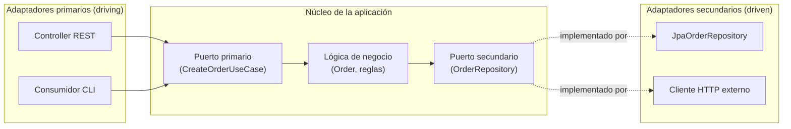
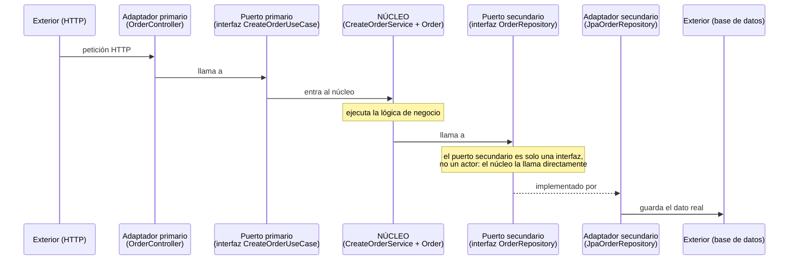

# Arquitectura hexagonal (Ports & Adapters)

## En una frase

La arquitectura hexagonal divide el sistema en **adentro (el núcleo de negocio) y afuera (todo lo demás)**: el núcleo define **puertos** (interfaces) para entrar y salir, y el mundo exterior se conecta mediante **adaptadores** que los usan o los implementan, de modo que el núcleo nunca depende de ninguna tecnología.

-----

## Antes de empezar

Conviene que ya sepas:

* La regla de dependencia y el modelo de dominio rico: [Clean Architecture](09-clean-architecture.md).
* DTOs y por qué no exponer la entidad: [Arquitectura en capas](08-arquitectura-en-capas-ntier.md).
* Cómo funciona un contenedor de DI: [Inyección de dependencias](06-inyeccion-de-dependencias.md).
* Leer algo de Kotlin: el ejemplo usa Kotlin con Spring, porque es un ecosistema donde la arquitectura hexagonal se usa mucho.

Palabras nuevas (también están en el [Glosario](Glosario.md)):

* **Puerto (*port*):** interfaz que define un punto de entrada o de salida del núcleo.
* **Puerto primario (*driving port*):** cómo el exterior **usa** la aplicación, por ejemplo un caso de uso.
* **Puerto secundario (*driven port*):** lo que la aplicación **necesita** del exterior, por ejemplo un repositorio.
* **Adaptador (*adapter*):** la pieza concreta que conecta una tecnología con un puerto.
* **Adaptador primario (*driving adapter*):** llama hacia adentro, como un controller REST o un comando de CLI.
* **Adaptador secundario (*driven adapter*):** implementa un puerto secundario y sale hacia afuera, como un repositorio JPA o un cliente HTTP.
* **Cableado (*wiring*):** construir los objetos concretos y pasarlos donde se piden sus interfaces.
* **Testcontainers:** librería que levanta servicios reales (bases de datos, colas) en contenedores Docker durante las pruebas.

-----

## El problema

Un servicio de pedidos en Spring:

```kotlin
@Entity
@Table(name = "orders")
class Order(
    @Id var id: UUID = UUID.randomUUID(),
    var customerId: UUID = UUID.randomUUID(),
    var total: BigDecimal = BigDecimal.ZERO
)

@Service
@Transactional
class OrderService(
    private val repo: SpringDataOrderRepository,     // interfaz de Spring Data
    private val restTemplate: RestTemplate
) {
    fun create(request: CreateOrderRequest): Order {
        require(request.items.isNotEmpty())
        val order = Order(customerId = request.customerId, total = request.items.sumOf { it.price })
        restTemplate.postForObject("https://antifraude/check", order, Void::class.java)
        return repo.save(order)
    }
}
```

Llegan dos pedidos: procesar pedidos también desde una cola de Kafka, y probar las reglas de negocio sin levantar Spring ni la base de datos.

Las consecuencias:

* la entidad de dominio **es** la entidad JPA: cualquier cambio de tabla toca el dominio, y el dominio no existe sin JPA;
* el servicio recibe un DTO de HTTP (`CreateOrderRequest`): reutilizarlo desde Kafka obliga a fingir una petición HTTP;
* para probar `create` hace falta el contexto de Spring, una base de datos y el servicio antifraude.

-----

## Cómo funciona

### 1. Origen

La formalizó **Alistair Cockburn** en 2005 con el nombre **Ports and Adapters**; "hexagonal" es el apodo que se popularizó por cómo se dibuja. Un detalle para no sobrepensarlo: **el hexágono no tiene seis lados por ninguna razón de diseño**. Cockburn eligió la forma porque le daba espacio para dibujar varios puertos alrededor del núcleo; la geometría no significa nada.

Cockburn la propuso como respuesta a los problemas de la arquitectura en capas tradicional, donde la lógica de negocio terminaba filtrándose en la UI y dependiendo de la base de datos. Su idea es más simple que la de capas: solo existe **adentro** y **afuera**.

### 2. Puertos y adaptadores

El objetivo es el mismo que en [Clean Architecture](09-clean-architecture.md): el núcleo no depende de detalles externos. Lo que cambia es el vocabulario:

| | Lado primario (*driving*) | Lado secundario (*driven*) |
| --- | --- | --- |
| **Puerto** | Cómo el exterior **usa** la aplicación (`CreateOrderUseCase`) | Lo que la aplicación **necesita** del exterior (`OrderRepository`) |
| **Adaptador** | Llama hacia adentro (controller REST, consumidor de Kafka, CLI) | Implementa el puerto y sale hacia afuera (repositorio JPA, cliente HTTP) |
| **Quién inicia** | El exterior | El núcleo |



El núcleo solo conoce sus puertos: no sabe si el adaptador primario es un controller REST o un CLI, ni si el secundario es JPA o un cliente HTTP.

### 3. El recorrido completo: la dirección cambia a la mitad

Lo que más confunde al principio es qué llama a qué. La respuesta cambia de dirección justo a la mitad del recorrido:



La regla para no confundirse:

* **Lado primario:** el **adaptador llama al puerto**. El adaptador inicia y entra al núcleo.
* **Lado secundario:** el **núcleo llama al puerto** (que es solo una interfaz), y el **adaptador lo implementa**. Es el único que realmente toca la base de datos.

### 4. Cómo se organiza en carpetas

En un proyecto Kotlin con Spring y dos módulos de Gradle:

```text
miapp-application/                          ← SIN Spring, SIN JPA, sin nada externo
└── src/main/kotlin/com/miapp/application/
    ├── domain/
    │   └── Order.kt                        ← la entidad (lógica de negocio pura)
    ├── ports/
    │   ├── inbound/
    │   │   └── CreateOrderUseCase.kt       ← puerto primario (interfaz)
    │   └── outbound/
    │       └── OrderRepository.kt          ← puerto secundario (interfaz)
    └── CreateOrderService.kt               ← caso de uso, implementa el puerto primario

miapp-infrastructure/                        ← SÍ depende de Spring, JPA, etc.
└── src/main/kotlin/com/miapp/infrastructure/
    ├── adapter/
    │   ├── inbound/
    │   │   └── rest/
    │   │       ├── OrderController.kt      ← adaptador primario
    │   │       ├── CreateOrderRequest.kt   ← DTO de entrada (JSON → dominio)
    │   │       └── OrderResponse.kt        ← DTO de salida (dominio → JSON)
    │   └── outbound/
    │       └── persistence/
    │           ├── JpaOrderRepository.kt   ← adaptador secundario
    │           └── OrderEntity.kt          ← modelo de persistencia (dominio ↔ tabla)
    └── config/
        └── AppConfig.kt                    ← composition root: el cableado
```

`miapp-infrastructure` depende de `miapp-application` (para implementar sus interfaces), pero `miapp-application` **nunca** depende de `miapp-infrastructure`. Así el compilador, y no solo la disciplina del equipo, impide que el núcleo importe Spring o JPA por accidente. Los nombres `inbound`/`outbound` (o `in`/`out`) son la convención más común para separar los dos lados del hexágono.

### 5. El código, pieza por pieza

**Núcleo: dominio y puertos** (sin Spring, sin JPA):

```kotlin
// application/domain/Order.kt
data class Order(val id: OrderId, val customerId: CustomerId, val total: Money) {
    companion object {
        fun create(customerId: CustomerId, items: List<OrderItem>): Order {
            require(items.isNotEmpty()) { "Un pedido necesita al menos un item" }
            val total = items.sumOf { it.price.amount * it.quantity.toBigDecimal() }
            return Order(OrderId.new(), customerId, Money(total))
        }
    }
}

// application/ports/outbound/OrderRepository.kt: puerto secundario
interface OrderRepository {
    fun findById(id: OrderId): Order?
    fun save(order: Order)
}

// application/ports/inbound/CreateOrderUseCase.kt: puerto primario
interface CreateOrderUseCase {
    fun execute(customerId: CustomerId, items: List<OrderItem>): OrderId
}
```

**Caso de uso:** implementa el puerto primario y depende solo del puerto secundario. Sin anotaciones de Spring: se registra en `AppConfig`.

```kotlin
// application/CreateOrderService.kt
class CreateOrderService(
    private val orderRepository: OrderRepository // el puerto, no el adaptador JPA
) : CreateOrderUseCase {

    override fun execute(customerId: CustomerId, items: List<OrderItem>): OrderId {
        val order = Order.create(customerId, items)
        orderRepository.save(order)
        return order.id
    }
}
```

**Adaptador secundario:** el núcleo definió qué necesita (`OrderRepository`) y esta clase lo implementa con una tecnología concreta.

```kotlin
// infrastructure/adapter/outbound/persistence/JpaOrderRepository.kt
class JpaOrderRepository(
    private val jpa: SpringDataOrderJpaRepository
) : OrderRepository {

    override fun findById(id: OrderId): Order? =
        jpa.findById(id.value).orElse(null)?.toDomain()

    override fun save(order: Order) {
        jpa.save(order.toJpaEntity())
    }
}
```

**Adaptador primario:** un controller que **usa** el puerto primario.

```kotlin
// infrastructure/adapter/inbound/rest/OrderController.kt
@RestController
@RequestMapping("/orders")
class OrderController(
    private val createOrderUseCase: CreateOrderUseCase // el puerto, no la clase concreta
) {
    @PostMapping
    fun create(@RequestBody request: CreateOrderRequest): ResponseEntity<OrderResponse> {
        // 1. Entrada: el DTO HTTP se traduce a tipos del dominio
        val orderId = createOrderUseCase.execute(CustomerId(request.customerId), request.items.map { it.toDomain() })

        // 2. Salida: el controller arma el DTO de respuesta; el núcleo nunca supo que existe un JSON
        return ResponseEntity.status(HttpStatus.CREATED).body(OrderResponse(orderId.value))
    }
}

data class OrderResponse(val id: UUID)
```

**Dónde se mapea la respuesta, en una frase:** en el adaptador primario, después de que el caso de uso terminó, nunca dentro del núcleo. `CreateOrderService` no sabe si el resultado termina en JSON, en gRPC o en una consola. Por eso `OrderResponse.kt` vive junto a `OrderController.kt` y `CreateOrderRequest.kt`, en `adapter/inbound/rest/`: los tres son detalles del borde primario.

> **¿Hace falta la interfaz del puerto primario?** No para que funcione. A diferencia del puerto secundario (donde la interfaz es indispensable para poder inyectar otra implementación), el puerto primario podría ser la clase `CreateOrderService` directamente. Su valor es de **documentación**: deja explícito, con un tipo, cuál es el límite de la aplicación, y permite reemplazar el caso de uso en las pruebas del controller. Muchos proyectos lo omiten.

### 6. El cableado explícito: cómo se conecta todo

Los puertos no "hacen" nada: son un contrato. Lo que conecta las piezas son dos cosas distintas:

* **Implementar:** una clase cumple el contrato.
* **Inyectar:** en un solo lugar, el composition root, se construyen los objetos reales y se pasan donde se pide la interfaz.

Sin el segundo paso, las interfaces no sirven de nada: nunca se ejecutaría código real.

```kotlin
// infrastructure/config/AppConfig.kt
@Configuration
class AppConfig {

    @Bean
    fun orderRepository(jpa: SpringDataOrderJpaRepository): OrderRepository =
        JpaOrderRepository(jpa) // el adaptador secundario como implementación real

    @Bean
    fun createOrderUseCase(orderRepository: OrderRepository): CreateOrderUseCase =
        CreateOrderService(orderRepository) // el núcleo recibe el puerto ya resuelto
}
```

Spring inyecta `CreateOrderUseCase` en `OrderController` porque su constructor lo pide: es el mismo mecanismo de [inyección de dependencias](06-inyeccion-de-dependencias.md) que en .NET.

Si lo usas mal:

```kotlin
@Service          // en el núcleo
class CreateOrderService(...) : CreateOrderUseCase

@Bean             // y también en AppConfig
fun createOrderUseCase(...): CreateOrderUseCase = CreateOrderService(...)
```

Hay dos problemas. El núcleo ahora importa Spring, así que rompe la regla que justifica los dos módulos. Y hay **dos beans** del mismo tipo: al inyectar `CreateOrderUseCase`, Spring falla con `NoUniqueBeanDefinitionException`. Elige una forma de registro: anotaciones **o** configuración explícita, no las dos.

**La traza de ejecución, objeto por objeto, cuando llega `POST /orders`:**

1. Spring enruta al bean de `OrderController`, que desde el arranque tiene una referencia a una instancia de `CreateOrderService`, aunque el tipo declarado sea `CreateOrderUseCase`.
2. `OrderController.create(request)` traduce el DTO y llama a `createOrderUseCase.execute(...)`.
3. Como la variable apunta a un `CreateOrderService`, se ejecuta el código de **esa** clase. Es polimorfismo (ver [Clase abstracta frente a interfaz](05-abstract-vs-interface.md)), no magia: la interfaz solo dice "existe algo con este método"; el objeto real decide qué código corre.
4. `CreateOrderService.execute(...)` llama a `Order.create(customerId, items)`. `Order` valida que haya al menos un item y calcula el total. El servicio **delega** la validación en la entidad: es el modelo de dominio rico de [Clean Architecture](09-clean-architecture.md). El servicio orquesta; `Order` decide si el estado es válido.
5. `CreateOrderService` llama a `orderRepository.save(order)`. El campo es de tipo `OrderRepository` (el puerto), pero el objeto que `AppConfig` puso ahí es un `JpaOrderRepository`.
6. Por polimorfismo se ejecuta `JpaOrderRepository.save(order)`: ahí, y solo ahí, `Order` se convierte en `OrderEntity` y Spring Data JPA toca la base de datos.
7. `execute(...)` devuelve `order.id` (un `OrderId`, tipo del dominio) hasta `OrderController`.
8. `OrderController` lo convierte en `OrderResponse` y responde `201 Created`.

**La idea que hay que quedarse:** en ningún punto una interfaz "llamó" a algo por sí sola. El composition root construyó los objetos concretos una vez, los pasó por constructor donde el tipo era una interfaz, y en cada llamada el runtime ejecutó el código de la clase real. Es la misma mecánica que `builder.Services.AddScoped<IOrderRepository, EfOrderRepository>()` en .NET.

### 7. Mapeo obligatorio en los dos bordes

En arquitectura hexagonal, el patrón DTO no es opcional en un solo borde: aplica **en los dos lados del hexágono**.

| Borde | Qué mapea |
| --- | --- |
| **Adaptador primario** | El formato externo (JSON) al dominio, y el resultado del caso de uso a la respuesta |
| **Adaptador secundario** | El dominio al formato de la tecnología de persistencia (entidad JPA, fila), y viceversa al leer |

```kotlin
// Adaptador secundario: la entidad JPA es un objeto distinto del dominio
@Entity
@Table(name = "orders")
class OrderEntity(
    @Id val id: UUID,
    val customerId: UUID,
    val total: BigDecimal
) {
    fun toDomain() = Order(OrderId(id), CustomerId(customerId), Money(total))
}

fun Order.toJpaEntity() = OrderEntity(id.value, customerId.value, total.amount)
```

```kotlin
// Adaptador primario: los DTOs de entrada y salida son distintos del dominio
data class CreateOrderRequest(val customerId: UUID, val items: List<OrderItemRequest>)
data class OrderResponse(val id: UUID)
```

> **Ojo con JPA en Kotlin:** JPA necesita que las entidades tengan un constructor sin parámetros y que las clases no sean `final`, y en Kotlin las clases son `final` por defecto. Por eso los proyectos Kotlin con JPA usan los plugins `kotlin("plugin.jpa")` (genera el constructor vacío) y `kotlin("plugin.spring")` / `allopen`. Es otra razón para que `OrderEntity` sea una clase aparte: el dominio no tiene por qué cargar con esas restricciones.

El costo de este mapeo (más clases, más código de conversión) solo se justifica cuando la lógica de negocio es lo bastante compleja como para valer la pena aislarla. En un CRUD sin reglas reales, forzar el mapeo en los dos bordes es la misma sobreingeniería de [SOLID y patrones](01-solid-y-patrones.md).

Una excepción pragmática que aceptan incluso los defensores más estrictos: una consulta de solo lectura, sin reglas de negocio, puede omitir el dominio y leer directamente a un DTO de proyección, como en [CQRS](10-cqrs.md).

### 8. La pirámide de testing en arquitectura hexagonal

Los puertos son la frontera natural de cada tipo de prueba:

| Nivel | Qué prueba | Qué es real | Qué se reemplaza |
| --- | --- | --- | --- |
| 1. Unitarias del núcleo | El caso de uso como caja negra | Dominio y caso de uso | El puerto secundario, con un fake |
| 2. Integración del adaptador primario | Que el HTTP se traduce bien al dominio | El controller y la serialización | El puerto primario o el secundario |
| 3. Integración del adaptador secundario | Que el mapeo y las consultas funcionan | `JpaOrderRepository` y una base de datos real (Testcontainers) | Nada |
| 4. End-to-end | El camino feliz principal | Todo, cableado de verdad | Nada |

```kotlin
class CreateOrderServiceTest {
    private val fakeRepository = FakeOrderRepository()
    private val service = CreateOrderService(fakeRepository)

    @Test
    fun `crea un pedido y lo guarda`() {
        val id = service.execute(CustomerId.new(), listOf(unItem()))

        assertNotNull(fakeRepository.findById(id))
    }

    @Test
    fun `rechaza un pedido sin items`() {
        assertThrows<IllegalArgumentException> {
            service.execute(CustomerId.new(), emptyList())
        }
    }
}
```

Los tests del nivel 1 son la mayoría, como en la [pirámide de testing](03-estrategia-de-testing.md): corren en milisegundos, sin Spring ni base de datos, y cubren toda la lógica de negocio. Los más lentos (3 y 4) se reservan para confirmar que el cableado con el mundo real funciona. Los casos borde ya los cubrió el nivel 1.

### 9. Cableado explícito frente a contenedor de DI

Cómo se conectan los puertos con sus adaptadores cambia bastante según el ecosistema:

| Enfoque | Cómo funciona | Ventaja | Costo |
| --- | --- | --- | --- |
| **Spring con escaneo** | `@Service`, `@Repository` y `@ComponentScan` arman el grafo solos | Escala con muchas dependencias; casi nada que escribir | El grafo queda escondido detrás de la reflexión |
| **Spring con `@Configuration`** | `@Bean` explícitos en el módulo de infraestructura (como en este ejemplo) | El núcleo no importa Spring; todo el cableado está en un archivo | Más código para escribir |
| **Cableado manual** (Kotlin con Ktor, sin contenedor) | Una clase que construye todo con constructores | 100 % explícito y rastreable leyendo un archivo | Repetitivo a medida que crece |
| **Contenedor de .NET** | Registro explícito línea por línea (`AddScoped<T>()`) | Punto intermedio: explícito, pero el contenedor resuelve el grafo en tiempo de ejecución | Sin escaneo por atributo de fábrica (librerías como Scrutor lo agregan) |

Cableado manual con Ktor:

```kotlin
class Dependencies(dataSource: DataSource) {
    val orderRepository: OrderRepository = ExposedOrderRepository(dataSource)
    val createOrderUseCase: CreateOrderUseCase = CreateOrderService(orderRepository)
}
```

Ninguno es "el correcto": es un trade-off entre automatismo y visibilidad. Si usas escaneo en Spring pero quieres el núcleo libre de Spring, un truco usado en proyectos serios es definir una anotación propia (`@UseCase`) en el núcleo y escanearla desde infraestructura. Incluso las transacciones se pueden aplicar desde afuera, con AOP, en lugar de anotar las clases de negocio con `@Transactional`.

### 10. Forzar la regla en el build

La forma más confiable de que la regla de dependencia no se rompa por accidente no es "acordarse": es que el build lo impida.

* **Gradle/Maven:** dos módulos. El de aplicación no tiene ninguna dependencia de Spring ni de JPA (solo el lenguaje y, como mucho, una librería de testing). El de infraestructura depende de los frameworks y del módulo de aplicación, nunca al revés. Si alguien importa una clase de infraestructura desde el núcleo, el build no compila.
* **.NET:** lo mismo con proyectos separados: `MiApp.Domain` y `MiApp.Application` sin referencia hacia `MiApp.Infrastructure` (ver [Clean Architecture](09-clean-architecture.md)). Para ir más allá, pruebas de arquitectura con NetArchTest o ArchUnitNET (en Java, ArchUnit) que fallan si alguien agrega una dependencia prohibida.

### 11. Hexagonal frente a Clean Architecture: ¿en qué se diferencian de verdad?

En el código resultante, muy poco: las dos separan el núcleo de negocio de los detalles externos, con las dependencias apuntando hacia el núcleo. La diferencia está en el **vocabulario y el énfasis**:

| | Clean Architecture | Hexagonal |
| --- | --- | --- |
| Capas internas | Prescribe 4 círculos: Entities, Use Cases, Interface Adapters, Frameworks & Drivers | No prescribe ninguna: solo adentro y afuera |
| Vocabulario | Casos de uso, gateways, presenters | Puertos y adaptadores, primarios y secundarios |
| Énfasis | La organización por capas del núcleo | La simetría entre las entradas y las salidas |

Es común, y válido, que un equipo use los dos términos casi como sinónimos para describir la misma estructura.

Como Cockburn no dice nada sobre cómo organizar el **adentro**, el núcleo se puede organizar como se prefiera (por feature, con patrones de DDD o incluso en capas) sin violar el principio hexagonal. Lo único no negociable es que nada de adentro dependa de nada de afuera.

-----

## Ejemplo completo

El servicio del problema, con el segundo punto de entrada (Kafka) que motivó el cambio.

El núcleo es el de la sección 5: `Order`, `CreateOrderUseCase`, `OrderRepository` y `CreateOrderService`, sin Spring. Para Kafka se agrega un puerto secundario y **un adaptador primario nuevo**:

```kotlin
// application/ports/outbound/FraudCheck.kt: lo que el núcleo necesita del antifraude
interface FraudCheck {
    fun isSuspicious(customerId: CustomerId, total: Money): Boolean
}
```

```kotlin
// application/CreateOrderService.kt: ahora consulta el antifraude a través de su puerto
class CreateOrderService(
    private val orderRepository: OrderRepository,
    private val fraudCheck: FraudCheck
) : CreateOrderUseCase {

    override fun execute(customerId: CustomerId, items: List<OrderItem>): OrderId {
        val order = Order.create(customerId, items)
        require(!fraudCheck.isSuspicious(customerId, order.total)) { "Pedido rechazado por antifraude" }
        orderRepository.save(order)
        return order.id
    }
}
```

```kotlin
// infrastructure/adapter/outbound/http/HttpFraudCheck.kt: adaptador secundario
class HttpFraudCheck(private val client: RestClient) : FraudCheck {
    override fun isSuspicious(customerId: CustomerId, total: Money): Boolean =
        client.post().uri("/check")
            .body(FraudRequest(customerId.value, total.amount))
            .retrieve()
            .body(FraudResponse::class.java)!!
            .suspicious
}
```

```kotlin
// infrastructure/adapter/inbound/kafka/OrderEventsListener.kt: adaptador primario nuevo
@Component
class OrderEventsListener(private val createOrderUseCase: CreateOrderUseCase) {

    @KafkaListener(topics = ["orders.incoming"])
    fun onMessage(message: IncomingOrderMessage) {
        createOrderUseCase.execute(CustomerId(message.customerId), message.items.map { it.toDomain() })
    }
}
```

```kotlin
// infrastructure/config/AppConfig.kt
@Configuration
class AppConfig {
    @Bean fun orderRepository(jpa: SpringDataOrderJpaRepository): OrderRepository = JpaOrderRepository(jpa)
    @Bean fun fraudCheck(builder: RestClient.Builder): FraudCheck =
        HttpFraudCheck(builder.baseUrl("https://antifraude").build())
    @Bean fun createOrderUseCase(repo: OrderRepository, fraud: FraudCheck): CreateOrderUseCase =
        CreateOrderService(repo, fraud)
}
```

Prueba del núcleo, sin Spring ni red:

```kotlin
@Test
fun `rechaza un pedido sospechoso y no lo guarda`() {
    val repo = FakeOrderRepository()
    val service = CreateOrderService(repo, fraudCheck = { _, _ -> true })

    assertThrows<IllegalArgumentException> { service.execute(CustomerId.new(), listOf(unItem())) }
    assertTrue(repo.isEmpty())
}
```

(Para pasar una lambda como `FraudCheck`, declara la interfaz como `fun interface FraudCheck`).

Qué observar:

* Kafka se agregó con **un adaptador primario nuevo**; el núcleo no cambió.
* El antifraude dejó de ser un `RestTemplate` dentro del servicio: es un puerto, y en la prueba es una lambda.
* El controller REST y el listener de Kafka llaman al **mismo** caso de uso, con la misma validación.
* La entidad JPA y el DTO de Kafka viven en infraestructura: el dominio no los conoce.

-----

## Errores comunes

**1. Anotaciones del framework en el núcleo.**
Qué pasa: el módulo de aplicación importa Spring, y los "dos módulos" no protegen nada.
Por qué: `@Service` o `@Transactional` son lo más rápido de escribir.
Arreglo: registra el núcleo con `@Bean` desde infraestructura o con una anotación propia.

**2. Registrar el mismo componente dos veces.**
Qué pasa: `NoUniqueBeanDefinitionException` al arrancar.
Por qué: una clase tiene `@Service` y además se crea con `@Bean`.
Arreglo: una sola forma de registro por componente.

**3. La entidad de dominio es la entidad JPA.**
Qué pasa: un cambio de tabla obliga a cambiar el dominio, y el dominio no se puede usar sin JPA.
Por qué: "es la misma información, para qué duplicar".
Arreglo: `OrderEntity` en infraestructura, con `toDomain()` y `toJpaEntity()`.

**4. El caso de uso recibe un DTO de HTTP.**
Qué pasa: para reutilizarlo desde Kafka o un CLI hay que fingir una petición HTTP.
Por qué: se pasa el `request` tal cual "porque ya tiene los datos".
Arreglo: el adaptador primario traduce a tipos del dominio antes de llamar al puerto.

**5. Mapear en los dos bordes para un CRUD.**
Qué pasa: tres clases por entidad (dominio, JPA, DTO) que solo copian campos.
Por qué: se aplica la arquitectura sin que haya reglas de negocio que proteger.
Arreglo: en un CRUD, una arquitectura más simple; hexagonal donde haya núcleo de negocio real.

-----

## Cuándo sí y cuándo no

**Usa arquitectura hexagonal cuando:** el núcleo de negocio es complejo, hay varios puntos de entrada (REST, colas, jobs, CLI) o varias dependencias externas que quieres poder reemplazar y probar por separado.

**No la uses cuando:** es un CRUD, un prototipo o un servicio que solo traduce de una API a otra. El mapeo en los dos bordes y los puertos son costo sin beneficio.

-----

## Resumen en 5 líneas

1. Solo hay adentro (núcleo) y afuera; el núcleo define puertos y el exterior se conecta con adaptadores.
2. Lado primario: el adaptador llama al puerto. Lado secundario: el núcleo llama al puerto y el adaptador lo implementa.
3. El cableado ocurre en un solo lugar (composition root); en cada llamada, el polimorfismo ejecuta la clase real.
4. Se mapea en los dos bordes: DTO de entrada y salida en el primario, modelo de persistencia en el secundario.
5. En el código resultante se parece mucho a Clean Architecture; cambian el vocabulario y que no prescribe capas internas.

-----

## Para profundizar

<details>
<summary>La misma estructura en .NET</summary>

```text
MiApp.Application/
  Domain/Order.cs
  Ports/Inbound/ICreateOrderUseCase.cs
  Ports/Outbound/IOrderRepository.cs
  CreateOrderService.cs
MiApp.Infrastructure/
  Adapters/Inbound/Rest/OrdersController.cs
  Adapters/Inbound/Messaging/OrderEventsConsumer.cs
  Adapters/Outbound/Persistence/EfOrderRepository.cs
  DependencyInjection.cs          ← services.AddScoped<IOrderRepository, EfOrderRepository>()
```

Es casi idéntico a la estructura de Clean Architecture: la diferencia está en los nombres de las carpetas (`Ports`, `Adapters`) y en hacer explícita la simetría entre la entrada (controllers, consumidores) y la salida (repositorios, clientes HTTP).

</details>

<details>
<summary>Varios adaptadores para el mismo puerto</summary>

Un puerto secundario puede tener varios adaptadores, y elegir cuál se usa en el composition root:

* `JpaOrderRepository` en producción;
* `InMemoryOrderRepository` para una demo o para pruebas de aceptación rápidas;
* `CachingOrderRepository`, que envuelve a otro y agrega caché (patrón Decorator).

El núcleo no se entera de cuál recibe. Es la prueba más clara de que el puerto está bien diseñado: si cambiar de adaptador obliga a tocar el núcleo, el puerto filtra detalles de la tecnología.

</details>

-----

## En entrevista

### Respuesta corta (junior)

La arquitectura hexagonal separa el núcleo de negocio del mundo exterior. El núcleo define interfaces llamadas puertos, y las tecnologías concretas, como un controller REST o un repositorio de base de datos, son adaptadores que se conectan a esos puertos.

### Respuesta ampliada (semi-senior)

Distingo dos lados. En el primario, adaptadores como un controller o un consumidor de colas llaman a los puertos de entrada, que son los casos de uso. En el secundario, el núcleo define lo que necesita (repositorios, servicios externos) y los adaptadores lo implementan. El núcleo no depende de ningún framework: lo hago cumplir con módulos separados y lo cableo en un composition root. Mapeo en los dos bordes, para que ni el JSON ni la tabla se filtren al dominio, y eso me permite probar toda la lógica con fakes, en milisegundos. Sé que en el resultado se parece mucho a Clean Architecture, y que tiene un costo que solo se justifica con un núcleo de negocio real y varios puntos de entrada o salida.

### Preguntas frecuentes de seguimiento

**1. ¿Qué diferencia hay entre un puerto primario y uno secundario?**
El primario es cómo el exterior usa la aplicación (un caso de uso) y lo llama un adaptador. El secundario es lo que la aplicación necesita del exterior (un repositorio), lo llama el núcleo y lo implementa un adaptador.

**2. ¿Por qué tiene seis lados?**
Por ninguna razón de diseño: Cockburn eligió la forma porque le daba espacio para dibujar varios puertos.

**3. ¿Es lo mismo que Clean Architecture?**
En el código resultante, casi. Clean prescribe cuatro capas; Hexagonal solo distingue adentro y afuera, y enfatiza la simetría entre entradas y salidas.

**4. ¿Dónde se mapea el resultado a JSON?**
En el adaptador primario, después de que terminó el caso de uso. El núcleo no sabe que existe un JSON.

-----

## Práctica

**Ejercicio 1.** Clasifica cada pieza como puerto primario, puerto secundario, adaptador primario o adaptador secundario.

1. `SendGridEmailSender`
2. `INotificationSender`
3. `RegisterUserUseCase`
4. `UsersController`
5. Un job programado que llama a `GenerateMonthlyReportUseCase`
6. `S3FileStorage`

<details>
<summary>Solución</summary>

1. **Adaptador secundario:** implementa el envío con una tecnología concreta.
2. **Puerto secundario:** lo que el núcleo necesita del exterior.
3. **Puerto primario:** cómo se usa la aplicación.
4. **Adaptador primario:** traduce HTTP y llama al caso de uso.
5. **Adaptador primario:** el job **inicia** la acción, como un controller pero disparado por tiempo.
6. **Adaptador secundario:** implementa un puerto de almacenamiento con S3.

</details>

**Ejercicio 2.** ¿Qué tiene de malo este caso de uso? Reescríbelo.

```kotlin
@Service
class RegisterUserService(
    private val jpaRepo: SpringDataUserRepository,
    private val sendGrid: SendGrid
) {
    fun register(request: RegisterUserRequest): ResponseEntity<UserResponse> {
        val user = UserEntity(email = request.email)
        jpaRepo.save(user)
        sendGrid.api(Request().apply { /* ... */ })
        return ResponseEntity.ok(UserResponse(user.id))
    }
}
```

<details>
<summary>Solución</summary>

* Depende de **adaptadores concretos** (`SpringDataUserRepository`, `SendGrid`) en lugar de puertos.
* Recibe un DTO de HTTP y **devuelve un `ResponseEntity`**: el núcleo conoce HTTP.
* Usa la entidad JPA como dominio.
* Tiene `@Service`: el núcleo importa Spring.

```kotlin
interface UserRepository { fun save(user: User) }
interface WelcomeNotifier { fun sendWelcome(email: Email) }

class RegisterUserService(
    private val users: UserRepository,
    private val notifier: WelcomeNotifier
) : RegisterUserUseCase {

    override fun register(email: Email): UserId {
        val user = User.register(email)
        users.save(user)
        notifier.sendWelcome(user.email)
        return user.id
    }
}
```

El controller traduce el `RegisterUserRequest` a `Email` y el `UserId` a `UserResponse`. `JpaUserRepository` y `SendGridWelcomeNotifier` implementan los puertos en infraestructura, y `AppConfig` los conecta.

</details>

-----

## Siguiente lección

Terminaste las lecciones de esta fase. Para pedir ayuda estructurada con lo que aprendiste, usa los [Prompts útiles](12-prompts-utiles.md). Para continuar: [Diseño de APIs y contratos](../03-diseno-de-apis-y-contratos/).
