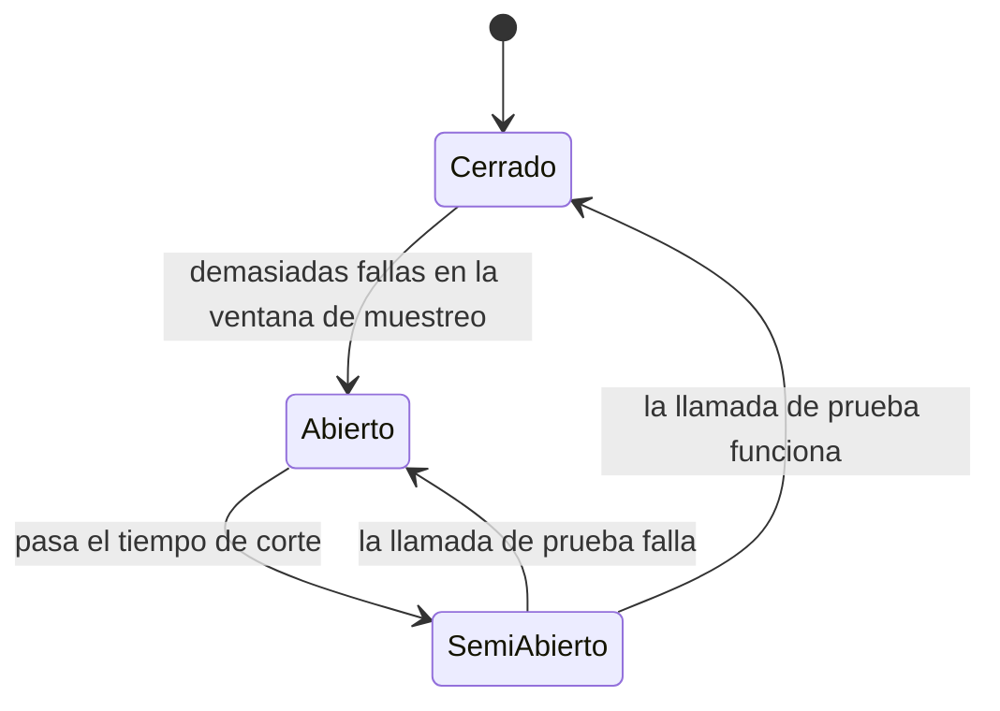

# Resiliencia: retries, timeouts y circuit breaker

## En una frase

Todo lo que viaja por la red **va a fallar alguna vez**; un sistema resiliente lo asume y combina **timeouts** (no esperar para siempre), **retries con backoff y jitter** (reintentar solo lo transitorio y lo idempotente) y **circuit breaker** (dejar de golpear a un servicio caído), que en .NET se configuran con Polly y `Microsoft.Extensions.Http.Resilience`.

-----

## Antes de empezar

Conviene que ya sepas:

* Qué es el backoff exponencial: [Estado de cliente frente a estado de servidor](../04-arquitectura-frontend-rendimiento-calidad/01-estado-cliente-vs-servidor.md).
* Qué verbos HTTP son idempotentes y qué es una clave de idempotencia: [Estándares RESTful](../03-diseno-de-apis-y-contratos/01-estandares-restful.md).
* Cómo se registra un `HttpClient` con inyección de dependencias: [Inyección de dependencias](../02-calidad-de-codigo-y-arquitectura/06-inyeccion-de-dependencias.md).

Palabras nuevas (también están en el [Glosario](Glosario.md)):

* **Resiliencia:** capacidad de un sistema de seguir funcionando (aunque sea de forma degradada) cuando algo falla, y de recuperarse.
* **Falla transitoria:** falla temporal que probablemente se resuelva sola: un timeout, un `503`, una conexión cortada.
* **Timeout:** tiempo máximo de espera antes de abandonar una operación.
* **Retry (reintento):** volver a ejecutar una operación que falló.
* **Jitter:** variación aleatoria que se agrega a la espera entre reintentos, para que muchos clientes no reintenten al mismo tiempo.
* **Circuit breaker (cortocircuito):** mecanismo que, tras muchas fallas, deja de llamar a un servicio durante un tiempo y falla de inmediato.
* **Fallback:** respuesta alternativa cuando la operación falla: un valor en caché, un valor por defecto.
* **Fallas en cascada:** un servicio lento o caído arrastra a los que dependen de él, y estos a los suyos.
* **Tormenta de reintentos (*retry storm*):** los reintentos de muchos clientes multiplican la carga sobre un servicio que ya está sobrecargado.
* **Polly:** la librería de resiliencia más usada en .NET.
* **Pipeline de resiliencia:** combinación ordenada de estrategias (timeout, retry, circuit breaker) que envuelve una operación.

-----

## El problema

La tienda llama a una pasarela de pagos externa:

```csharp
public class PasarelaPagosClient(HttpClient http)
{
    public async Task<ResultadoPago> CobrarAsync(Cobro cobro)
    {
        for (var intento = 0; intento < 5; intento++)
        {
            try
            {
                var r = await http.PostAsJsonAsync("/v1/charges", cobro);
                r.EnsureSuccessStatusCode();
                return (await r.Content.ReadFromJsonAsync<ResultadoPago>())!;
            }
            catch (Exception)
            {
                // reintenta de inmediato
            }
        }
        throw new Exception("No se pudo cobrar");
    }
}
```

Un viernes por la noche, la pasarela empieza a responder lento y después a dar errores. Lo que pasa:

* cada petición espera **100 segundos** (el timeout por defecto de `HttpClient`) antes de fallar, así que los hilos de la tienda se acumulan esperando y toda la tienda se vuelve lenta, incluso las páginas que no cobran nada;
* cada cobro se reintenta 5 veces **sin pausa**: la pasarela, que ya estaba sobrecargada, recibe 5 veces más tráfico y tarda más en recuperarse;
* el `POST` de cobro se reintentó después de un timeout... pero el primer intento sí había llegado: **algunos clientes fueron cobrados dos veces**;
* también se reintentan los `400 Bad Request` por una tarjeta inválida, que van a fallar las 5 veces.

Las consecuencias: una falla en un servicio externo se convirtió en una caída de toda la tienda, más cobros duplicados.

-----

## Cómo funciona

### 1. Las fallas son normales

Las "falacias de la computación distribuida" (L. Peter Deutsch y otros, en Sun) empiezan con: *"la red es confiable"*. No lo es. Cualquier llamada por red puede:

| Falla | Ejemplo | ¿Es transitoria? |
| --- | --- | --- |
| Timeout o conexión cortada | La red se corta un instante | Sí |
| `503 Service Unavailable`, `502`, `504` | El servicio está reiniciando o sobrecargado | Sí, normalmente |
| `429 Too Many Requests` | Superaste el límite del proveedor | Sí: espera el `Retry-After` |
| `408 Request Timeout` | El servidor no recibió la petición a tiempo | Sí |
| `400 Bad Request`, `422` | Los datos son inválidos | **No**: falla igual en cada intento |
| `401`, `403`, `404` | Credenciales, permisos o recurso inexistente | **No** |
| `500 Internal Server Error` | Un bug del servicio | A veces |

Resiliencia no es evitar las fallas, sino **contenerlas**: que una falla en una dependencia no tumbe todo el sistema.

### 2. Timeouts: la estrategia más importante

Sin timeout, una dependencia lenta **retiene recursos** (hilos, conexiones, memoria) mientras espera. Con suficientes peticiones esperando, tu servicio también deja de responder: la falla se propaga en cascada.

`HttpClient` tiene un timeout por defecto de **100 segundos**. Para casi cualquier llamada entre servicios es demasiado: si una pasarela de pagos no respondió en 10 segundos, lo más probable es que no responda.

Hay dos timeouts distintos:

| Timeout | Qué limita | Ejemplo |
| --- | --- | --- |
| **Por intento** | Cuánto espera cada llamada individual | 5 segundos por intento |
| **Total** | Cuánto puede durar la operación completa, contando todos los reintentos | 20 segundos en total |

Sin el total, 3 reintentos de 5 segundos más las esperas pueden sumar casi medio minuto.

> **Ojo:** el timeout del **servidor** que llamas no es el tuyo. Si tu cliente abandona a los 5 segundos, la pasarela puede seguir procesando el cobro y completarlo. Por eso los timeouts y los reintentos de operaciones que **modifican** algo necesitan idempotencia (sección 4).

### 3. Retries con backoff exponencial y jitter

Reintentar tiene sentido solo para fallas **transitorias**, y **con pausas crecientes**:

```text
Sin backoff:         fallo → reintento → fallo → reintento → fallo   (todo en milisegundos)
Backoff exponencial: fallo → 1 s → reintento → 2 s → reintento → 4 s → reintento
Con jitter:          fallo → 0,8 s → reintento → 2,3 s → reintento → 3,6 s → reintento
```

* **Backoff exponencial:** cada espera es más larga, para darle tiempo al servicio a recuperarse.
* **Jitter:** una variación aleatoria en cada espera. Sin jitter, si mil clientes fallan al mismo tiempo, los mil reintentan **exactamente** al mismo tiempo (a 1 s, a 2 s, a 4 s), generando picos que vuelven a tumbar el servicio. Con jitter, los reintentos se reparten.

**Tormenta de reintentos.** Los reintentos se multiplican por capas: si el frontend reintenta 3 veces, la API 3 veces y el servicio interno 3 veces, una sola acción del usuario puede generar **27** llamadas a la dependencia que falla. Reintenta en **una** capa (normalmente la más cercana a la dependencia), con pocos intentos.

### 4. Solo se reintenta lo idempotente

Reintentar una operación que **modifica** algo es peligroso: si el primer intento llegó pero la respuesta se perdió, el reintento la ejecuta **otra vez**.

| Operación | ¿Se puede reintentar sin más? |
| --- | --- |
| `GET`, `HEAD` | Sí |
| `PUT`, `DELETE` | Sí: son idempotentes |
| `POST`, `PATCH` | **No**, salvo que la operación use una clave de idempotencia |

Para reintentar un `POST` de forma segura, el cliente genera una **clave de idempotencia** y la envía en cada intento; el servidor reconoce los duplicados y devuelve la respuesta original sin repetir el cobro (ver [Estándares RESTful](../03-diseno-de-apis-y-contratos/01-estandares-restful.md)). Muchas pasarelas de pago la soportan con el header `Idempotency-Key`.

### 5. Circuit breaker: dejar de golpear a un servicio caído

Si un servicio está caído, seguir llamándolo (aunque sea con backoff) desperdicia recursos propios y retrasa su recuperación. El **circuit breaker** funciona como el disyuntor eléctrico de una casa: tras muchas fallas, **corta**.



| Estado | Comportamiento |
| --- | --- |
| **Cerrado** | Las llamadas pasan normalmente; el circuito cuenta las fallas |
| **Abierto** | Las llamadas fallan **de inmediato**, sin llegar al servicio (en Polly, con `BrokenCircuitException`) |
| **Semiabierto** | Deja pasar una llamada de prueba: si funciona, cierra; si falla, vuelve a abrir |

Ventajas: tu servicio responde rápido (aunque sea con un error) en lugar de acumular peticiones esperando, y la dependencia tiene tiempo de recuperarse sin tu tráfico.

### 6. Fallback y degradación elegante

Cuando una operación falla (o el circuito está abierto), a veces hay una alternativa razonable:

| Dependencia caída | Fallback |
| --- | --- |
| Servicio de recomendaciones | Mostrar los productos más vendidos (precalculados) |
| Servicio de cotización de envío | Mostrar un costo estimado y confirmarlo después |
| Servicio de reseñas | Ocultar la sección de reseñas |
| **Pasarela de pagos** | **No hay fallback seguro**: informar al usuario y permitir reintentar más tarde |

La degradación elegante mantiene funcionando lo esencial. Pero no todo tiene fallback: inventar un resultado para un pago sería un error mucho peor que mostrar un mensaje claro.

### 7. Polly y `Microsoft.Extensions.Http.Resilience`

**Polly** es la librería de resiliencia estándar en .NET. Desde la versión 8 (2023), las estrategias se combinan en un **pipeline de resiliencia**. Para `HttpClient`, Microsoft publica el paquete `Microsoft.Extensions.Http.Resilience`, construido sobre Polly 8.

**La opción más simple: el handler estándar.**

```csharp
builder.Services.AddHttpClient<CatalogoProveedorClient>(c =>
        c.BaseAddress = new Uri("https://api.proveedor.com"))
    .AddStandardResilienceHandler();
```

`AddStandardResilienceHandler()` agrega, en este orden (de afuera hacia adentro):

| # | Estrategia | Valor por defecto |
| --- | --- | --- |
| 1 | Rate limiter | Limita las peticiones concurrentes hacia la dependencia |
| 2 | Timeout total | 30 segundos para la operación completa |
| 3 | Retry | 3 reintentos, backoff exponencial con jitter; reintenta `5xx`, `408`, `429` y errores de red, y respeta `Retry-After` |
| 4 | Circuit breaker | Abre si falla el 10 % de las llamadas en 30 segundos (con un mínimo de 100 llamadas), durante 5 segundos |
| 5 | Timeout por intento | 10 segundos por cada intento |

Todo se puede ajustar:

```csharp
.AddStandardResilienceHandler(o =>
{
    o.AttemptTimeout.Timeout = TimeSpan.FromSeconds(3);
    o.TotalRequestTimeout.Timeout = TimeSpan.FromSeconds(15);
    o.Retry.MaxRetryAttempts = 2;
    o.Retry.DisableForUnsafeHttpMethods(); // no reintenta POST, PATCH, PUT ni DELETE
});
```

> **Ojo:** por defecto, la estrategia de retry reintenta **todos** los métodos HTTP, incluido `POST`. Para un cliente que hace operaciones no idempotentes, usa `DisableForUnsafeHttpMethods()` (disponible desde la versión 9 del paquete) o envía una clave de idempotencia.

**Un pipeline a medida**, cuando necesitas control total:

```csharp
builder.Services.AddHttpClient<PasarelaPagosClient>(c =>
        c.BaseAddress = new Uri("https://api.pasarela.com"))
    .AddResilienceHandler("pagos", pipeline =>
    {
        pipeline.AddTimeout(TimeSpan.FromSeconds(20));                 // total (externo)

        pipeline.AddRetry(new HttpRetryStrategyOptions
        {
            MaxRetryAttempts = 2,
            BackoffType = DelayBackoffType.Exponential,
            UseJitter = true,
            Delay = TimeSpan.FromMilliseconds(500)
        });

        pipeline.AddCircuitBreaker(new HttpCircuitBreakerStrategyOptions
        {
            FailureRatio = 0.5,                          // abre con 50 % de fallas...
            MinimumThroughput = 10,                      // ...si hubo al menos 10 llamadas...
            SamplingDuration = TimeSpan.FromSeconds(30), // ...en los últimos 30 segundos
            BreakDuration = TimeSpan.FromSeconds(15)     // y queda abierto 15 segundos
        });

        pipeline.AddTimeout(TimeSpan.FromSeconds(5));                  // por intento (interno)
    });
```

**El orden importa:** las estrategias se aplican de afuera hacia adentro en el orden en que se agregan. El timeout total va primero (envuelve todo, incluidos los reintentos) y el timeout por intento va último (cada intento individual). Si los invirtieras, un solo intento lento consumiría todo el tiempo.

**Fuera de HTTP**, Polly sirve para cualquier operación, con `ResiliencePipelineBuilder`:

```csharp
var pipeline = new ResiliencePipelineBuilder()
    .AddRetry(new RetryStrategyOptions
    {
        ShouldHandle = new PredicateBuilder().Handle<TimeoutException>(),
        MaxRetryAttempts = 3,
        BackoffType = DelayBackoffType.Exponential,
        UseJitter = true
    })
    .AddTimeout(TimeSpan.FromSeconds(10))
    .Build();

await pipeline.ExecuteAsync(async ct => await cola.PublicarAsync(mensaje, ct), cancellationToken);
```

> **Para la base de datos:** EF Core con SQL Server ya trae una estrategia de reintentos para errores transitorios: `options.UseSqlServer(cadena, sql => sql.EnableRetryOnFailure())`. No hace falta Polly para eso.

-----

## Ejemplo completo

La integración con la pasarela del problema, resiliente.

`Program.cs`:

```csharp
builder.Services.AddHttpClient<PasarelaPagosClient>(c =>
    {
        c.BaseAddress = new Uri(builder.Configuration["Pagos:Url"]!);
        c.Timeout = Timeout.InfiniteTimeSpan; // los timeouts los maneja el pipeline
    })
    .AddStandardResilienceHandler(o =>
    {
        o.AttemptTimeout.Timeout = TimeSpan.FromSeconds(5);
        o.TotalRequestTimeout.Timeout = TimeSpan.FromSeconds(20);
        o.Retry.MaxRetryAttempts = 2;
        o.CircuitBreaker.MinimumThroughput = 20;
        o.CircuitBreaker.SamplingDuration = TimeSpan.FromSeconds(30);
        o.CircuitBreaker.BreakDuration = TimeSpan.FromSeconds(15);
    });
```

`PasarelaPagosClient.cs` (el `POST` se puede reintentar porque lleva clave de idempotencia):

```csharp
public class PasarelaPagosClient(HttpClient http, ILogger<PasarelaPagosClient> logger)
{
    public async Task<ResultadoPago> CobrarAsync(Cobro cobro, CancellationToken ct)
    {
        using var request = new HttpRequestMessage(HttpMethod.Post, "/v1/charges")
        {
            Content = JsonContent.Create(cobro)
        };
        // la misma clave en todos los reintentos: la pasarela no cobra dos veces
        request.Headers.Add("Idempotency-Key", cobro.PedidoId.ToString());

        try
        {
            var r = await http.SendAsync(request, ct);

            if (r.StatusCode is HttpStatusCode.BadRequest or HttpStatusCode.UnprocessableEntity)
                return ResultadoPago.Rechazado(await r.Content.ReadAsStringAsync(ct)); // no transitorio

            r.EnsureSuccessStatusCode();
            return (await r.Content.ReadFromJsonAsync<ResultadoPago>(ct))!;
        }
        catch (BrokenCircuitException)
        {
            logger.LogWarning("Circuito de pagos abierto; cobro {PedidoId} no intentado", cobro.PedidoId);
            return ResultadoPago.NoDisponible(); // falla rápida: el usuario puede reintentar más tarde
        }
        catch (TimeoutRejectedException)
        {
            logger.LogWarning("Timeout cobrando el pedido {PedidoId}", cobro.PedidoId);
            return ResultadoPago.Pendiente(); // se confirma después con la pasarela, usando la misma clave
        }
    }
}
```

Qué pasa ahora ese viernes por la noche:

| Momento | Comportamiento |
| --- | --- |
| La pasarela se vuelve lenta | Cada intento se corta a los 5 segundos, no a los 100 |
| Fallas transitorias | Se reintenta 2 veces, con backoff y jitter, sin cobrar dos veces gracias a la clave |
| La pasarela empieza a caerse | El circuito se abre: los cobros fallan de inmediato con un mensaje claro |
| El resto de la tienda | Sigue respondiendo normalmente: no hay hilos esperando a la pasarela |
| A los 15 segundos | Una llamada de prueba; si funciona, se cierra el circuito y todo vuelve a la normalidad |

Qué observar:

* El `HttpClient.Timeout` se desactiva porque el pipeline ya maneja los timeouts por intento y total.
* Un `400` o `422` no se reintenta: es una tarjeta rechazada, no una falla transitoria.
* El cobro con timeout queda **pendiente**, no "fallido": con la clave de idempotencia se puede consultar después si se completó.
* Pagos no tiene fallback inventado: se informa y se deja reintentar.

-----

## Errores comunes

**1. Sin timeouts (o con el de 100 segundos).**
Qué pasa: una dependencia lenta deja a tu servicio sin hilos ni conexiones, y la falla se propaga.
Por qué: se confía en el timeout por defecto de `HttpClient`.
Arreglo: timeout por intento y total, ajustados a lo que tarda la dependencia normalmente.

**2. Reintentar de inmediato y sin límite.**
Qué pasa: se multiplica la carga sobre un servicio que ya está sobrecargado.
Por qué: un `for` con `try/catch`.
Arreglo: pocos reintentos, con backoff exponencial y jitter.

**3. Reintentar operaciones no idempotentes.**
Qué pasa: cobros, pedidos o emails duplicados.
Por qué: se reintenta un `POST` después de un timeout, sin saber si el primero llegó.
Arreglo: no reintentar `POST` (`DisableForUnsafeHttpMethods()`), o usar una clave de idempotencia.

**4. Reintentar errores permanentes.**
Qué pasa: más carga y más latencia para un error que no va a cambiar.
Por qué: se atrapa cualquier excepción o cualquier código de error.
Arreglo: reintentar solo `5xx`, `408`, `429` y errores de red; los `4xx` de validación, nunca.

**5. Reintentos en todas las capas.**
Qué pasa: una acción del usuario genera decenas de llamadas a la dependencia caída.
Por qué: cada capa agrega sus propios reintentos sin coordinarse.
Arreglo: reintentar en una sola capa, la más cercana a la dependencia.

**6. Fallbacks que inventan datos críticos.**
Qué pasa: se muestra "pago aprobado" o un precio desactualizado como si fuera correcto.
Por qué: se busca que "nunca se vea un error".
Arreglo: fallback solo para lo no esencial; para lo crítico, un error claro.

-----

## Evolución y versiones

* **2007:** Michael Nygard populariza el patrón circuit breaker en *Release It!*.
* **2013:** aparece Polly.
* **Polly v7:** API basada en `Policy.Handle<T>().WaitAndRetryAsync(...)` y `PolicyWrap`; es la que vas a ver en tutoriales viejos.
* **Polly v8 (2023):** API nueva basada en `ResiliencePipeline` y estrategias, con mejor rendimiento y telemetría.
* **.NET 8 (2023):** `Microsoft.Extensions.Http.Resilience` y `AddStandardResilienceHandler()` reemplazan a `Microsoft.Extensions.Http.Polly`.
* **Versión 9 del paquete (2024):** `DisableForUnsafeHttpMethods()` para no reintentar métodos no idempotentes.

-----

## Cuándo sí y cuándo no

**Usa timeouts siempre:** toda llamada por red necesita uno.

**Usa retries cuando:** la falla puede ser transitoria y la operación es idempotente (o tiene clave de idempotencia).

**Usa circuit breaker cuando:** dependes de un servicio externo o interno que puede caerse, y seguir llamándolo empeoraría las cosas.

**No reintentes cuando:** el error es permanente (`400`, `401`, `404`), la operación no es idempotente, o el usuario está esperando una respuesta inmediata y los reintentos solo alargarían la espera.

-----

## Resumen en 5 líneas

1. Toda llamada por red va a fallar alguna vez: resiliencia es contener la falla, no evitarla.
2. Timeouts siempre, por intento y total: el de 100 segundos de `HttpClient` es demasiado.
3. Retries solo para fallas transitorias y operaciones idempotentes, con backoff exponencial, jitter y en una sola capa.
4. Circuit breaker para dejar de golpear a un servicio caído y fallar rápido; fallback solo para lo no esencial.
5. En .NET: `AddStandardResilienceHandler()` o un pipeline de Polly 8, con el timeout total afuera y el por intento adentro.

-----

## Para profundizar

<details>
<summary>Bulkhead: aislar los recursos de cada dependencia</summary>

El patrón **bulkhead** (mamparo, como los compartimentos estancos de un barco) limita cuántas llamadas concurrentes puede hacer tu servicio a cada dependencia. Si la pasarela de pagos se vuelve lenta, solo se bloquean, por ejemplo, 20 llamadas concurrentes a la pasarela; el resto de los recursos queda libre para las demás funciones. En Polly 8 se implementa con `AddConcurrencyLimiter(20)`; el handler estándar incluye un limitador similar como primera estrategia.

</details>

<details>
<summary>Hedging: pedir lo mismo a dos lugares</summary>

Para operaciones de lectura donde la latencia es crítica, el **hedging** envía la misma petición a otra réplica si la primera no respondió en un tiempo corto, y usa la primera respuesta que llegue. `AddStandardHedgingHandler()` lo implementa para `HttpClient`. Reduce la latencia de los casos lentos a cambio de más carga: solo tiene sentido con operaciones idempotentes y réplicas equivalentes.

</details>

-----

## En entrevista

### Respuesta corta (junior)

Para que la aplicación tolere fallas de servicios externos uso reintentos con backoff exponencial, timeouts y circuit breaker. En .NET se hace con Polly, que se puede agregar al `HttpClient`.

### Respuesta ampliada (semi-senior)

Parto de que toda llamada por red va a fallar. Lo primero son los timeouts, por intento y total, porque sin ellos una dependencia lenta agota los recursos y la falla se propaga en cascada. Reintento solo fallas transitorias (`5xx`, `408`, `429`, errores de red) y operaciones idempotentes, con backoff exponencial y jitter para evitar tormentas de reintentos, y en una sola capa. Para un `POST` uso una clave de idempotencia o directamente no lo reintento. Agrego circuit breaker para fallar rápido cuando una dependencia está caída, y fallback solo donde tiene sentido, nunca para algo crítico como un pago. En .NET uso `AddStandardResilienceHandler()` de `Microsoft.Extensions.Http.Resilience`, sobre Polly 8, ajustando los valores y desactivando el retry para métodos no seguros.

### Preguntas frecuentes de seguimiento

**1. ¿Qué es el jitter y por qué importa?**
Una variación aleatoria en la espera entre reintentos. Sin ella, muchos clientes que fallaron a la vez reintentan a la vez, y vuelven a tumbar el servicio.

**2. ¿Cuáles son los estados de un circuit breaker?**
Cerrado (pasa todo y cuenta fallas), abierto (falla de inmediato sin llamar) y semiabierto (deja pasar una llamada de prueba para decidir si cerrar).

**3. ¿Por qué no reintentar un `POST`?**
Porque si el primer intento llegó y solo se perdió la respuesta, el reintento ejecuta la operación otra vez: un cobro o un pedido duplicado. Se puede hacer seguro con una clave de idempotencia.

-----

## Práctica

**Ejercicio 1.** Para cada respuesta de una API externa, ¿reintentarías?

1. `GET` que devuelve `503 Service Unavailable`.
2. `POST /pedidos` con timeout, sin clave de idempotencia.
3. `GET` que devuelve `404 Not Found`.
4. `PUT /productos/7` que devuelve `502 Bad Gateway`.
5. `GET` que devuelve `429 Too Many Requests` con `Retry-After: 30`.
6. `POST /pagos` con timeout, con `Idempotency-Key`.

<details>
<summary>Solución</summary>

1. **Sí:** transitorio e idempotente.
2. **No:** el pedido pudo haberse creado; reintentar puede duplicarlo.
3. **No:** el recurso no existe; no va a aparecer.
4. **Sí:** `PUT` es idempotente y `502` suele ser transitorio.
5. **Sí, pero esperando 30 segundos** (lo que indica `Retry-After`), y solo si el usuario no está esperando la respuesta. Si lo está, conviene fallar y avisarle.
6. **Sí:** la clave de idempotencia evita el cobro duplicado.

</details>

**Ejercicio 2.** ¿Qué problema tiene este pipeline? Corrígelo.

```csharp
.AddResilienceHandler("inventario", p =>
{
    p.AddTimeout(TimeSpan.FromSeconds(2));
    p.AddRetry(new HttpRetryStrategyOptions { MaxRetryAttempts = 5, Delay = TimeSpan.Zero });
});
```

<details>
<summary>Solución</summary>

* **El timeout está afuera del retry:** es un timeout **total** de 2 segundos para todos los intentos juntos. Si el primer intento tarda 2 segundos, no queda tiempo para ningún reintento.
* **Delay cero:** reintenta de inmediato, sin backoff ni jitter.
* **Cinco reintentos:** demasiados; con cada capa sumando reintentos, se multiplica la carga.

```csharp
.AddResilienceHandler("inventario", p =>
{
    p.AddTimeout(TimeSpan.FromSeconds(10));                 // total
    p.AddRetry(new HttpRetryStrategyOptions
    {
        MaxRetryAttempts = 2,
        BackoffType = DelayBackoffType.Exponential,
        UseJitter = true,
        Delay = TimeSpan.FromMilliseconds(300)
    });
    p.AddTimeout(TimeSpan.FromSeconds(2));                  // por intento
});
```

</details>

-----

## Siguiente lección

[Rate limiting](08-rate-limiting.md)
